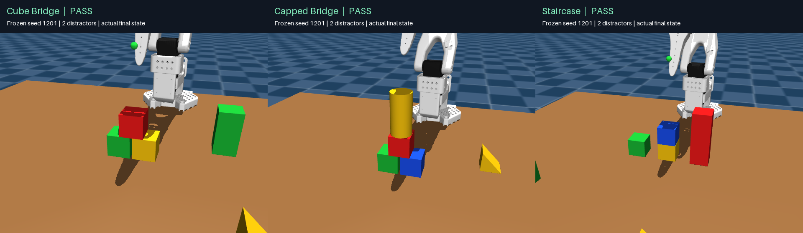

# ASPIRE SO-100 stacking

## Current research: lightweight geometric abstraction

The active experiment compares **Visual Base versus Full geometry** on a low-rise
bridge, with CPU perception/policy and RGB-D observations. Start with the
[research status and evidence boundaries](docs/GEOMETRIC_STATE_RESEARCH.md),
[latest budget-limited results](docs/PARTIAL_GEOMETRY_BUDGET_LIMITED_RESULTS.md),
and [completed independent comparison](docs/VISUAL_INPUT_LEARNING_RESULTS.md).
The latest experiment is stopped at 103 reserved rollouts; do not resume it without
a further user request. No stable cross-chain learning advantage is claimed.

Recognition/pointing experiments are in [the historical archive](archive/pointing/README.md).
Earlier tower controllers and mixed/negative geometry studies below remain as
context and reproduction dependencies, not additional current treatment arms.
Raw rollout recordings stay in ignored local `outputs/`; Git contains code,
fixtures, reports and selected visual evidence, not the complete raw dataset.

## Earlier tower and execution work

The Mac RGB-D/proprioception campaign started with an empty task-skill library, reached 3/3 in two rounds, then passed 2/2 after freezing. See the [experiment guide](docs/VISION_FROM_SCRATCH.md), [visualization/deployment guide](docs/VISION_DEPLOYMENT.md), and [historical observation audit](docs/OBSERVATION_AUDIT.md). Recordings and public evidence are in `web/vision/`; the recorded [static demo deployment](https://aspire-so100-vision.vercel.app/) is described in the deployment guide.

This project adapts the three useful pieces of the ASPIRE workflow to the local
`mjlab` SO-100 scene:

1. A closed-loop execution API records every observation, IK motion, gripper
   command, wait, pre/post state, status, and optional RGB keyframe.
2. Code-as-policy candidates implement `run(api)` and are ranked on fixed debug
   seeds.
3. A small skill library stores validated repair patterns for later candidates.

The project goal is varied towers from the full block inventory. The historical
`inventory_tower` curriculum covers upright single columns with different colors,
shapes and 2–4 levels. That task supports named, random and explicit bottom-to-top goals,
task-conditioned sampling, private whole-column evaluation and CPU control.
The frozen CPU column policy passed **79/100 fresh frozen trials** with color
permutations, random shape/identity goals and zero/two distractors. Two- and
three-level tasks passed **73/80 (91.3%)**; four-level tasks passed **6/20**,
so the overall 90% target remains unmet. See the [current results, CPU timings
and limits](docs/COLUMN_POLICY_V2.md), [visual geometry](docs/COLUMN_GEOMETRY.md)
and [evaluation protocol](docs/COLUMN_EVALUATION_PROTOCOL.md). The
[first milestone and its 25/45 reserved result](docs/SINGLE_COLUMNS.md) remain
available as historical evidence under a different matrix and sensor profile.

## Low-rise structures with multiple supports

Current work prioritizes spatial structure over extra height. The new
`inventory_structure` task builds a two-foundation cube bridge (6 cm), a capped
bridge (12 cm), and a five-object staircase (3/6/9 cm). Its CPU policy binds visual
instances to a support graph, clears the complete working area, and reasons about
loads shared across multiple supports. The original three recipes keep all targets upright. Their frozen candidate is
`policies/assemble_structure_v1_cpu.py`.

That frozen candidate passed **29/30 fresh frozen trials (96.7%)** across these three recipes with
color permutations and zero/two distractors. See the [low-rise structure report,
full evaluation and actual replays](docs/LOW_STRUCTURES.md).
The frozen single-column policies and their results above remain unchanged.



## A thin-beam bridge with a cylinder cap

`thin_beam_bridge` places two 3 cm cubes with a 3 cm clear gap, spans them with
an actual horizontal 1.5 × 3 × 6 cm thin prism, and adds an upright cylinder.
The beam rests on its broad face, with 1.5 cm overlap per support; total height
is 10.5 cm. The beam starts flat on the table and is physically picked and placed.
The policy uses visual dimensions and runs on CPU. This new task passed
**10/20 fresh reserved trials (50%)**; thin-beam grasping and longer stability
still need improvement. See the [task, capability
boundary, evaluation, and replay](docs/THIN_BEAM_BRIDGE.md). The report also links
[five recorded failure cases](docs/THIN_BEAM_BRIDGE.md#recorded-failure-videos),
covering perception, pickup, missing cylinder, obstructed placement and retries.

## Current object library and sampled scenes

The library contains **20 objects: five shapes × red, yellow, blue, and green**.
Each shape has one object of each color; there are no additional shape types
or colors in the new scenes. Names follow `<color>_<shape>`.

[All 20 objects](docs/media/block_catalog.png) ·
[A six-object task-conditioned sample](docs/media/block_subset_upright.png)

| Shape ID | Shape | Dimensions |
| --- | --- | --- |
| `cube` | Cube | 3 × 3 × 3 cm |
| `thin_prism` | Slender rectangular prism | 1.5 × 3 × 6 cm |
| `prism` | Rectangular prism | 3 × 3 × 6 cm |
| `cylinder` | Cylinder | Radius 1.5 cm, height 6 cm |
| `triangular_prism` | Half-cube triangular prism | 3 cm cube cut diagonally in XZ, extruded 3 cm along Y |

The triangular prism has six vertices, two right-isosceles triangular ends,
and three rectangular faces, including a flat bottom. Its visible and collision
surfaces use the same convex mesh. Its volume and mass are half of the cube's.

The default passive scene samples **6 unique objects** from the library.
`--object-count` controls the count (1–20); `--seed` reproduces both object
selection and positions. Jittered slots keep at least 2 cm edge clearance
between initial object bounding boxes. All objects start upright with zero yaw.
The library and generator are in `src/aspire_so100/block_catalog.py`.

```bash
# Default: sample six objects.
uv run python view_scene.py --scene-only --seed 51

# Choose a smaller subset.
uv run python view_scene.py --scene-only --object-count 4 --seed 17

# Task-specific generation: required target/base plus sampled distractors.
uv run python view_scene.py --scene-only --scene-task upright_thin_prism \
  --object-count 6 --seed 17

# Inspect all five shapes in all four colors.
uv run python view_scene.py --scene-only --scene-task catalog
```

`upright_thin_prism` reserves the **red slender prism** as target and the
**blue cube** as base, places both in central slots, and fills the remaining
count with randomly sampled distractors. It requires at least two objects.
The new **CPU instance policy**, `policies/stack_inventory_cpu.py`, resolves
color + shape + persistent object ID before grasping or clearing a blocker.
It passed **50/50 fresh reserved six-object scenes** after source freeze.
Perception, tracking, geometric planning and robot IK use CPU; simulation and
rendering retain EGL/GPU. See the [results, CPU timings and real experiment
visualizations](docs/INVENTORY_CPU_POLICY.md).

The earlier color-only transfer diagnostic passed **6/20** six-object scenes
and often selected the wrong same-color shape. Its
[evaluation and wrong-object replay](docs/INVENTORY_TRANSFER.md) remain available.
Sensor-only trials now support `--task inventory_prism --layout sampled
--object-count 6`; the viewer uses `--vision-task inventory_prism`.

```bash
uv run python view_scene.py --vision-task inventory_prism --object-count 6 \
  --seed 604 --vision-policy policies/stack_inventory_cpu.py \
  --vision-output outputs/inventory_cpu_view_604
```

Historical `single`, `tower`, and `prism` tasks retain their original scenes,
object names, and evaluators for replay and reproducible evaluation. The
historical single task stacks `small_red_block` on `blue_block`.

### Historical six-object slender-prism training scene

The separate `prism` scene contains exactly six movable objects: blue, red,
and green 3 cm cubes, orange and purple rectangular prisms, and a cyan cylinder.
The task is to place the **purple 1.5 × 3 × 6 cm prism upright on the blue cube**.
All objects initially stand upright; `random_xy` randomizes separated XY
positions with zero initial yaw. The final check requires table/base contact,
prism/base contact, robot withdrawal, an upright long axis within 8 degrees,
support margin, low velocity, and five seconds of stability.

```bash
uv run python view_scene.py --scene-only --vision-task prism
```

Sensor-only trial execution supports `scripts/run_vision_trial.py --task prism`;
the policy still receives only side RGB-D, wrist RGB, calibration, and robot
proprioception. New trial metadata selects the correct six-object scene for
`--vision-trial` playback and `scripts/render_vision_trial.py`.

`policies/stack_prism_upright_visual.py` actively relocates blockers before
positioning the base and stacking the purple prism. It passed **66/70 development**,
**47/50 fresh reserved randomized layouts (94%)**, and **5/5 nominal layouts**.
The earlier prism policy passed 42/50 on the same reserved set. See the
[clutter policy report and recorded experiment](docs/PRISM_CLUTTER_POLICY.md)
for the observation boundary, failures, and actual clearing replay.

```bash
uv run python view_scene.py --vision-task prism \
  --vision-policy policies/stack_prism_upright_visual.py \
  --vision-layout random_xy --seed 405 --vision-output outputs/prism_view_405
```

Historical recordings and campaign success rates below describe their recorded
scene geometry; the 4 cm results are not results for the current 3 cm scene.

## Visual cube and gripper geometry

The current [symbolic/metric state research](docs/GEOMETRIC_STATE_RESEARCH.md)
separates sensor-derived geometry from shared robot execution. The completed
[feedback-only comparison](docs/SYMBOLIC_FEEDBACK_EXPERIMENT.md) did not establish
an iteration-efficiency benefit. A new [online-state comparison](docs/ONLINE_GEOMETRY_EXPERIMENT.md)
tests queryable object/face/vertex geometry during execution. Runtime perception
and planning remain CPU-only; private simulator truth is restricted to evaluation.


The [generic RGB-D PnP extraction](docs/GENERIC_RGBD_PNP.md) separates basic
visual grasp/place control from the single-column task adapter and historical
tower-specific compensation.

The [generic PnP geometry experiment](docs/GENERIC_PNP_GEOMETRY_EXPERIMENT.md)
compares policy improvement from the extracted PnP base with and without a
supplied geometric abstraction.

The [shared-base stacking comparison](docs/PNP_GEOMETRY_COMPARISON.md) starts both
arms from the same historical RGB-D policy and compares supplied geometric
abstraction against the original sensor interface with matched sensors.

The new [rigid geometry state experiment](docs/RIGID_GEOMETRY_STATE.md) adds opt-in
wrist depth, robot-model finger pads, and structured current/desired cube states.
It includes actual three-cube rollout visualizations and a same-scene sensor control;
the new wrist estimates are diagnostic and do not yet command corrections.
The [four-color mixed-shape bridge example](docs/MIXED_RIGID_GEOMETRY.md) extends
this to two cubes, a thin beam and a cylinder, including a recorded occlusion failure.

`policies/stack_three_blocks_visual_geometry.py` passed **445/450 development**,
**198/200 fresh reserved randomized layouts (99%)**, and **10/10 nominal** layouts
in simulation. It uses side RGB-D and wrist RGB to measure visible gripper reach
and cube geometry, then moves the blue base to a clear area selected using
robot-only reachability previews. It predicts how a tilted cube will settle and
permits a bounded retry. A deliberately missed grasp recovered with **9.75
additional simulated seconds**. See the [results, gripper overlay, and recovery
replay](docs/VISUAL_RETRY_POLICY.md).

```bash
uv run python view_scene.py --vision-policy policies/stack_three_blocks_visual_geometry.py \
  --vision-layout random_xy --seed 4001 --vision-output outputs/visual_geometry_view_4001
```

## Earlier improved 3 cm cube policy

`policies/stack_three_blocks_cubes_3cm.py` passed **8/10 training** layouts and
**9/10 new reserved** layouts (2001–2010), compared with **4/10** for the original
geometry policy on both sets. The fitter and evaluator are unchanged; the repair
raises the grasp, reduces release compensation, and increases final contact
clearance. See [the 3 cm evolution report](docs/CUBE_3CM_EVOLUTION.md).

The unchanged geometry policy and earlier evolved policy each passed **4/10**
randomized layouts in the initial transfer test. RGB-D estimated the side length at about
29.9 mm, but placement/support failures remain. See
[the 3 cm evaluation](docs/CUBE_3CM_EVALUATION.md) for per-seed results and evidence.

```bash
uv run python view_scene.py --vision-policy policies/stack_three_blocks_cubes_3cm.py \
  --vision-layout random_xy --seed 2002 --vision-output outputs/cube_3cm_view_2002
```

Saved state replays require the matching scene size: older 4 cm `rollout.npz`
files should not be replayed with the current 3 cm scene. Their existing MP4s
retain the original geometry.

## Evolved policy for 4 cm cubes

The historical `policies/stack_three_blocks_geometry.py` additionally fits cube
centroids, orientation, and eight inferred vertices from RGB-D. It passed 5/5
training seeds and 5/5 new validation seeds (1001–1005), compared with 3/5 for
the earlier evolved policy on those same new seeds. See
[visual cube geometry](docs/VISUAL_CUBE_GEOMETRY.md) for the method, uncertainty,
overlays, and run commands.

`policies/stack_three_blocks_cubes_4cm.py` reached **5/5 training** layouts
(101–105), then **4/5 reserved** layouts (201–205) after freezing. The same
frozen policy passed **2/3 nominal** layouts (81–83). It uses RGB-D measurements
for grasp height and release-drift compensation. See
[the evolution report](docs/CUBE_4CM_EVOLUTION.md) for changes and remaining failures.

These results require the original 4 cm scene. Use the saved MP4 recordings
to review them; running these policies in the current scene is a new 3 cm
transfer experiment.

## Run the baseline

To watch the robot stack in the browser, run `uv run python view_scene.py`.
This simulates the policy on seed 51, then loops playback of the physical
rollout with pause, speed, and reset controls. Use `--seed 54` to view another
instance, or `--scene-only` for the original passive scene viewer.
The **Arm camera** panel shows the wrist-mounted camera image; an orange
camera outline follows the arm in the 3D scene. The image updates at up to
10 FPS. On headless hosts the viewer selects EGL automatically; you can also
set `MUJOCO_GL=egl` explicitly.

The newer sensor-only RGB-D policy has a separate Viser playback mode. It runs
the frozen policy once with its `camera()`/`proprioception()` API, saves the
actual MuJoCo rollout, then opens interactive Viser playback with the side
RGB-D and wrist-camera panels:

```bash
uv run python view_scene.py --vision-policy policies/stack_three_blocks_vision.py \
  --seed 81 --vision-output outputs/vision_viser_81
```

The output directory must not exist yet. To replay this same trial without
running the policy again, use `uv run python view_scene.py --vision-trial
outputs/vision_viser_81`. On Linux, the policy subprocess requires `bwrap`;
on macOS, it uses `sandbox-exec`. The older `--task tower --candidate` mode
uses a different API and cannot execute the RGB-D policy.
Viser's **1x** setting paces the saved states at their original simulated-time
duration (subject to render performance); the separate MP4 demo is labeled 2x.
The printed success result describes the selected rollout; playback does not
guarantee that every seed succeeds.

```bash
uv run aspire-so100 --split debug --seeds 51
```

Save RGB keyframes around every primitive with:

```bash
MUJOCO_GL=egl uv run aspire-so100 --split debug --seeds 51 --render
```

Outputs are written to `outputs/stack_small_red_on_blue/<split>_<timestamp>/`.
Each candidate has a per-seed `trace.json`; the run-level `manifest.json` ranks
candidates by success rate and mean partial-credit score.

## ASPIRE repair loop

Copy `policies/stack_small_red_on_blue.py`, change one hypothesis, then compare
the candidates on the same debug seeds:

```bash
uv run aspire-so100 --split debug \
  --candidate policies/stack_small_red_on_blue.py \
  --candidate policies/my_repair.py
```

Inspect failed primitive states and frames, revise the candidate, and repeat.
Once a candidate is fixed, evaluate it exactly once on the untouched held-out
split:

```bash
uv run aspire-so100 --split heldout --candidate policies/my_repair.py
```

The default partitions are debug seeds 51–55 and held-out seeds 1–10. Do not use
held-out traces to tune a policy. Record repairs that generalize across debug
seeds in `skills/stacking.md`.

## Automatic LLM propose / execute / repair loop

### Learning across randomized RGB-D layouts

`scripts/learn_randomized_vision.py` evaluates the existing vision policy, then
asks the LLM to improve it using sensor images and post-trial feedback. All
three block colors share XY bounds `[-0.14, 0.14] × [-0.32, -0.21]` metres,
with 25 mm edge clearance. Yaw is unchanged. Training uses seeds 101–105;
only after 5/5 pass is the frozen candidate tested on held-out seeds 201–205.
Held-out feedback is never sent to the learner. This is continuation from the
existing policy, not learning from an empty policy library.

The current 5/5 training policy is saved in
`policies/stack_three_blocks_random_xy.py` (SHA-256
`0c8f31b2949a83b20acae430497a775590aae113439de7c89cb11f37df908349`).
Two reserved layouts, 201 and 202, were run and both passed. The other three
reserved layouts were not run; this is not a 5/5 held-out result.

```bash
uv run python -u scripts/learn_randomized_vision.py \
  --root outputs/random_xy_01 --model gpt-6-astra --rounds 0 --jobs 2
```

The same command resumes completed rounds. It retains the best scored policy
as `best_policy.py` and a successful replay directory in `best_trial.txt`.
When retrying an interrupted trial without `result.json`, it preserves the partial
files and previous log under `seed_<seed>.interrupted-*` before rerunning that seed.
Each attempt saves `rollout.npz`, cameras, notes, results and logs; MP4 rendering
is optional. `--baseline-only` runs no LLM calls. `--rounds 0` keeps trying until
all five training layouts pass or interruption. There is no cumulative token cap;
each proposal has bounded feedback, up to four images, and a 300-second timeout.

To execute any selected policy on a random layout and then view it at 1x:

```bash
uv run python view_scene.py --vision-policy policies/stack_three_blocks_random_xy.py \
  --vision-layout random_xy --seed 301 --vision-output outputs/random_view_301
```

To replay an existing attempt without executing it again, pass its directory
to `view_scene.py --vision-trial`.

### Original campaign runner

The autonomous runner invokes the installed **Codex CLI** using its existing
login and configured model (or an explicit `--model`). It sends the task API,
validated skill memory, generated code, rollout state/error traces, and selected
camera images to that LLM. It starts without a hand-written tower policy.

```bash
uv run python -m aspire_so100.agent_loop \
  --rounds 3 --output outputs/tower_campaign_01
```

Each round asks the LLM for a new Python program and its hypothesis, executes
the program on debug seeds 51–53, and supplies the best and latest programs and
failure evidence to the next LLM call. The full code, prompts, model events,
per-primitive traces, scores and campaign state are saved under the output path.
Each model call has a 300-second timeout; each trial has a 120-second timeout.
The runner stops after its round budget or a full debug pass.

### Compact context and usage controls

The feedback compiler in `src/aspire_so100/context.py` adapts the idea of
selective context construction described by
[GPT-Policy](https://github.com/cheng-haha/GPT-Policy). This is an independent
implementation for our simulator, not an installation of its hardware control
framework. No upstream source was copied. Its current LICENSE says a license
for redistribution/commercial use has not been selected.

Before each proposal, local code groups matching seed outcomes, retains each
distinct error and a representative trace, selects up to six physical changes
or errors, rounds numbers to four decimals, and includes complete source for
the best and latest candidate. Full precision traces remain on disk. Memory
is bounded to three tower skills within 4,000 characters. Summary selection
may omit useful intermediate events; smaller prompts do not prove better task
performance. No extra LLM call is used for compression.

```bash
uv run python -u -m aspire_so100.agent_loop \
  --model gpt-6-astra --rounds 3 \
  --max-prompt-chars 32000 --max-reported-tokens 60000 \
  --output outputs/gpt6_compact_01
```

The runner finds `codex` on `PATH` or in the newest installed OpenAI VS Code
extension. If Codex is installed elsewhere, pass `--codex-bin /path/to/codex`
or set `ASPIRE_CODEX_BIN`; a shell `PATH` export is not required.

`--max-prompt-chars` (default 32,000) bounds our supplied text for every proposal
and curator call. If code plus essential context will not fit, the runner stops
before calling the model rather than cutting code. Codex's own instructions and
other overhead are outside this character limit. Characters are not tokens.

Each call writes `proposal/usage.json` (or `curator/usage.json`), also recorded in
`campaign.json` under `llm_calls`. These are the CLI's observed usage counters,
not a dollar invoice. `--max-reported-tokens` (default 100,000) stops before the
next call once cumulative reported input plus output tokens reach the threshold;
**a running call can overshoot it**, so this is not a hard spending cap. Missing
usage is reported as unknown and blocks the next call. Cached/reasoning counters
are preserved separately without adding them again to input/output totals.

Preview the next prompt from an old campaign without any model call or simulation:

```bash
uv run python -m aspire_so100.agent_loop \
  --preview-from outputs/gpt6_tower_02/campaign.json \
  --output outputs/context_preview_01
```

The preview writes `prompt.txt`; it does not resume that campaign. Output
directories must be new. Already-running processes must be restarted to use
the new compiler; old artifacts are not rewritten.

Continue from the best and latest evidence in a prior campaign with a new
output directory:

```bash
uv run python -u -m aspire_so100.agent_loop \
  --continue-from outputs/gpt6_compact_02/campaign.json \
  --model gpt-6-astra --rounds 5 \
  --max-prompt-chars 32000 --max-reported-tokens 60000 \
  --output outputs/gpt6_compact_03
```

`--rounds` is the number of additional proposals. Prior policies, hypotheses,
scores and trace paths are inherited, while the token counter applies to new
calls in the continuation. Round numbering continues from the old history.
The actor stops proposing immediately after a 3/3 debug result, then runs the
fixed validation seeds and promotes a skill only if both validation trials pass.
`best_policy.py` is atomically refreshed after every scored round, including
when the prior campaign remains best. It is therefore available while an
open-ended campaign is running and after token-budget or keyboard interruption.

For an open-ended continuation, set `--rounds 0`. To make Ctrl+C or a 3/3 pass
the normal stopping conditions, also set `--max-reported-tokens 0`; this removes
the cumulative token guard but retains the per-call prompt-size limit and
timeouts:

```bash
uv run python -u -m aspire_so100.agent_loop \
  --continue-from outputs/gpt6_compact_02/campaign.json \
  --model gpt-6-astra --rounds 0 \
  --max-prompt-chars 32000 --max-reported-tokens 0 \
  --llm-timeout 300 --trial-timeout 120 \
  --output outputs/gpt6_compact_03
```

Ctrl+C records `status: interrupted`. Continue again by using that campaign as
`--continue-from` and choosing another new output directory.

View proposed and demonstrated capability changes for every round without an
LLM call:

```bash
uv run python -m aspire_so100.skill_report \
  --campaign outputs/gpt6_compact_02/campaign.json
```

Every active campaign also maintains `skill_progress.json`, and each new round
writes `round_NNN/skill_update.json`. A round is labeled `partial` only when the
evaluator demonstrates a capability such as a stable two-block stack. Proposed
hypotheses and failed behaviors are not called learned skills. `skills/learned/`
is updated only after a 3/3 debug pass and a separate 2/2 validation pass.

On a full debug pass, the selected program is frozen and tested on separate
validation seeds 61–62. Only if those also pass does a further LLM call distill
repair guidance into `skills/learned/*.json`, with the policy hash and evidence
path. Later campaigns read those entries automatically. Held-out seeds 1–10
are never used by this loop. Failed or unvalidated proposals are not promoted.

The current learning task is a three-block tower in a dedicated uncluttered
workspace: blue base, small red block, then a 4 cm green cube. Generated code
uses observations and motion/gripper primitives; the fixed evaluator checks
the entire support chain, robot release, face alignment, speed, COM margin,
and drift. A two-second two-block check and a final five-second whole-tower
check are required. These are finite-horizon simulation checks, not a promise
of stability under arbitrary future disturbances.

Replay a generated policy, including a failed attempt, with:

```bash
uv run python view_scene.py --task tower \
  --candidate outputs/tower_campaign_01/best_policy.py --seed 51
```

Tower playback executes the selected Python file; use policies from a trusted
campaign. Trials launched by the automatic runner use `bwrap` with networking
disabled, host files read-only, the user's home hidden, a fresh temporary
directory and a writable trial-output directory. API lint is an additional
check, not a Python security boundary. Infrastructure failures stop the campaign
instead of being misreported as failed robot policies.

Status: a live GPT-6 campaign produced policies and failed debug trials.
Compact context and usage guards have offline regression checks; their effect
on task success and live token usage still needs measurement. No learned tower
skill or successful generated tower policy is claimed yet.

## Scope

### Overhead RGB-D camera

Both the shape scene and tower scene include `table/overhead_camera` (name
retained for compatibility), now on a visible right-side mast at world
`(0.48, -0.60, 1.10)`, aimed toward `(0, -0.30, 0.45)`, with a 60-degree
vertical field of view. The decorative mast has no collision response.
This is a workspace view in the spirit of a
bimanual robot's top camera, not a calibrated replica of a particular YAM rig.
Viser shows a **Side-mounted RGB-D camera** folder with RGB and depth images at
up to 5 Hz and a cyan camera frustum, alongside the existing wrist camera.

```bash
uv run python view_scene.py --scene-only
# Or inspect the same camera during policy playback:
uv run python view_scene.py --task tower \
  --candidate outputs/gpt6_compact_03/best_policy.py --seed 52
```

Generated policy code can call `api.get_overhead_rgbd()` on demand. It returns
aligned `rgb` (uint8, 240x320x3), `depth_m` (float32, 240x320), `valid_depth`,
`intrinsics`, `camera_to_world`, and simulation `time`. Depth is distance along
the optical axis in meters, not Euclidean range or height above the table.
Camera coordinates are right/down/forward and pixels are indexed `[v,u]`.
The UI displays a fixed grayscale mapping: white at 0.25 m, black at 1.00 m;
tabletop depth varies across this angled view. Raw depth is not display-normalized.
This ideal simulated sensor has no real-camera noise or missing-depth model.

Rendering requires a working OpenGL backend (EGL on the headless GPU node).
New trials capture before/after image observations automatically. Each PNG sheet
contains side RGB, a depth preview and wrist RGB, saved as `initial.png` and
`outcome.png` under `round_NNN/debug/seed_N/`. Corresponding NPZ files keep raw
metric depth, validity mask and calibration locally. Generated policies may
also call `get_overhead_rgbd()` at intermediate steps.

The next proposal attaches up to four sheets to **Codex/OpenAI** with `--image`:
before/after for one representative seed of the best and latest policies.
If prior trials have no images (including old campaigns), the runner renders
and attaches a fresh initial scene. It never pretends that this is a historical
rollout image. Every proposal's `images.json` records exactly which files were
attached, and usage records include `image_count`. Images consume model tokens
outside the text-character budget; the small fixed selection limits growth.

This makes the coding LLM's learning context multimodal, with simulator object
poses retained as auxiliary inputs. It is not continuous VLM control at each
motion step, nor an image-only perception pipeline. The model writes a policy,
the local simulator executes it, and subsequent revisions receive images and
text feedback. This path was tested locally with a simulated worker and a
mocked model command; improved task success is not yet established. Restart the
viewer/learner to load these changes.

This is a lightweight SO-100 adaptation of ASPIRE's architecture, not the
paper's full CaP-X reproduction. It uses camera feedback plus simulator object
poses, without SAM3/GraspNet perception. The automatic loop generates one proposal per round
and reuses the best and latest candidates; it does not yet run a parallel
population or implement human turn-taking. The original `aspire-so100`
command still evaluates manually supplied single-object policies and does
not call an LLM; use `aspire_so100.agent_loop` for autonomous discovery.
