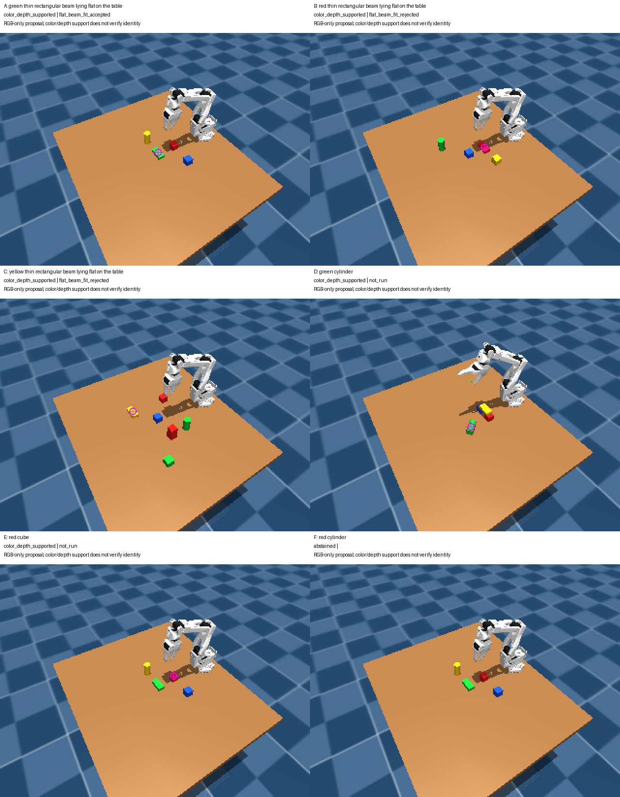

# RGB-only pointing with a session subagent

An independent subagent, `/root/rgb_pointer`, was created with no conversation
history and asked to locate objects using RGB images and public target text.
This experiment uses the current session's hosted subagent capability; it does
not call OpenRouter or depend on the `.apikey` credential.

The reusable [role instruction](prompts/RGB_POINTING_AGENT.md) requires a visible
interior pixel or an explicit abstention. The host validates proposals against
camera RGB-D and retains the original geometry checks. The agent received no
previous parent predictions, depth, camera calibration, object poses, dimensions,
contacts, or evaluator outputs. It reported reading only the six task entries
and their referenced RGB PNGs, using 3x full-image zooms without crops.

This is a behavioral input boundary in a shared workspace, not a technically
enforced file-access sandbox. A standalone deployment would need restricted
image-only tools. The subagent uses hosted model inference; only the subsequent
geometry validation is local CPU computation. No robot control loop was added.

## Recorded development experiment

Six queries were made over four unique archived 320 x 240 policy camera frames.
The first four queries use the prepared bridge examples; the final two query a
red cube and a red cylinder in the same image. These were selected development
examples, not a randomized or fresh held-out evaluation.

| Task | Target | Pixel proposal | Color/depth gate | Flat-beam geometry |
| --- | --- | --- | --- | --- |
| A | Green flat thin beam | (163, 123) | Supported, 95 pixels | Fit accepted |
| B | Red flat thin beam | (180, 118) | Supported, 88 pixels | Fit rejected |
| C | Yellow flat thin beam | (137, 116) | Supported, 86 pixels | Fit rejected |
| D | Green cylinder | (166, 132) | Supported, 103 pixels | Not checked |
| E | Red cube | (179, 115) | Supported, 68 pixels | Not checked |
| F | Red cylinder | Abstain | Not evaluated | Not checked |

All five proposed points passed color/depth support checks. For F, the agent
reported that the visible red object was a cube and no red cylinder was visible.
This is not a measured object-identity accuracy or a tower-assembly success rate.
The host did not automatically certify the shape identity of any point.

The two rejected beam fits both report `Beam top boundary is clipped or rotated`.
Pointing supplies a semantic region proposal but does not recover unseen
boundaries or establish complete dimensions. Even A's accepted one-face fit
retains the existing `geometry_reliable=false` and `inferred_orientation=true`
flags. No geometric gate was relaxed and no proposal was revised after feedback.



Magenta markers are the original subagent proposals. The last panel intentionally
has no marker. The gallery uses enlarged source RGB images, without fabricated
scene content. [Machine-readable evidence](evaluations/gpt_pointing_subagent.json)
contains exact predictions, visual reasons, image/frame hashes, gate results,
and geometry diagnostics.

## Reproduction and scope

The subagent task list and host-only RGB-D mapping remain in
`outputs/subagent_pointing_01/`. Given those local artifacts, replay validation:

```bash
OPENBLAS_NUM_THREADS=1 OMP_NUM_THREADS=1 .venv/bin/python \
  scripts/evaluate_pointing_agent.py \
  --tasks outputs/subagent_pointing_01/tasks.json \
  --frames outputs/subagent_pointing_01/validation_frames.json \
  --predictions outputs/subagent_pointing_01/predictions.json \
  --output outputs/subagent_pointing_01/validation

OPENBLAS_NUM_THREADS=1 .venv/bin/python -m unittest discover \
  -s tests -p 'test_pointing*.py' -v
```

Nine local tests pass. They cover coordinate parsing, rejection gates, separate
same-color components, RGB-only request construction, abstention handling,
malformed outputs, duplicate task IDs, and exact RGB/frame correspondence.
Tests do not call a model. This experiment does not measure standalone model
latency, inference cost, or improvement in full-policy success.

The frozen assembly policy remains unchanged at SHA-256
`80bfb487e1b35ec08ceb83e06c298dc40354eca3df17fbf1ce2ff1aad50e9504`.
The previous Molmo endpoint/authentication failures remain recorded separately
in [the Molmo experiment](MOLMO_POINTING.md).

## Twenty-query extension

A subsequent [20-query development batch](GPT_POINTING_20.md) produced 18 exact
object-mask hits and two correct absent-target abstentions. Seven of eight flat
beam proposals also passed the existing geometry fit. Unlike this first pilot,
the extension includes separate privileged replay segmentation for offline
identity scoring; those labels were not available to its RGB-only agents.

## Live policy integration

A subsequent [paired real-policy experiment](GPT_POINTING_POLICY.md) ran all ten
previous failures plus two success controls. Point-guided reassociation recovered
one original short-horizon failure, but that tower failed the additional
60-second stability check. The default frozen CPU policy remains unchanged.
