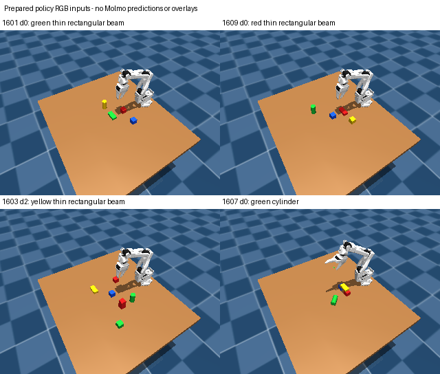

# Optional Molmo 2 pointing experiment

Molmo 2 can supply a semantic pixel proposal for an object description. The
intended path is RGB + public target description → remote pointing → local
RGB-D component selection → existing geometry/identity checks → grasp planning.
The point is a visible surface location, not a physical centroid or a grasp pose.

This is a separate perception experiment. The frozen assembly policies, their
worker sandbox, and the previous 10/20 bridge result are unchanged. All local
validation and backprojection run on CPU. A future API-backed variant would
depend on remote model inference and would not be an entirely CPU-only system.

## Actual status

The [probe record](evaluations/molmo2_pointing_probe.json) records two authenticated
**text-only** requests to OpenRouter: both `allenai/molmo-2-8b` and
`allenai/molmo-2-8b:free` returned HTTP 401, `User not found`. The public endpoint
lists for both routes were also empty at the recorded check time. A model landing
page does not establish that an inference provider is currently available.

No experiment image request executed, and no Molmo point prediction was obtained.
Automatic approval review rejected the proposed upload of a non-public camera
image pending explicit authorization for that payload. The key must be made valid
and a serving route must be available before a localization test can proceed.
There is no measured Molmo localization accuracy, latency, or policy improvement.

Four archived policy RGB frames are prepared locally: a successful initial scene,
two initial beam-identification failures, and a later cylinder-tracking failure.
These selected development examples are not a fresh held-out evaluation.



The images come from the `rgb` field in policy `camera_*.npz` observations. They
are not the separate overview renders. At 320 × 240, some objects occupy only a
few pixels; pointing accuracy and partial occlusion need direct measurement.

## Local adapter

`src/aspire_so100/pointing_geometry.py` implements:

- Single-image Molmo 2 parsing, for example `<points coords="1 1 500 500">beam</points>`.
  The first index is image 1, followed by object ID and coordinates scaled by
  1000. The example is a format illustration, not an inference result.
- Rejection of multiple points, other images, legacy percentage formats,
  out-of-bounds coordinates, wrong colors, and invalid depth.
- Selection of the depth-connected color region containing the pointed pixel,
  with the existing visual tabletop gate and no nearest-object fallback.
- Calibrated backprojection of the sampled surface pixel and a visible-surface
  centroid. Neither is labeled as the complete object center. Object identity
  remains unverified, including when same-color objects merge in the image.

Shape, orientation, complete extents, grasp feasibility, and temporal identity
still require downstream evidence. Pointing cannot supply depth hidden by an
occluder or restore a dropped object's original pose.

## Reproduction

Run from the repository root. The default command only prepares a local PNG and
report; it does not read the key or contact a service:

```bash
.venv/bin/python scripts/probe_molmo_pointing.py \
  --frame outputs/beam_bridge_01/heldout_v2/thin_beam_bridge_d0_colors/seed_1609/camera_001.npz \
  --target 'red thin rectangular beam lying flat on the table' \
  --color red --output outputs/molmo_pointing_01/prepared_1609_d0
```

Add `--response response.txt` to evaluate a saved model text response locally.
Add `--send` instead to make one real image request once the blockers above are
resolved. Only RGB and target text are sent; depth and calibration remain local.
The client never loads rollout states, object poses, catalog dimensions, contacts,
or evaluator outputs. It uses a fixed HTTPS endpoint, disables redirects, reads
the key from the ignored `.apikey`, and omits credentials from reports.

The credential/route probe sends only `Reply with OK.`:

```bash
.venv/bin/python scripts/probe_molmo_pointing.py --probe \
  --output outputs/molmo_pointing_01/new_probe
OPENBLAS_NUM_THREADS=1 .venv/bin/python -m unittest discover \
  -s tests -p test_pointing_geometry.py -v
```

Five local tests pass, covering format ambiguity, pixel/depth/color rejection,
same-color component isolation, calibrated surface backprojection, and a mocked
outbound RGB-only request. The tests do not call a model.

## Primary references

- [Ai2 Molmo 2](https://allenai.org/blog/molmo2)
- [Official single-image point formatter](https://github.com/allenai/molmo2/blob/main/olmo/preprocessing/point_formatter.py)
- [OpenRouter image inputs](https://openrouter.ai/docs/guides/overview/multimodal/image-understanding)
- [Molmo 2 provider listing](https://openrouter.ai/allenai/molmo-2-8b/providers)

MolmoPoint is a separate model variant with specialized pointing tokens. This
adapter targets Molmo 2's text coordinate format and does not claim MolmoPoint
API support.
