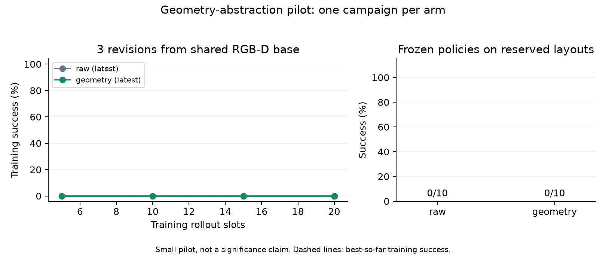

# Geometry comparison from the generic RGB-D PnP base

This campaign starts from the extracted generic PnP mechanism and its separate
single-column adapter. It does not resume or replace the historical
`geometry_base_ablation_01` campaign, whose starter was a different controller.

## Frozen protocol

| Setting | Value |
| --- | --- |
| Output | `outputs/generic_pnp_geometry_ablation_01` |
| Shared mechanism | `policies/pick_place_rgbd_base.py` |
| Shared task adapter | `policies/stack_from_rgbd_pnp_adapter.py` |
| Task | Three 3 cm cubes, blue/red/green bottom to top, unique colors |
| Scene | Sampled `inventory_tower`, `cube_triple`, no distractors |
| Physics | Default NoSlip 0 |
| Training seeds | 4101–4105 |
| Reserved seeds | 4201–4210 |
| Improvement budget | Three revisions per arm, five training trials per revision |
| Proposal model | `gpt-6-astra`, high reasoning, 900 seconds per proposal |
| Selection | Highest training success count including shared revision zero; earliest tie |
| Reserved evaluation | Ten paired layouts per arm, after both policies are frozen |

The bundled starter is frozen byte-for-byte and evaluated once on each training
seed. There are 55 planned rollout slots: five shared baseline executions, thirty
candidate training executions and twenty reserved executions. Source and manifest
hashes, exact model outputs, sensor images, reduced feedback and failures are kept.
Eighteen existing baseline and experiment tests passed before launch.

Both arms receive the same starter, task, robot geometry API, numerical libraries,
side RGB-D and wrist RGB-D. Runtime perception and control run on CPU. Simulation
may use GPU rendering. Simulator object poses, dimensions, contacts and evaluator
state are unavailable to either runtime policy. A private evaluator supplies final
success/failure only after execution; its object truth is not sent to the actor.

The treatment arm additionally receives frozen numerical functions for cube
geometry, observability, desired rigid states and state errors. The library issues
no actions. The raw arm can write its own geometric calculations, but receives no
prebuilt abstraction. Both actors can improve the complete controller within their
isolated contexts; this is an experiment on policy improvement from a shared base,
not a fixed-controller perception swap. Neither sees historical controllers,
repository skills, the other arm's results or reserved feedback.

The starting base still assumes calibrated RGB-D, unique color segmentation and
initially upright tabletop objects. It has no tower compensation, worksite search
or base relocation. Its earlier two smoke examples are not training seeds or a
success-rate claim for this campaign. No manual repairs or seed filtering are
allowed after the campaign is frozen.

## Outcomes to report

Report success by revision, best-so-far training success, selected revision and
paired reserved success. Also report actual executed trials versus invalid source,
model time/tokens, camera calls and policy CPU compute. Failures are retained even
if all revisions fail. A single campaign per arm is a pilot, not a statistical
claim. Runtime timing does not compare against repeated online VLM checks; both
policies execute without a runtime VLM.

Live state is in `progress.json`; final artifacts are `summary.json`, `report.json`
and `learning_curves.png` inside the campaign directory. No final result is implied
until `summary.json` records completion.

## Reproduction

```bash
.venv/bin/python scripts/build_rgbd_pnp_policy.py \
  --output outputs/generic_pnp_geometry_starter_01/stack_policy.py
OPENBLAS_NUM_THREADS=1 OMP_NUM_THREADS=1 MUJOCO_GL=egl .venv/bin/python -u \
  scripts/run_geometry_ablation.py \
  --output outputs/generic_pnp_geometry_ablation_01 \
  --base-policy outputs/generic_pnp_geometry_starter_01/stack_policy.py \
  --rounds 3 --train-seeds 4101 4102 4103 4104 4105 \
  --heldout-seeds 4201 4202 4203 4204 4205 4206 4207 4208 4209 4210
```

Use a fresh output directory for any changed source or settings. See
[the generic base](GENERIC_RGBD_PNP.md) for primitive semantics and assumptions,
and [the shared-base protocol](PNP_GEOMETRY_COMPARISON.md) for isolation details.

## Completed results

All 55 planned rollouts executed. There were no source-validation rejections or
infrastructure failures. No candidate was manually repaired. The frozen protocol
produced the following **original evaluator scores**:

| Revision / split | Without supplied abstraction | With supplied abstraction |
| --- | --- | --- |
| Shared baseline | 0/5 | 0/5 |
| Revision 1 | 0/5 | 0/5 |
| Revision 2 | 0/5 | 0/5 |
| Revision 3 | 0/5 | 0/5 |
| Reserved layouts, selected policy | 0/10 | 0/10 |

The earliest-tie rule selected revision zero for both arms. Their frozen policy
hashes are identical. Thus reserved evaluation measures the common baseline on
new layouts, **not a contrast between evolved geometry and raw controllers**.
Each arm had eight unreachable-target exceptions and two task-evaluation failures
on the reserved split. Merely loading the geometry library does not mean the
selected baseline calls it.



[Full measured report](evaluations/generic_pnp_geometry_ablation_01.json) and
[post-hoc audit](evaluations/generic_pnp_geometry_ablation_01_audit.json) retain
source hashes, per-seed results, timing and the two issues below.

### Diagnostic observations and protocol defects

- The initial baseline completed red placement in three of four training scenes
  that later raised unreachable-target errors. Seed 4104 returned both releases
  but failed the private stack evaluation. This is not simply a detection failure.
- Raw revision 1 stopped during grasp approach; revision 2 confirmed a lift in
  one scene but stopped during placement. Geometry revisions 1 and 2 often stopped
  on partial visual poses, tracking errors or unsuccessful grasping. Geometry
  candidates did call `cube`, `table`, `targets`, `error` and `relation`.
- **Cube symmetry in the evaluator:** raw revision 3, seed 4101, produced a stack
  whose only recorded rejection during the five-second check was
  `green_cube: local Z axis is not upright`. The green cube rested on another
  equivalent face. Its nearest face normal was within about 1 degree of vertical
  at the start and end of that check. The evaluator requires a particular model
  axis to point upward even for uniform cubes; its support-plane calculations
  also assume local Z. This is inappropriate for a face-symmetric cube task and
  inconsistent with the abstraction's symmetry-aware rotation error.
- **Underspecified anchor interface:** geometry revision 3 passed an XYZ array to
  `geometry.targets(..., anchor=...)`. The implementation expects a complete
  observation dictionary, but the frozen actor contract did not specify that
  schema. The resulting `IndexError` affected all five training trials. An isolated
  numerical call reproduced the type mismatch. These are interface failures,
  not evidence that geometric reasoning cannot solve the task.

The audit reads evaluator traces only after training. None of that private state
was supplied to actors or policies. Original scores and selection are preserved;
there is no post-hoc promotion, corrected success-rate claim or reserved retest.

### Interpretation and next experiment

This pilot does not establish an improvement in learning efficiency or task
success from supplied geometry. It also does not establish that geometry is
unhelpful: early control failures and the two protocol defects limit that inference.
Before another campaign, make the evaluator invariant to valid cube face
symmetries, specify and validate geometry API argument schemas, and establish a
reliable shared low-level grasp/place capability on development layouts. Then
freeze that capability and compare higher-level planning/checking with and without
structured geometry. Any changed protocol needs a fresh campaign and reserved set.

The summed per-arm model generation times were 1,204 seconds (raw) and 942 seconds
(geometry); the two arms ran concurrently. Output token counts were 39,693 and
30,994. These figures are costs of this failed pilot, not an efficiency advantage.
Reserved median worker CPU times were 0.153 and 0.191 seconds, and median host
trial times were 2.921 and 2.971 seconds. Both selected policies are the same,
most trials terminate early, and geometry loading adds setup work. These timings
cannot support a realtime or VLM-check latency claim.
