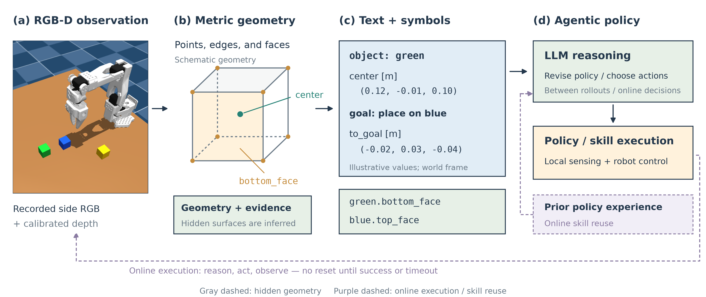

# Geometric abstraction for agentic policy

Sections 1–5 describe the geometric interface and its current use in single-policy
training. Section 6 describes the extension to continuous online reasoning
and execution, with no scene reset within an episode. The appendices give
implementation assumptions, examples, and evaluation details. Numerical examples
are illustrative; coordinates use meters. The separate 20-episode online pilot
is complete; its [results and limitations](ONLINE_BRIDGE_TOWER_RESULTS.md) should
be consulted before making empirical latency or recovery claims. The later
[explicit-target study](ONLINE_TARGET_BINDING_RESULTS.md) places metric target
selection in the LLM's decision loop; its results are separate from that pilot.

## 1. A geometric interface for agentic policy

An agentic policy must connect reasoning about a task to actions in a physical
scene. An LLM can interpret goals, compose procedures, and use prior experience,
while manipulation requires precise information about object positions, surfaces,
and spatial relations. We introduce a geometric abstraction that converts visual
3D information into **text and symbolic representations for LLM reasoning**.
The resulting interface lets the agent refer to geometric entities, reason about
relations, and express action goals using values grounded in the current scene.

The abstraction exposes two complementary views. At the symbolic level, named,
typed references such as `red.bottom_face` identify geometric entities and support
operations such as alignment and support checks. At the text level, compact
records communicate their metric values, evidence status, and progress toward a
goal. Symbols provide a vocabulary for composing decisions; text makes the
current grounding of that vocabulary available in the LLM's context. Both views
are derived from the same geometric estimates.

Let $o_t$ denote calibrated RGB-D observations and public robot information at
time $t$, and let $M$ denote shape information acquired during initialization.
A visual grounding function produces an object-based state,

$$
\mathcal Z_t=\Phi(o_t;M).
$$

Typed queries on $\mathcal Z_t$ supply geometric values to executable policies.
A projection $\Psi$ selects the active object's geometry, requested references,
and goal residuals for serialization into text. For example, a stacking decision
can be expressed as aligning one object's bottom face with another object's top
face, with the required translation computed from current observations.



**Figure. Geometric abstraction for agentic policy.** (a) A recorded RGB-D
preflight scene, shown as side RGB. (b) Metric geometry represented by points,
edges, and faces with evidence labels. (c) Compact text and symbolic references
expose geometry to the LLM. (d) The current agent revises executable policies
between training rollouts; local sensing and actuation run within each rollout.
Purple dashed paths indicate the online extension without scene reset and
reuse of trained policy experience (labeled as planned in this earlier figure). Geometry and numeric values in (b–c) are
illustrative and are not estimates from the displayed frame. Gray dashed edges
represent inferred hidden geometry.

Paper assets: [vector PDF](media/agentic_geometry_method.pdf),
[editable SVG](media/agentic_geometry_method.svg),
[rendering source](../scripts/render_agentic_geometry_method.py), and
[figure provenance](media/agentic_geometry_method.json).

We study this interface in two settings. In single-policy training, the LLM revises
one executable policy per training chain, and each rollout executes that policy
without further LLM decisions. In a separate online pilot, the agent observes the
consequences of its actions, invokes adapted previously trained skills, and
continues in the same scene until success or timeout. The second setting tests
whether compact text and symbols improve decision efficiency during interaction;
it does not assume that fewer image attachments imply faster task completion.

## 2. Geometric state and reference semantics

We represent each object by its current metric geometry, evidence metadata,
and observation time. Geometry includes a fitted center, orientation, dimensions,
and supported geometric parts. Evidence specifies which quantities are
constrained by the observation and which depend on a shape assumption. Thus the
state describes both a geometric estimate and the conditions under which a policy
may use it.

For blocks with explicit polygonal boundaries, we represent geometry as

$$
\mathcal G_i^t=(V_i^t,E_i^t,F_i^t,\mathcal S_i^t),
$$

where $V_i^t$ contains 3D vertices, $E_i^t$ contains endpoint-index pairs,
$F_i^t$ contains ordered face boundaries, and $\mathcal S_i^t$ associates each
vertex with its evidence source. The reference layer derives segments and faces
from this connectivity. Two vertices specify a segment; a face additionally
requires an ordered, nondegenerate planar boundary. Its center is the area
centroid and its normal follows the boundary orientation. This representation
admits different boundary shapes without defining an operator for each named
polygon.

A reference $r=(i,\rho)$ identifies an object $i$ and a geometric role $\rho$.
Its interpretation is a partial function of the current state:

$$
\llbracket i.\rho\rrbracket_{\mathcal Z_t}
=
\begin{cases}
(v,\tau,\eta,t), & \text{if a current supported reference is available},\\
\bot, & \text{otherwise},
\end{cases}
$$

where $v$ is the geometric value, $\tau$ its type, and $\eta$ its evidence
metadata. The notation $\bot$ describes an unavailable query; the implementation
reports this through its existing rejection or unavailable-state interface.

| Operation | Inputs | Output |
| --- | --- | --- |
| `reference` | Object and supported role | Point, axis, segment, or face with current evidence |
| `relation` | Predicate and two object identities | Geometric residuals and `true`, `false`, or `unknown` |
| `align` | Source face, target point, desired outward normal | Desired rigid transform |
| `checkpoint` | Active object, optional goal and requested references | Compact record for feedback |

Operators preserve geometric meaning across objects. A top face supplies a
position and normal regardless of the number of vertices in its boundary.
Evidence is also preserved: a reference using an inferred hidden surface retains
that qualification. Symmetry limits which roles are defined. For example, equal
cube dimensions do not identify a unique longest axis. Indexed vertices describe
the current fitted geometry and do not assert material-point correspondence over
time.

## 3. Grounding geometric references in visual observations

The grounding module converts valid depth pixels into world-frame points using
camera calibration, associates points with objects through their unique colors,
and estimates geometry from the resulting object point sets. Public robot
geometry is used to mask the robot, and background depth provides a table plane.
Object dimensions are acquired from initial on-table observations under declared
shape assumptions. Subsequent estimates combine this initialized shape with
current visual evidence. Runtime perception does not use simulator object poses,
dimensions, or contacts.

Known cubes, rectangular prisms, and cylinders use their existing geometric
observers. An optional observer extends this interface to convex polygonal
extrusions. It fits a planar cap, extracts resolved boundary segments, and
intersects neighboring fitted lines to obtain vertices. The initial height and
extrusion direction determine a parallel bottom and side connectivity. The cap
vertices are fitted from current RGB-D; the hidden bottom is explicitly inferred
under the extrusion model. The geometric vocabulary is shared, while the sensing
assumptions remain specific to each observer.

Under partial occlusion, the polygon observer registers its initialized footprint
to visible current edges and side surfaces. Acceptance requires independent edge
directions, a conditioned pose fit, and agreement with current depth. Same-time
complementary views can disambiguate candidate completions. Shape information is
reused across observations; a new pose must be supported by new visual evidence.

Freshness and observability determine how these estimates may be composed.
A reference is usable only at its observation time. After motion, the policy
must obtain a current estimate before querying that object's pose. A relation
requiring an unobserved direction returns `unknown` unless available evidence
already establishes a violation. For instance, failure to observe an object's
height does not establish that it is below its support. Conditional finite bounds
may be exposed when the cuboid observer cannot accept a point pose; these bounds
remain separate from executable pose estimates.

The current grounding routines run on the CPU and use supplied geometric models
and numerical fitting. Their parameters are not trained through policy feedback.
Implementation assumptions and the broader limits of the polygon observer appear
in Appendix A.

## 4. Composing references into manipulation goals

The reference vocabulary connects object geometry to continuous action goals.
Consider placing object $a$ on object $b$. Querying their mating faces gives

$$
(\mathbf p_a,\mathbf n_a)=\operatorname{bottom}(a),
\qquad
(\mathbf p_b,\mathbf n_b)=\operatorname{top}(b),
$$

where $\operatorname{bottom}$ and $\operatorname{top}$ abbreviate the corresponding
face-reference queries. The policy can ask for a rigid transform that makes the
face centers coincide and their outward normals oppose:

$$
R_\Delta\mathbf n_a=-\mathbf n_b,
\qquad
\mathbf t_\Delta=\mathbf p_b-R_\Delta\mathbf p_a,
\qquad
\mathbf c_a^*=R_\Delta\mathbf c_a+\mathbf t_\Delta.
$$

The alignment operator returns this desired geometry. A point and a normal leave
rotation about the target normal free, so the implementation chooses a
minimum-angle representative and reports the remaining twist freedom. The policy
selects the support and when to act; the common actuator carries out the selected
pick or placement.

**Running example.** Let an upright red cube have side length $0.04$ and center
$(0.12,-0.01,0.10)$. Its bottom center is $(0.12,-0.01,0.08)$. Let the blue cube's
top center be $(0.10,0.02,0.04)$. Their normals already oppose, giving

$$
R_\Delta=I,\qquad
\mathbf t_\Delta=(-0.02,0.03,-0.04),\qquad
\mathbf c_{\mathrm{red}}^*=(0.10,0.02,0.06).
$$

The same sequence of face queries and alignment operations applies when the
support is moved: only the grounded values change. A three-object stack reuses
the construction for another pair of objects after updating the observations.
This illustrates compositional reuse of the interface; successful execution still
depends on perception, policy choices, and physical control.

After placement, a `support_candidate` query combines vertical ordering, normal
gap, projected overlap, and face orientation. It exposes the individual geometric
residuals and their availability. Contact and stability require additional
physical evidence and are not established by this predicate. Appendix B gives the
corresponding executable API example.

## 5. Textual state for reasoning and single-policy training

The LLM receives a selected textual view of the geometric state. For active
object $i$, requested references $\mathcal R$, and desired geometry $g_i$, the
checkpoint is

$$
x_t=\Psi(\mathcal Z_t,i,\mathcal R,g_i).
$$

Serialized as text, $x_t$ includes identity, time, evidence status, current
geometry, requested points or face centers, and an optional goal residual.
For a target reference position $\mathbf g_r$ and current position
$\mathbf p_r(t)$, the residual is

$$
\mathbf e_t=\mathbf g_r-\mathbf p_r(t).
$$

In the stacking example, the center-goal residual is $(-0.02,0.03,-0.04)$.
This provides a concrete spatial discrepancy for the agent to reason about.
If the red cube becomes occluded and its current pose cannot be recovered, the
record retains the goal and marks the residual unavailable. The agent can then
distinguish an unmet geometric goal from insufficient evidence to assess it.
The recorder keeps one preceding center for changes between available observations
and includes detailed geometry only when requested.

The interface separates local visual processing from LLM input. Several queries
can reuse one current geometric estimate. After motion, the observer can acquire
new RGB-D and produce updated text without automatically attaching those images
to a language-model request. Images remain useful for establishing initial visual
context and for resolving failures that the abstraction does not explain.
The intended benefit is to make repeated spatial reasoning possible from a
compact, explicit state while retaining access to visual evidence when needed.

**Current evaluation: single-policy training.** Each training chain maintains an
executable policy that is revised between batches of rollouts. The policy uses
local perception and control during execution. Its checkpoints and outcomes are
returned to the LLM for the next revision, together with selected training images
under the registered feedback rules. The actor context persists across revisions,
but the physical scene is reset for each rollout. Policy improvement changes the
program; the geometric observers and operator definitions remain fixed.

This evaluation measures how geometric abstraction affects policy acquisition
and the success of the resulting policies. It does not measure an LLM's online
response time while interacting continuously with a scene. The real-time
advantage of the text interface is a separate hypothesis for the online setting
below.

## 6. Continuous online reasoning and execution

In the online pilot, an episode begins from one scene and
continues without resetting objects after an unsuccessful action. The agent
repeatedly receives current geometric text, reasons about progress, and chooses
what to execute next. The episode ends when the task succeeds or its wall-clock
budget expires. Reasoning delays therefore consume time that could otherwise be
used for observation, execution, or recovery.

Let $\mathcal H_t$ denote the current episode's interaction history and
$\mathcal E$ denote experience from previously trained policies. A conceptual
online decision has the form

$$
u_t=\mathcal A_{\mathrm{LLM}}(g,x_t,\mathcal H_t,\mathcal E),
$$

where $u_t$ selects a shared skill or recovery operation, binds object identities,
or requests additional evidence. The pilot accepts structured JSON decisions;
it does not execute newly generated policy code. Execution changes the existing
scene, and a fresh observation supplies the next geometric state and text record.
Astra handles initial planning and replanning, while Luna handles routine decisions
in the same persistent conversation. Simulation advances during model requests,
and their latency consumes the episode's wall-clock budget.

Prior policy experience can supply reusable procedures and examples of successful
or failed decisions. The agent must bind that experience to current object
references and observations: coordinates from a training episode do not describe
the current scene. The pilot uses two directly supplied, training-selected policies
adapted into bridge and stacking skills, with a shared clearing primitive. Both
arms receive the same implementations and skill descriptions. This fixed small
library does not require learned retrieval.

The subsequent explicit-target interface moves destination selection into the
agent's online decision. Each placement decision specifies a skill, an object
identity and a world-frame support-surface point. The common actuator executes
that point without choosing a task destination on the agent's behalf. Both arms
can query calibrated depth samples from displayed images. Full additionally
receives current geometric references, while unavailable references remain
explicitly unavailable. The agent uses one persistent Astra medium context and
can request images or depth when the text does not supply sufficient evidence.
This differs from the earlier pilot's node-only skill calls and Astra/Luna routing.

For example, an agent may preserve an existing foundation, place a second
foundation relative to its observed geometry, and target the beam between their
current top faces. Choosing to preserve the first foundation can save an entire
physical operation. Reasoning efficiency therefore includes action selection as
well as model-request duration. This mechanism is consistent with the successful
traces in the five-layout explicit-target study; it does not isolate the effect
of text serialization from the geometric estimates or resulting decisions.

An optional text encoder factors shared reference metadata within each message.
References explicitly marked for inheritance share frame, units, source and
other identical evidence fields; unavailable references inherit nothing. All
numeric values and observation times are preserved, and the complete original
record can be reconstructed. The encoding reuses no metadata implicitly across
time. It changes the LLM input format without changing policy references or
actuator calls. A separate development comparison measures its token cost; it
should not be assumed to improve decision latency.


**Example: continue after an incomplete placement.** Suppose an attempted
placement leaves the red cube beside its intended support. The agent receives
an updated pose and a nonzero goal residual, consults its prior stacking
experience, and can choose to pick the cube again and target the support's current
top face. If the pose is unavailable, it can request a new observation instead.
The next decision starts from the resulting scene, preserving both progress and
the consequences of failure. The geometric abstraction supplies the evidence;
the agent determines the recovery procedure.

This setting directly tests whether text and symbolic geometry allow the LLM to
make useful decisions sooner. The hypothesis is that explicit references and
residuals reduce repeated visual interpretation and numerical reconstruction,
leaving more of a fixed time budget for execution and recovery. Local perception,
model requests, and actions all contribute to the measured cost. We compare
success within a common wall-clock budget, time to success, and decision latency,
with matched access to prior policy experience. In the five-layout pilot, both
arms succeeded in 6/10 episodes. Full reduced image attachments from 168 to 72,
but mean capped completion time changed only from 231.54 to 229.33 seconds.
This establishes the working online interface and a reduction in image attachments;
it does not establish improved final success or a substantial speedup. See the
[complete results](ONLINE_BRIDGE_TOWER_RESULTS.md) for token-accounting limits and
unsuccessful reserved-layout recovery attempts.

In the later 180-second explicit-target study, Full succeeded on 3/5 new paired
layouts and Base on 0/5. Full attached fewer images and used less completed
model-request time, but recorded more total tokens. This is exploratory evidence
for the interface package on five layouts, not a general success-rate or latency
guarantee. The [complete paired results](ONLINE_TARGET_BINDING_RESULTS.md) retain
the common failures, interrupted-request accounting and timing limitations. A
separate [200-second comparison](ONLINE_COMPACT_TOWER_200_STUDY.md) uses fresh
layouts and the development-validated compact text; its protocol must not be
confused with a retrospective extension of the 180-second outcomes. That study
completed with Full 4/5 versus Base 2/5, an 11.1% reduction in mean capped time
and 39.4% fewer image attachments. Recorded tokens increased by 6.3%, and mean
per-request latency did not improve. The [complete results](ONLINE_COMPACT_TOWER_200_RESULTS.md)
support a task-level benefit on these five layouts, with explicit cost and
sampling limitations.
Conditioning on success gives mean completion times of 167.66 seconds for Full
and 189.77 seconds for Base, with completed model-request subtotals averaging
36.95 and 45.84 seconds per successful episode. These select different layouts
(four successes versus two) and exclude three interrupted Full requests from the
model-time subtotal. They are secondary descriptive measures, not a paired
latency estimate; the [detailed timing analysis](ONLINE_COMPACT_TOWER_200_RESULTS.md#timing-conditioned-on-success)
also reports the sole jointly successful layout and the opposite all-episode
mean per-request timing direction.


## Appendix A. Observation model and implementation scope

### Inputs and coordinate system

The observer receives an RGB image, an optical-axis depth map, a valid-depth mask,
camera intrinsics, a camera-to-world transform, and an observation timestamp.
Object association currently uses unique colors. Known inventory objects also
have declared coarse shape families and initialization assumptions. Robot
proprioception and public robot geometry support masking of the robot. Simulator
object poses, dimensions, contacts, and task-evaluator state are excluded from
runtime perception.

For a pixel $\tilde{\mathbf u}=[u,v,1]^\top$, its world point is

$$
\mathbf p_W = R_{WC}\left(D(u,v)K^{-1}\tilde{\mathbf u}\right)+\mathbf t_{WC},
$$

where $D$ is optical-axis depth, $K$ is the intrinsic matrix, and
$(R_{WC},\mathbf t_{WC})$ transforms camera coordinates into world coordinates.
Color masks isolate object points, and a plane estimated from background depth
provides the table reference. Perception runs on the CPU.

**Example: one pixel becomes one metric point.** With
$f_x=f_y=200$, $(c_x,c_y)=(160,120)$, pixel $(180,110)$, and
depth $0.50$, the camera-frame point is $(0.05,-0.025,0.50)$.
For an illustrative identity camera rotation and translation
$(0.10,0.20,0)$, the world point is $(0.15,0.175,0.50)$.
This operation supplies surface samples; it does not identify object vertices by
itself. These calibration values are illustrative, not the experiment settings.

### Initialized shape and current pose

Initial on-table observations establish object dimensions under the declared
shape and orientation assumptions. Subsequent observations estimate the current
pose using those dimensions and current visual evidence. Known cubes, rectangular
prisms, and cylinders retain their existing family-specific observers. The
observer first attempts the side view and can use a wrist view and supported
multiview checks when the first view is insufficient.

Shape persistence and pose persistence are treated differently. The system may
reuse an initialized rigid shape, but neither the previous pose nor commanded
gripper motion supplies a new measured pose. A failed current observation remains
unavailable. In particular, an assumed grasp attachment cannot silently convert
an old object pose into a current one.

### Optional extension: polygonal blocks without named polygon classes

The point-based extension uses a convex extrusion model to handle simple blocks
whose footprint is not a predefined rectangle. It does not dispatch on names such
as a particular polygon type. Boundary count, edge lengths, and angles come from
the image. Its present scope is a sufficiently resolved convex planar cap with
approximately constant cross-section along the extrusion direction.

The observer fits a near-horizontal cap plane, extracts its contour, and removes
turns too small to resolve reliably at the image scale. Half-pixel mask
transitions are projected onto the fitted plane. Straight boundary segments are
fit by total least squares, and intersections of adjacent fitted lines yield the
cap vertices. This is a contour-and-depth construction of 3D vertices; generic
image corners alone do not establish physical 3D corners.

Let $\mathbf v_k^+$ be the ordered cap vertices, $\mathbf n$ its upward unit
normal, and $\mathbf c^+$ its area centroid. For an initially table-supported
extrusion and table plane $\mathbf n_T^\top\mathbf x=d_T$, the height is

$$
h=\frac{\mathbf n_T^\top\mathbf c^+-d_T}{\mathbf n_T^\top\mathbf n},
\qquad
\mathbf v_k^- = \mathbf v_k^+-h\mathbf n,
\qquad
\mathbf c=\mathbf c^+-\frac{h}{2}\mathbf n.
$$

The hidden bottom is inferred under the table-support and extrusion assumptions.
It is labeled accordingly rather than described as directly observed. The initial
model stores the footprint and height. A later complete contour must agree with
the initialized shape through vertex count, pairwise distances, area, perimeter,
and visible side evidence.

For an occluded cap boundary, the observer registers the initialized footprint to
current visible boundary lines and side points in the current cap plane. Given
footprint $P$, boundary samples $B$, and projected side samples $S$, it
refines an in-plane rigid transform by minimizing

$$
J(\theta,\mathbf t)=
\frac{1}{|B|}\sum_{\mathbf b\in B}
 d\!\left(\mathbf b,\partial(R_2(\theta)P+\mathbf t)\right)^2
+\frac{1}{|S|}\sum_{\mathbf s\in S}
 d\!\left(\mathbf s,\partial(R_2(\theta)P+\mathbf t)\right)^2,
$$

omitting the second term when no side samples are available. Here $d$ is
Euclidean distance to the nearest boundary segment. Candidate edge
correspondences are enumerated before refinement. Acceptance requires independent
edge directions, a conditioned fit, small residuals, and consistency with current
depth. Missing depth is not treated as evidence of an occluder. Complementary
same-time views can reject incompatible candidates; materially different
remaining completions make the pose unavailable. Registered vertices retain a
model-inferred evidence label.

This observer supplies the representation in Section 2, but the representation does not
require this particular observer. Conversely, a general point API does not imply
that the current observer reconstructs arbitrary objects.

### Scope of the current observer

The implementation depends on calibrated RGB-D, color-based instance association,
rigid objects, and explicit model assumptions. The optional polygon observer
currently requires an initially visible, near-horizontal convex cap with resolved
edges and constant cross-section. Its supported contour size is 3–12 vertices;
small chamfers may be suppressed as unresolved. Later partial updates require
sufficient independent current evidence. Rounded, tapered, concave, or heavily
occluded objects are outside its validated perception scope.

The reference representation can describe supplied simple concave planar faces,
but that capability is broader than the current observer. Hidden surfaces remain
model-derived, indexed points are not material-point tracks, and geometric
relations do not certify grasp feasibility, contact, or stability. These boundaries
should remain explicit when adapting the method section for a paper.

## Appendix B. Numerical and API examples

### Points and connectivity

**Example: four points define a rectangular patch.** Consider the supplied points

```text
v0 = (0.10, 0.00, 0.04)     v1 = (0.14, 0.00, 0.04)
v3 = (0.10, 0.02, 0.04)     v2 = (0.14, 0.02, 0.04)

edge_0 = [0, 1]
face_0 = [0, 1, 2, 3]
```

The declared edge has length $0.04$. The declared face has centroid
$(0.12,0.01,0.04)$ and normal $(0,0,1)$. Under an initialized extrusion
height of $0.04$, its inferred bottom lies at $z=0$, and its volume centroid
is $(0.12,0.01,0.02)$. This example supplies only a cap to explain connectivity;
a complete extrusion record includes both cap and bottom vertices.

### Reference queries

Policies access geometry through the existing `object_id.role` convention:

```python
top = session.reference("red.top_face")
bottom = session.reference("red.bottom_face")
center = session.reference("red.center")

# Indexed references are available for the polygonal-block extension.
point = session.reference("red.vertex_0")
edge = session.reference("red.edge_0")
face = session.reference("red.face_0")
```

Point references return a position, segments return endpoints, and faces return
a patch with a center, normal, and boundary. The polygon observer numbers bottom
vertices before top vertices; its `face_0` is the top and `face_1` the bottom.
Legacy cubes retain `corner_i` and named faces rather than acquiring the new
indexed API. Reference indices identify geometry in the current observation;
they do not track the same material point across motion or refitting.

Evidence propagates through references. A face containing inferred vertices
remains model-inferred. Symmetry is also explicit: a cube does not provide a
unique longest axis, and a symmetric footprint does not reveal a material yaw.
Unavailable or ambiguous roles are rejected rather than assigned arbitrary
physical meanings.

### Stacking through the existing interface

The following code implements the goal construction and checkpoint from Section 4.
It assumes an initialized session and a valid current fit for both objects.

```python
# Refresh both objects at the current simulation time before querying them.
session.observe("blue")
session.observe("red")
support = session.reference("blue.top_face")
goal = session.align(
    "red.bottom_face",
    support["center_m"],
    [-value for value in support["normal"]],
)
record = session.checkpoint(
    "red", "before_place", refresh=False,
    goal_center=goal["desired_center_m"],
    reference_names=("red.bottom_face",),
)
```

After a successful pick, the policy can separately call
`session.place(support["center_m"])`. The placement argument is the support-surface
point, not the desired object center. This snippet constructs a goal and logs
evidence; it is not a complete pick-and-place controller.

### Compact checkpoint

For the stacking example, the following is an excerpt of the checkpoint. The
goal refers to the object center:

```json
{
  "object": "red",
  "step": "before_place",
  "frame": "world",
  "units": "meters",
  "status": "current_estimate",
  "geometry": {
    "shape": "cube",
    "center_m": [0.12, -0.01, 0.10],
    "position_fully_observed": true,
    "orientation_inferred": false
  },
  "goal": {
    "reference": "center",
    "point_m": [0.10, 0.02, 0.06]
  },
  "remaining_translation_m": [-0.02, 0.03, -0.04]
}
```

The full record additionally includes time and the requested face reference.
Polygonal-block checkpoints preserve evidence labels for inferred requested
points and faces. Dense vertices and connectivity are available through detailed
queries, not copied into the compact record by default. Segment endpoints are
queried directly rather than packed into the point/face-center checkpoint.
Displayed coordinates are rounded to six decimal places for serialization; this
does not imply micrometer measurement accuracy.

A placement intent uses a separate `placement_goal` with reference
`center_xy_min_z`: the horizontal model center and its lowest world height.
Its residual must not be confused with a center-goal or face-center residual,
particularly for tilted objects.

`get`, `reference`, and `checkpoint(refresh=False)` do not acquire new images.
`observe` and `checkpoint(refresh=True)` request a visual update; the shared
executor also acquires observations as needed. Camera frames and images attached
to a language-model request are therefore distinct counts.

## Appendix C. Observability and conditional bounds

The observer also records which translation directions are constrained. If
$R_o$ contains the corresponding columns of the fitted object rotation, the
observed translation subspace has projector

$$
\Pi_o=R_oR_o^\top.
$$

A relation is evaluated only in the directions it needs: vertical ordering needs
vertical position evidence, whereas horizontal alignment needs both horizontal
directions. These flags describe observability under the fitted model; they are
not calibrated probabilities of correctness.

When a rejected cuboid point fit still yields a unique valid correspondence with
finite center bounds, the partial-geometry path can report

$$
\boldsymbol\ell\le Q\mathbf c\le\mathbf u,
\qquad \texttt{pose\_available=false},
$$

where the rows of $Q$ define the fitted local basis. The bounds are conditional
on dimensions, orientation, and association. They do not become an executable
point pose, and they are not statistical confidence intervals.

## Appendix D. Experimental interpretation and efficiency

### Current single-policy training experiment

Base and Full share the sensor access boundary and hidden visual pick/place
executor. Base receives images, calibration, public object labels, robot
information, and qualitative action feedback; it may implement its own visual
estimator. Full additionally exposes the supplied geometry, typed references,
constraint operators, and compact geometric feedback. The comparison evaluates
this package, rather than isolating any single operator or serializer.

The current three-cube study uses five paired training chains, three generated
revisions after an observation-only R0 and five training layouts per pair. Its
original 100-layout evaluation was amended to 20 shared reserved layouts before
reserved results, yielding 800 evaluations across all chains and revisions. Each rollout starts from its registered initial layout.
Every saved revision is evaluated only after all training has frozen. Retention
decisions use training outcomes, never reserved success rates. The updated bundle
retains the existing cube observer, so this study does not establish novel-shape
perception performance. Exact settings and selection rules are in the
[registered study description](THREE_CUBE_GEOMETRY_STUDY.md).

Policy acquisition is evaluated through success-rate curves against revision
count and cumulative resources. Report input tokens, output tokens, cached input
where available, newly attached images, and model-request wall time alongside
rollout cost. Persistent-session cumulative counters must be differenced between
turns before summation; cached input is already included in input tokens. Parallel
campaign wall time, per-rollout latency, and total worker time are separate
quantities. These measurements do not establish real-time LLM decision latency.

### Continuous online pilot

Each evaluation episode permits repeated reasoning and execution in one scene
until success or timeout. A failed action does not reset the scene. The pilot uses
five shared new layouts, two repetitions per arm, and a 360-second wall-clock
budget including model requests, visual grounding and execution. Both arms use
matched initial layouts, goals, model settings, actuators, timing rules and
training-selected skill experience. This experience remains fixed during reserved
evaluation. Repetitions are grouped by layout rather than treated as distinct
scene samples.

For episode $j$, let $T_j$ be the elapsed time to first verified task success,
with $T_j=\infty$ if success is not reached before timeout. At time budget $B$,
report

$$
\operatorname{SR}(B)=\frac{1}{N}\sum_{j=1}^N\mathbf 1[T_j\le B].
$$

Success-versus-time curves capture both reliability and speed. Also report the
mean capped completion time $N^{-1}\sum_j\min(T_j,B)$, counting timeouts as $B$,
and identify any timing summary conditioned on successful episodes. Per-decision
latency, model tokens, image attachments, camera acquisitions, and time spent in
local perception and action execution help explain differences. Task success
must use the same evaluation criterion across arms; a geometric support candidate
alone is not a success certificate.

To attribute an effect specifically to geometric text, control the available
policy experience as well as the action interface. If arms use different learned
policy archives, the result measures their combined representation-and-experience
systems; a separate controlled comparison is needed to isolate the text interface.
The pilot controls the shared skill archive but changes the supplied geometry and
its presentation together. It therefore evaluates the online interface package,
not text serialization alone. Its [separate protocol](ONLINE_BRIDGE_TOWER_PILOT.md)
and [audited results](ONLINE_BRIDGE_TOWER_RESULTS.md) are independent of the
single-policy campaign. Missing final usage receipts for interrupted requests are
reported explicitly; completed-request totals are not full episode token costs.

### Explicit metric targets and compact text

The explicit-target comparison keeps ordinary bridge-tower construction and no
reset after failure, but requires the LLM to bind each placement's metric
support-surface point. Both arms share a calibrated pixel-depth query API,
initial/requested images and the same adapted actuator. Full receives geometric
references in addition to these common capabilities. The 180-second study uses
five fresh layouts and one episode per arm/layout. Its budget, source snapshots
and outcomes remain fixed after completion.

The subsequent 200-second study registers five further paired layouts and adopts
compact reference serialization after separate development checks. Both arms use
the same actor wrapper; it leaves Base prompts unchanged. Runtime/source, resource,
submitted-target, depth-query and terminal-contact audits are supplemented by
independent reconstruction of actual model-visible compact text. A 200-second
raw/compact Full development pair succeeded in both conditions and used 6.7%
fewer compact tokens, but completion time was slightly longer. That development
result is not a held-out Base/Full comparison or a general latency claim.

These studies use at most four workers in balanced paired batches. Parallelism
reduces campaign duration; it does not increase either arm's per-episode time
budget. Report raw/compact development, 180-second evaluation and 200-second
evaluation separately because their layouts, budgets or representations differ.
See the [compact text record](ONLINE_COMPACT_GEOMETRY_TEXT.md) and
[200-second protocol](ONLINE_COMPACT_TOWER_200_STUDY.md) for exact settings.

## Appendix E. Implementation references

These links provide implementation traceability; they are not literature citations.

| Component | Source |
| --- | --- |
| Shared visual observation and execution | [Mixed session](../policies/mixed_scene_session.py), [RGB-D observer](../src/aspire_so100/pnp_observation.py) |
| Current geometry and observability | [Metric ledger](../src/aspire_so100/metric_scene.py), [conditional bounds](../policies/partial_geometry_state.py) |
| References, relations, and goals | [Symbolic scene](../src/aspire_so100/symbolic_scene.py), [rigid goal operators](../src/aspire_so100/rigid_goals.py) |
| Point-based extension | [Point references](../prototypes/point_geometry.py), [contour observer](../prototypes/polygon_prism/geometry.py), [partial-boundary registration](../prototypes/polygon_prism/partial_boundary.py) |
| Compact text and integration | [Step state](../policies/geometry_step_state.py), [step session](../policies/geometry_step_session.py), [extension builder](../scripts/build_polygon_prism_session.py) |
| Agent context and resource accounting | [Persistent actor](../scripts/geometry_actor_session.py), [token accounting](../scripts/summarize_geometry_session_resources.py) |

See also the [short method overview](METHOD.md),
[extension design](NOVEL_OBJECT_GEOMETRY_DESIGN.md), and
[separate development validation](NOVEL_OBJECT_GEOMETRY_VALIDATION.md).
