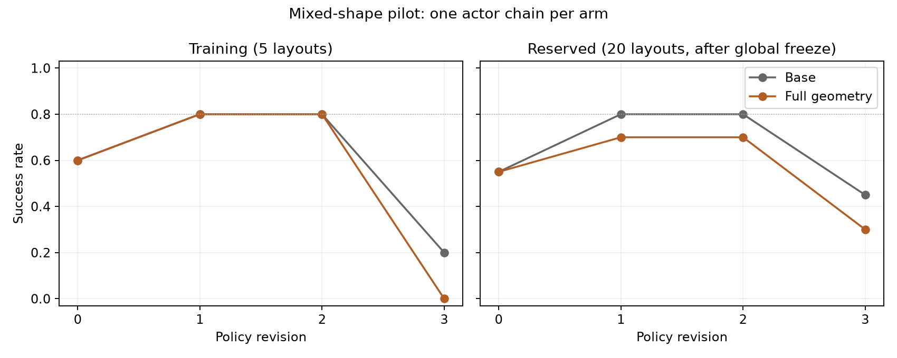

# Target-only geometry abstraction: completed pilot

This pilot does **not** demonstrate higher reserved success in fewer policy revisions.
The training-selected Base policy achieves **16/20 (80%)**, versus **14/20 (70%)** for
Full geometry. Both selected versions are R1. Base reaches the registered 80% reserved
threshold at R1; Full geometry never reaches it in this run.

| Revision | Base training /5 | Full training /5 | Base reserved /20 | Full reserved /20 |
|---|---:|---:|---:|---:|
| R0 | 3 | 3 | 11 | 11 |
| R1 | 4 | 4 | 16 | 14 |
| R2 | 4 | 4 | 16 | 14 |
| R3 | 1 | 0 | 9 | 6 |

The selected paired outcomes are 14 shared successes, two Base-only successes,
zero Full-only successes and four shared failures. The exploratory exact unadjusted
McNemar p-value is 0.5. There is one independent actor chain per arm; this is neither
a replicated advantage nor proof that geometric abstraction is generally harmful.
The selected Wilson 95% intervals are approximately 58.4–91.9% for Base and 48.1–85.5%
for Full geometry, conditional on these selected policies and sampled layouts.

Mean reserved SR over R0–R3 is 65% for Base and 56.25% for Full geometry. The registered
secondary rule that retains the highest training SR available at each budget produces
Base [55%,80%,80%,80%] and Full [55%,70%,70%,70%]. This is a budget summary of existing
versions, not an additional evolution run with a different parent-selection mechanism.
The R3 regressions remain in the primary curves.



## What was tested

Both arms use the same CPU mixed RGB-D observer, public initial orientation context
and PnP executor. Base already receives useful surface geometry. Full additionally
receives rigid fields, symbolic references/operators and compact per-step geometry
records. This is an added-abstraction package comparison, **not geometry versus no
geometric information**. R0 physical trajectories match exactly.

All feedback records concern the current object; no global scene snapshots appeared
in the evolved policies' recorded feedback. Geometry checkpoint median sizes across
R1–R3 are 356, 362 and 363 characters, compared with Base's 681, 682 and 681.5.
Completed-generation input tokens are:

| Revision | Base input tokens | Full input tokens |
|---|---:|---:|
| R1 | 21,483 | 21,110 |
| R2 | 25,648 | 24,773 |
| R3 | 27,356 | 26,227 |

The input footprint is now comparable. This does not establish reasoning acceleration:
each generation still receives eight training images, and output length, code and
reasoning differ. This pilot does not measure fewer VLM image checks. The earlier
96.5% global-to-focused record reduction was an offline projection of matching
checkpoints, not an SR or latency experiment.

The generated Full policies use checkpoints and measured geometric fields. Static
source inspection finds no calls to the supplied reference/relation/alignment
operators in R1–R3; that is a code-use observation, not evidence about what the model
internally used from its text feedback. It suggests the richer operator interface
was not directly exercised by this high-level planner on this task.

## Validity and preserved correction

The final independent audit verifies **200 valid rollouts, zero invalid slots, six
exact completed actor contexts**, frozen source/library hashes, training-only
selection and freezing all eight candidate versions before reserved execution.
The corrected root is `outputs/geometry_step_learning_pilot_01_corrected`.

Its predecessor is preserved as `outputs/geometry_step_learning_pilot_01`, withdrawn
for a host validator defect: a local object variable named `load` was mistaken for a
file-loading operation. The correction changed only host name validation, not a
submitted policy, observer or controller. It retained 25 valid trials, four complete
actor outputs and 2703 files byte-for-byte; five old invalid slots remain in the
withdrawn parent. Two in-progress R3 invocations were interrupted before completion.
Thus accounting is **six completed retained/new generations plus two interrupted
attempts**, not six total attempts. No reserved outcome was available at correction.

The training-only R3 diagnosis was recorded before inspecting reserved outcomes.
Both policies added a cap relocation before building. All ten R3 training trials
first picked that cap; new placement/perception failures followed. This explains
observed failure stages, not a causal effect of the representation.

## Interpretation and next method work

A smaller state is now implemented and exercised, but the desired learning benefit
remains unproven. Adding more global state is not supported by these results.
The next method work should make a small active-object record useful for action
reasoning: distinguish unavailable evidence from another object's failure, connect
object points to robot geometry, and test explicit conditional changes separately
from current observations. Merely exposing more fields or unused operators is
insufficient evidence of a useful abstraction.

Independent development probes already test two bounded ideas: per-object unknown
initialization and a held-center prediction in the tool frame. They are separate
from this learning comparison and demonstrate no task-SR gain. Their limitations
and evidence are in [the state research notes](GEOMETRIC_STATE_RESEARCH.md).
Both this negative pilot and the preceding inconclusive larger-state pilot remain
part of the research evidence; their different seeds/actor histories preclude a
causal before/after SR comparison of state size.

Artifacts: [protocol and correction](GEOMETRY_STEP_LEARNING_PROTOCOL.md),
[complete audit](evaluations/geometry_step_learning_pilot_01_corrected.json),
[withdrawn parent audit](evaluations/geometry_step_learning_pilot_01.json).
Reproduce against the registered runtime snapshot:

```sh
PYTHONPATH=outputs/geometry_step_learning_pilot_01_corrected/source_snapshot/scripts:scripts \
  OPENBLAS_NUM_THREADS=1 OMP_NUM_THREADS=1 .venv/bin/python \
  -m summarize_geometry_step_experiment \
  --root outputs/geometry_step_learning_pilot_01_corrected \
  --output docs/evaluations/geometry_step_learning_pilot_01_corrected.json \
  --figure docs/media/geometry_step_learning_pilot_01_corrected.png
```
