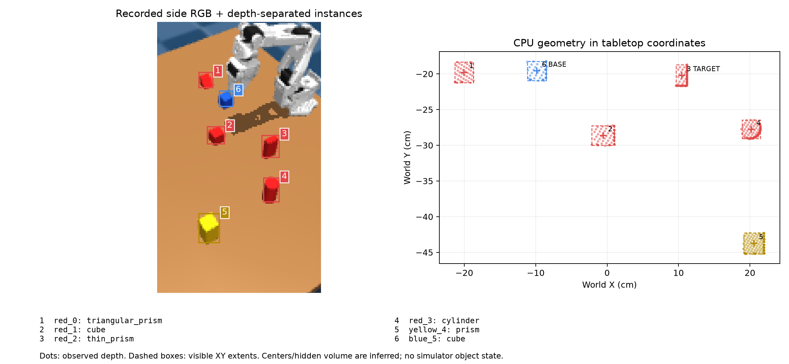
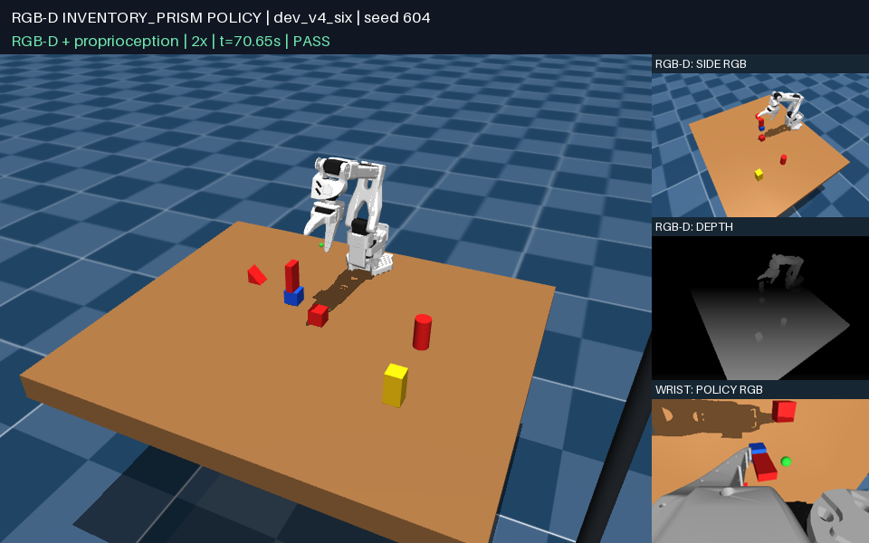

# CPU 多实例几何策略：新积木库实验

`policies/stack_inventory_cpu.py` 在冻结后的 80 个新场景中通过 **78/80**：
6 物体 **50/50**，10 物体 **19/20**，2 物体 **9/10**。
任务仍是把**红色 1.5 × 3 × 6 cm 细长条竖直放在蓝色 3 cm cube 上**。
其他物体从五种形状 × 红黄蓝绿的 20 物体库抽样。

策略的感知、跟踪、规划与控制使用 **NumPy/SciPy CPU**；仿真和图像渲染继续使用 EGL/GPU。
这是几何感知与 code-as-policy 的改进，没有训练或调用 GPU 神经网络。

## 实验结果

| 场景 | 旧颜色绑定策略，开发集 | 新 CPU 策略，开发集 | 新 CPU 策略，冻结后预留集 |
| --- | --- | --- | --- |
| 2 物体 | 10/10 | 10/10 | **9/10**，701–710 |
| 6 物体 | 6/20 | **19/20** | **50/50**，701–750 |
| 10 物体 | 0/10 | **9/10** | **19/20**，701–720 |

开发集为六物体 601–620、两/十物体 601–610；预留种子在开发时声明，
源码冻结后才运行，未根据预留结果调整策略。旧策略仅在相同开发集上比较，
其[原始结果](INVENTORY_TRANSFER.md)保持不变。
物体数量改变会改变生成器的随机数消耗，因此相同种子跨密度组的目标位置并不相同；
这些不是固定位置、只增加障碍物的配对实验。

冻结源码 SHA-256：

```text
20613dbf213444f77aac9fdcbdf2b6245d249e0770ab362121e5663e4e53394b
```

成功由私有评估器检查正确目标身份、底座/桌面与目标/底座接触、支撑余量、
长轴偏离竖直不超过 8°、机器人退出、干扰物接触和最终 5 秒稳定性。
停止、错误物体堆叠或不稳定放置都计为失败。

## 几何抽象如何参与决策

1. 标定 RGB-D 反投影出可见点云，并从桌面像素拟合支撑平面。
2. 在每种颜色内部按三维深度连续性分开实例。同色物体不再共享一个动作目标。
3. 利用可见尺寸比例、表面法向的平面性/曲率和斜面证据，在五种形状假设间选择；
   证据不足时输出 `unknown`。尺寸来自图像，未读取场景 catalog 的物体尺寸。
4. 为实例建立持久 ID，以颜色和有界空间距离匹配；歧义匹配不接管旧 ID。
   抓起后用最近一次视觉位置和机器人运动预测位置，再由新图像修正。
   被夹爪遮挡后的窄面可以更新已知实例，但不能单凭这类碎片建立新物体身份。
5. 把任务绑定为一个红色 `thin_prism` ID 和一个蓝色 `cube` ID。
   后续定位、抓取、清障、停车与避障均使用 ID；底座和目标的其他同色物体仍是障碍物。
6. 对选定实例的独立 RGB-D mask 拟合 box/cube 面、质心和推断顶点。
   抓取高度还使用图像中的夹爪表面几何；放置使用底面间隙和支撑余量闭环修正。
   清障时要求停车点有实际桌面深度观测，遮挡区域不当作已确认的空位。

初始检测阶段的包围盒中心只是位置摘要；cube/cuboid 的实体质心和顶点来自后续几何模型。
隐藏顶点始终是推断值。部分遮挡时只更新可观测方向，未见方向由最近视觉位姿和机器人运动传播，
并检查其与新深度的一致性。完全遮挡仍可能导致停止。

### 真实记录：同一场景内四个红色物体

下面直接处理六物体 seed 604 的 `camera_001.npz`，没有使用模拟器分割 ID 或物体位姿。
红色三棱柱、cube、细长条和圆柱分别成为 `red_0`–`red_3`，仅 `red_2` 被选为目标。
右侧点为观测深度，虚线为可见 XY 范围，十字为推断的位置摘要。



旧策略在这个场景里把红色圆柱放到了蓝色 cube 上。
新策略选择并堆叠了正确的红色细长条：



[正确目标堆叠回放，六物体 seed 604](media/inventory_cpu_604.mp4) ·
[清走黄色长条后堆叠，十物体 seed 603](media/inventory_cpu_clear_603.mp4)

回放恢复保存的实际物理状态，不是生成的示意动画。
大幅外部视角用于观看，策略输入仍只有侧面 RGB-D 和腕部 RGB。

## 感知与 CPU 测量

离线审计预留场景的 80 张初始图像：

- 520 个物体全部检测到，无额外实例；**516/520** 形状分类正确。
- 3 个黄色圆柱被分为长条，1 个黄色圆柱输出 `unknown`。
- **80/80** 场景都正确且唯一地绑定了目标细长条和底座 cube。

这些是初始图像的结果，不是整段轨迹每一帧的识别率。
审计脚本用私有 trace 做离线标签匹配；这些标签不会传入策略。

在 **Intel Core i9-14900K** 上，BLAS/OMP 各限制为一个线程。
将 80 张图像预加载，预热后各运行 3 次：

| CPU 测量 | p50 | p95 |
| --- | --- | --- |
| 每张 RGB-D 的桌面拟合、实例分离和形状识别 | **30.6 ms** | **44.4 ms** |
| 六物体完整策略 episode 的累计 CPU 计算 | **3.57 s** | **4.66 s** |
| 十物体完整策略 episode 的累计 CPU 计算 | **4.42 s** | **6.54 s** |

第一行不含渲染、文件加载、跟踪、servo 和 IK，也不能等同于完整控制频率。
后两行是 worker 的 `process_time`，包含源码编译/数值库导入、感知、跟踪和策略逻辑，
扣除了 RPC 序列化/等待；不含 worker 自身启动/预导入 NumPy、模拟器、渲染或宿主 IK。
机器人 IK 单独统计，六/十物体整段 episode 的 CPU 中位数分别约 **0.103/0.098 s**。
这些是本机 CPU 数据，没有低功耗设备上的性能保证。

策略候选源码只允许数值库导入，在 Linux `bwrap` 中运行，看不到 GPU 设备；
测试还检查 `/dev/nvidia0` 和 `/dev/dri` 不可见。
宿主的 MuJoCo/EGL/GPU 使用与策略计算分开，未改成 CPU 渲染。

## 剩余失败与适用范围

冻结预留集的两例失败：

- 两物体 seed 703：放置置信度不足，返回原位后重试遇到不可达姿态。
- 十物体 seed 704：清障后的再次抓取发生顶面遮挡，无法继续视觉确认。

开发集仍有两例失败：六物体 seed 620 的顶面遮挡，以及十物体 seed 602 达到 600 次 RPC 上限。
最后一例是 runner 终止，未产生完整 worker CPU profile；其余最终 119/120 条任务试验有该 profile。
保留了原有 **600 次调用 / 120 秒超时**，未放宽限制来提高成功率。

当前针对初始直立、零 yaw、固定四种颜色的场景。最多清理两个障碍物；
三棱柱可以识别并避让，但尚未实现它的清障抓取。
形状分数是几何假设选择分数，不是校准过的概率。
接触融合、严重遮挡、任意翻转与光照变化仍需额外评估。
少物体不必然更容易：不同密度组位置不同，不能据此声称密度增加提高了成功率。

## 输入边界与验证

执行时只提供：侧面 RGB-D、腕部 RGB、相机标定、机器人关节/工具状态和机器人自身模型的 IK 预览。
不提供物体真值位置、尺寸、模拟器 segmentation ID、接触信息、场景 catalog 或评估结果。
开发诊断和离线评估可读取私有轨迹；其结果不作为在线动作输入。

完整传感器 blackout：**0 个运动指令、0 秒策略仿真运动**。
历史六物体 prism seed 405 仍通过，旧策略源码 hash 未改变。
测试套件 **57 通过、1 个平台相关跳过**，覆盖深度分离、同色实例、运动关联、歧义拒绝、
窄面更新、缺失目标、生成源码一致性、输入隔离和 CPU 时间排除 RPC 等待。

[可移植逐场景记录、源码 hash、CPU 数据和离线审计](evaluations/inventory_cpu.json)
包含所有最终开发/预留试验、失败说明及诊断。完整本地帧、RPC、物理状态和日志在
`outputs/cpu_instances_01/`。

## 运行与复现

```bash
# 在线策略运行；仿真保留 EGL 渲染。
MUJOCO_GL=egl OPENBLAS_NUM_THREADS=1 OMP_NUM_THREADS=1 \
  uv run python scripts/run_vision_trial.py \
  --task inventory_prism --layout sampled --object-count 6 --seed 701 \
  --candidate policies/stack_inventory_cpu.py --output outputs/cpu_trial_701

# 执行后观看实际回放。
uv run python view_scene.py --vision-task inventory_prism --object-count 10 \
  --seed 603 --vision-policy policies/stack_inventory_cpu.py \
  --vision-output outputs/cpu_clear_view_603

# 从真实记录生成几何图，不读物体标签。
uv run python scripts/inspect_instances.py \
  --frame outputs/cpu_trial_701/camera_001.npz --output outputs/cpu_overlay_701

# 离线审计（这一步才读取 evaluator 的 trace 标签）。
OPENBLAS_NUM_THREADS=1 OMP_NUM_THREADS=1 \
  uv run python scripts/audit_inventory_perception.py \
  --trials outputs/cpu_instances_01/reserved_six \
           outputs/cpu_instances_01/reserved_two \
           outputs/cpu_instances_01/reserved_ten \
  --output outputs/cpu_audit.json

# 源码维护：修改可复用模块，再生成隔离执行的纯数值脚本。
uv run python scripts/build_inventory_policy.py --output policies/stack_inventory_cpu.py
MUJOCO_GL=egl uv run python -m unittest discover -s tests
```

可复用实现为 `src/aspire_so100/instance_geometry.py` 和 `inventory_policy.py`；
`scripts/build_inventory_policy.py` 把它们与 cube/cuboid/gripper 几何一起打包，
使隔离 worker 无需读取仓库或导入仿真包。
