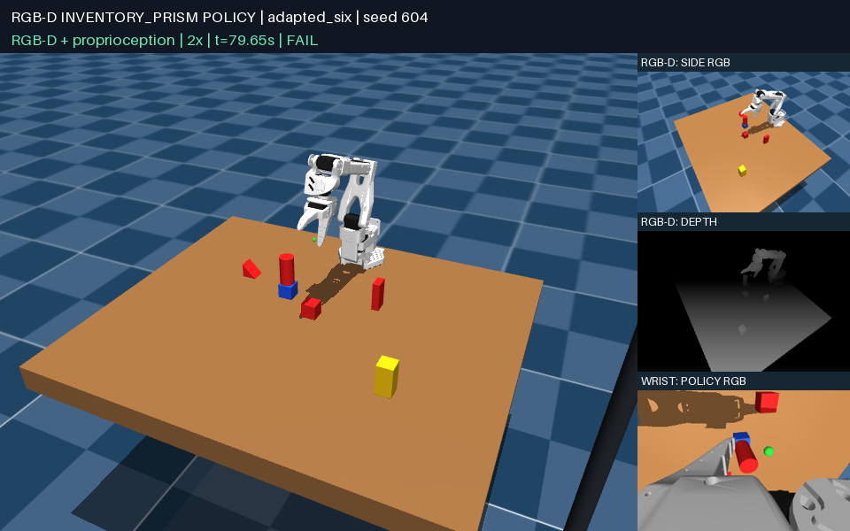

# Existing policy on the new four-color shape library

The existing policy does **not** transfer reliably to the new setting.
Its object identity model is based primarily on color, whereas the new library
contains five different shapes of each color. These are transfer tests, with
no policy training or motion-parameter tuning from the results.

The task is to place the **red 1.5 × 3 × 6 cm slender prism upright on the blue
3 cm cube**. Required objects come from the task-conditioned generator;
remaining objects are sampled from the 20-object library.

| Candidate | Objects in scene | Seeds | Success |
| --- | --- | --- | --- |
| Published policy, unchanged | 6 | 601–605 | **0/5** |
| Color-binding diagnostic | 2, target + base only | 601–610 | **10/10** |
| Color-binding diagnostic | 6 | 601–620 | **6/20 (30%)** |
| Color-binding diagnostic | 10 | 601–610 | **0/10** |

The unchanged source searches for a purple target, absent from the new library,
and stops with `No visible purple block.` in every trial. Its SHA-256 remains
`b0b426b7f3c777f663297e4599a221f329819b7c54073d4f38a9b0f0c828b2df`.

The [diagnostic source](evaluations/inventory_color_binding_only.py) changes
target binding from purple to red, old red distractor binding to yellow,
corresponding RGB masks, and footprint enumeration to the four current colors.
The motion controller, geometric assumptions, and task-solving logic are
unchanged. It is a frozen diagnostic artifact, not a promoted replacement policy.
Its SHA-256 is
`34a2f9ad33678c0e2c1b01c64d50b64e5b660bd37b0cb43ec10071d3c6529040`.

Both sources and the seed sets were fixed before evaluation. The two-object
and ten-object sets reuse seed numbers, but object count changes the generator's
random draws and hence target poses. This is not a paired experiment that holds
all poses constant while adding distractors.

## What fails

Within the six-object set, four layouts have no additional red or blue object;
all four pass. Sixteen have at least one additional red or blue object; only
two pass. This supports an instance-selection problem in these samples, rather
than a conclusion that the new task is physically impossible.

The policy selects a colored image component before resolving the shape.
It can select a red cylinder or wide prism as the target, or treat a tall blue
prism as a cube. In seed 606, for example, it reports approximately 6 cm cube
dimensions for a blue object although the required blue cube is 3 cm. Some
unreachable-motion stops occur after selecting an unintended distant object.
Triangle faces and multiple same-color objects also violate assumptions in the
old cube/rectangular-prism geometry pipeline.

Seed **604** is a concrete wrong-object example: the controller places the
**red cylinder** on the blue cube and leaves the required slender prism on the
table. The private evaluator correctly marks this as a failure.



[Failure replay: wrong red object, seed 604](media/inventory_transfer_604.mp4) ·
[Successful six-object replay, seed 601](media/inventory_transfer_601.mp4)

These videos restore actual recorded simulation states. The large external
camera view is for the viewer; the policy uses the side RGB-D and wrist RGB.

## Evaluation boundary and verification

The new `inventory_prism` runner constructs the sampled scene for its seed and
object count, then uses the same isolated sensor RPC. The actor receives only
side RGB-D, wrist RGB, camera calibration, and robot proprioception/robot-only
IK previews. No object poses, simulator dimensions, contact data, scene metadata,
or evaluator status are returned during execution.

The private evaluator checks the specific `red_thin_prism` and `blue_cube`
identities, long-axis verticality within 8 degrees, support contacts/margin,
robot withdrawal, distractor contact, and five seconds of stability. Stacking
another red object does not count. New metadata saves the sampled identities
and their order; replay rejects a generator mismatch even when state width
happens to match.

All 45 transfer trials completed without worker errors. Controlled stops and
wrong-object stacks still count as task failures. The color-binding diagnostic
issued zero motion commands under full sensor blackout. The unchanged policy
still passed historical six-object seed 405 after the evaluator integration.
The test suite passed 47 tests with one platform-specific skip, including an
explicit wrong-red-cylinder rejection test.

The [portable manifest](evaluations/inventory_transfer.json) records all trials,
source hashes, sampled identities, notes, private evaluation reasons, and sensor
audits. Full local camera frames, calls, physics states, and trial logs are in
`outputs/inventory_transfer_01/`.

## Reproduce

```bash
# Test the unchanged production policy in the new scene.
MUJOCO_GL=egl uv run python scripts/run_vision_trial.py \
  --task inventory_prism --layout sampled --object-count 6 --seed 601 \
  --candidate policies/stack_prism_upright_visual.py \
  --output outputs/inventory_original_601

# Run the frozen color-binding diagnostic, then open its physical replay.
uv run python view_scene.py --vision-task inventory_prism --object-count 6 \
  --seed 604 --vision-policy docs/evaluations/inventory_color_binding_only.py \
  --vision-output outputs/inventory_probe_604
```

The next policy change should resolve **color + shape + object instance** before
grasping, track that selected instance through occlusion, and use shape-specific
geometry for both the target and distractors. The old success rate of 94% applies
to its original six-object scene, not to the new sampled library.
