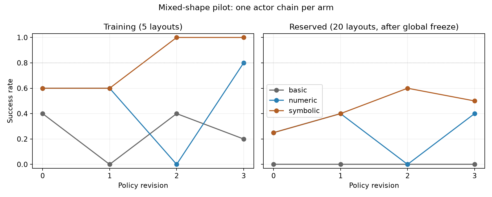

# Mixed-shape geometry learning pilot: completed results

The symbolic interface produced a promising learning curve in one matched actor
chain, but this pilot does not establish a repeatable policy-learning advantage.
The training-selected symbolic policy succeeds on 12/20 reserved layouts after
two revisions; the numeric policy succeeds on 8/20 after three revisions. Their
paired comparison is inconclusive (exact McNemar p = 0.125, unadjusted).

## Experiment

The task is a low-rise bridge: two cube foundations, a horizontal thin rectangular
prism, and a cylinder above it. Colors are unique and permuted across layouts.
All arms start from the same generic support-graph starter and use the same frozen
PnP motion executor. Runtime perception and control run on CPU; simulation may use
GPU rendering. Policy inputs exclude simulator object poses, dimensions, contacts,
and evaluator state.

- **Basic:** historical RGB-D visible-top estimates and a freshness-aware surface packet.
- **Numeric:** mixed rigid RGB-D estimates, metric geometry, availability, observation history, and separate desired poses.
- **Symbolic:** the same numeric observer and executor, plus typed geometric references, relations, desired alignment, and symbolic feedback serialization.

Basic versus numeric measures a combined perception/state package change. Only
numeric versus symbolic isolates the additional reasoning interface. All actors
receive RGB/depth examples, so this is not a vision-versus-text comparison.

Each arm has one model-generation chain, three revisions, five training layouts
(seeds 76001–76005), and twenty reserved layouts (77001–77020). R0 is the starter.
The actor is gpt-6-astra with high reasoning effort and external tools disabled.
All twelve policy versions were frozen before any reserved evaluation. Selection
uses the highest training success count, with the earliest revision breaking ties.
Reserved feedback never enters policy evolution. Revision and rollout budgets are
matched; token consumption is recorded but not equalized.

## Complete curves

| Arm | Training successes R0, R1, R2, R3 (each /5) | Reserved SR R0 | R1 | R2 | R3 | Training-selected policy |
|---|---|---:|---:|---:|---:|---|
| Basic | 2, 0, 2, 1 | 0% | 0% | 0% | 0% | R0: 0/20 |
| Numeric | 3, 3, 0, 4 | 25% | 40% | 0% | 40% | R3: 8/20 |
| Symbolic | 3, 3, 5, 5 | 25% | 40% | 60% | 50% | R2: 12/20 |



Symbolic first reaches 80% training SR at R2; numeric at R3; basic never does.
**No arm reaches 80% reserved SR.** The regressions at numeric R2 and symbolic R3
are retained. Mean reserved SR over the four revisions is 0%, 26.25%, and 43.75%,
respectively. These are correlated versions on twenty common layouts, not eighty
independent trials per arm.

For the training-selected policies, the 95% Wilson intervals are basic
[0.0%, 16.1%], numeric [21.9%, 61.3%], and symbolic [38.7%, 78.1%]. Symbolic succeeds
on all eight numeric-success layouts and four additional layouts. The paired
p = 0.125 is conditional on these fixed policies; it does not quantify variation
across independently generated actor chains. The selected basic-versus-numeric
contrast has p = 0.0078125, but it cannot establish a symbolic reasoning benefit
because the observer implementation also changes.

## Integrity and limitations

The final campaign contains **300 valid rollout records**: 60 training and 240
reserved, with zero invalid slots. The full offline audit passes source/library
hashes, exact generated candidates, model isolation, initial scene pairing across
25 seeds, training-only selection, all per-seed results, and global freeze ordering.

Two infrastructure defects were corrected before reserved evaluation: an import
validator incorrectly rejected an allowed SciPy name, and direct observations
could omit a documented cylinder field. Withdrawn runs and outputs remain intact.
For the schema repair, all thirty R0/R1 paired records preserved physics and
projected feedback; six retained model contexts were byte-identical, including
attached images. Three R3 calls were replaced before executing their original
policies. Service accounting is **twelve actual calls: nine retained and three
discarded**, not nine calls or an additional independent replication. See the
[protocol and correction lineage](MIXED_SCENE_LEARNING_PROTOCOL.md).

The symbolic candidates do not explicitly call reference/relation/align/text
helpers. They do receive symbolic facts in actor feedback and use state/target
interfaces. Static call counts therefore cannot establish whether the model used
those facts, nor attribute the improvement to a particular abstraction component.
The earlier replicated cube study remains negative for iteration efficiency; this
mixed-shape pilot does not supersede that evidence.

Twenty-three related interface/harness/audit tests passed after the schema repair.
The independent checkpoint-difference prototype passed four tests. That prototype
was not included in the frozen campaign and has no measured SR benefit.

## State-system finding and next controlled question

A separate training-only diagnostic found fifteen action-spanning estimated center
changes above 10 mm, while all corresponding latest-internal-observation changes
were below 1 mm. The two differences describe different time intervals. This
supports exposing an explicit reasoning-checkpoint difference alongside the
current estimate, rather than interpreting the latest observation delta as an
action effect. Missing endpoints remain unknown; desired and predicted poses stay
separate from measurements. See [checkpoint memory](GEOMETRY_CHECKPOINT_MEMORY.md).

The next learning comparison should replicate numeric versus symbolic with the
current method frozen, new training and reserved layouts, and independent actor
chains. Do not tune against these twenty inspected reserved layouts. Evaluate
checkpoint memory as a separate ablation after its interface is frozen, so that
its effect is not mixed with the representation comparison. This pilot supports
that follow-up question; it does not yet satisfy the broader learning-benefit goal.

## Artifacts and reproduction

- Final campaign: `outputs/mixed_scene_learning_pilot_01_schema_corrected`.
- [Machine-readable results and audit](evaluations/mixed_scene_learning_pilot_01.json).
- [Learning-curve figure](media/mixed_scene_learning_pilot_01.png).
- [Frozen protocol](MIXED_SCENE_LEARNING_PROTOCOL.md).

Rebuild the report and figure from archived results without model or simulation calls:

```bash
OPENBLAS_NUM_THREADS=1 OMP_NUM_THREADS=1 .venv/bin/python \
  scripts/summarize_mixed_scene_learning.py \
  --root outputs/mixed_scene_learning_pilot_01_schema_corrected \
  --output docs/evaluations/mixed_scene_learning_pilot_01.json \
  --figure docs/media/mixed_scene_learning_pilot_01.png
```
