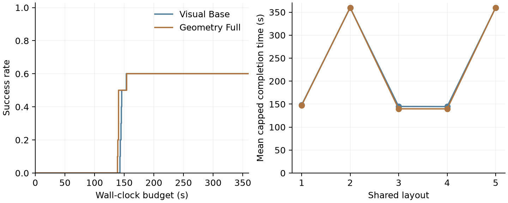

# Online bridge-tower pilot results

The registered pilot completed all 20 episodes and passed an independent evidence
audit. Visual Base and Geometry Full each succeeded in 6 of 10 episodes. Full used
fewer image attachments and slightly less time on average, but this pilot does
not demonstrate improved final success or a substantial end-to-end speed gain.
The independent scene sample is five layouts, each repeated twice per arm.

## Design and execution

The task composes a two-foundation bridge with two cubes stacked at the beam's
center. Both arms receive the same adapted, training-selected bridge and stacking
skills, clearing primitive, public goal, initial images and model routing. Astra
with medium reasoning handles initial planning and replanning; Luna with low
reasoning handles routine decisions in the same persistent conversation. Full
receives compact geometric text by default; Base receives current RGB and
qualitative skill feedback. Both can request additional RGB-D observations.

Each episode permits one initial reset and then continues from action outcomes
until verified success or a 360-second wall-clock deadline. Simulation advances
during model waits and actions are paced at real time. The private common
success monitor requires the full structure to remain stable for five simulated
seconds, with object displacement within 3 mm of the interval's start. Evaluator
state is not supplied to either agent or its skills.

All runtime choices were frozen after development. Five reserved layouts
(2028101001–2028101005) were run twice per arm, sequentially with balanced order.
There were no infrastructure failures, retries, or timing-limit violations. The
largest recorded simulation lag was 0.6444 seconds, below the registered
2-second threshold. Campaign wall time was 4625.73 seconds (77.10 minutes).

See the [protocol and implementation description](ONLINE_BRIDGE_TOWER_PILOT.md).

## Outcomes and timing

| Measurement | Visual Base | Geometry Full |
| --- | ---: | ---: |
| Success within 360 s | 6/10 | 6/10 |
| Mean capped completion time | 231.54 s | 229.33 s |
| Mean completion time among successful episodes only | 145.90 s | 142.22 s |
| Median feedback-to-dispatch latency | 5.18 s | 4.91 s |
| Dispatched decisions | 113 | 103 |
| Model request attempts | 122 | 112 |
| Model-wait time, including interrupted requests | 696.14 s | 610.56 s |
| Completed Astra requests: count / median latency | 39 / 7.29 s | 38 / 7.66 s |
| Completed Luna requests: count / median latency | 74 / 4.22 s | 65 / 4.03 s |

Capped completion time assigns every timeout the full 360 seconds. Full's mean
is 2.21 seconds lower (0.95%). The success-conditioned mean is a separate,
conditional statistic. Model latency summaries pool decisions with different
histories and recovery needs; they are not matched-request causal comparisons.
The Astra/Luna comparison likewise does not isolate model speed because routing
assigns them different types of decisions.

**Figure.** Left: fraction of episodes reaching verified task success within each
wall-clock budget. Right: mean capped completion time for each shared layout,
averaging its two repetitions per arm. Both arms reach 60% success by 155 seconds
and remain there through the 360-second deadline. Layout indices follow seed
order. Curves summarize 10 episodes per arm across five distinct layouts.
[Vector PDF](media/online_bridge_tower_pilot.pdf) and
[figure provenance](media/online_bridge_tower_pilot.json) are available.

| Layout seed | Base successes | Full successes | Base capped mean | Full capped mean |
| --- | ---: | ---: | ---: | ---: |
| 2028101001 | 2/2 | 2/2 | 148.20 s | 147.24 s |
| 2028101002 | 0/2 | 0/2 | 360.00 s | 360.00 s |
| 2028101003 | 2/2 | 2/2 | 144.90 s | 139.77 s |
| 2028101004 | 2/2 | 2/2 | 144.62 s | 139.64 s |
| 2028101005 | 0/2 | 0/2 | 360.00 s | 360.00 s |

The paired success difference is zero on every layout. On the successful layouts,
Full used four dispatched decisions per episode and Base used five. Full's
feedback allowed it to skip an already satisfied foundation placement. Base's
shared skill also checks completed placements, so its extra call can return
without a physical pick/place. This limits the time saved by skipping that call.
There is no evidence here for a large or statistically established speedup.

## Images, tokens and local sensing

| Measurement | Visual Base | Geometry Full |
| --- | ---: | ---: |
| Newly attached images across all attempts | 168 | 72 |
| Local camera acquisitions | 1473 | 2000 |
| Completed-request input tokens, including cache | 3,519,283 | 3,405,013 |
| Cached input tokens, included above | 2,892,544 | 2,764,032 |
| Uncached input tokens, completed requests | 626,739 | 640,981 |
| Completed-request output tokens | 10,575 | 8,680 |
| Requests without final usage receipts | 9 | 9 |

Full reduced newly attached images by 57.1%. This is an attachment count, not a
claim about image-token costs. Full made more local camera acquisitions because
it also refreshed geometry for agent feedback. Local acquisition time totaled
8.81 seconds for Base and 12.20 seconds for Full; these timers do not include
all geometric fitting work. Initialization plus initial feedback took 8.55 and
19.09 seconds respectively across the ten episodes in each arm.

The token table covers completed requests only. Each arm had nine interrupted
requests: six interrupted when the physical success monitor fired and three at
the episode deadline. Their final token usage is unavailable. Raw attempt logs
and elapsed waits are preserved; missing usage is not treated as zero. These
numbers therefore do not establish a complete token-cost reduction. In
particular, Full's uncached input total is slightly higher among completed
requests despite its lower total input count. Cached input is already included
in input tokens and must not be added again.

## Recovery behavior and limits

Both arms continued after unsuccessful actions without resetting the scene.
Traces contain observation requests, replanning, clearing, gripper release and
repeated skill attempts. Layouts 2028101002 and 2028101005 timed out in both
repetitions for both arms. Thus the reserved pilot does not demonstrate successful
recovery on these difficult layouts.

On layout 2028101002, traces include missing current object poses, unavailable
support geometry and clearing attempts rejected for unavailable geometry. Some
later bridge attempts returned unconfirmed quickly. On layout 2028101005,
clearing and reconstruction could continue, but grasp/placement confirmation and
sustained whole-structure success remained problematic. A `visually_consistent`
skill result was not promoted to task success. These are trace-level descriptions;
they do not identify a single root cause or establish identical failure states
between arms.

Separate development evidence did establish continuous recovery: on development
layout 2028100102, Base succeeded in 339.47 seconds and Full in 316.57 seconds after
clearing and rebuilding. Those runs informed development and are not reserved
results. Natural failure subsets are not fair paired recovery trials because the
agents reach different intermediate states. All episodes remain in the primary
paired outcome and time statistics.

For subsequent development, the observed constraints suggest improving shared
recovery feasibility and current-pose acquisition before expecting a large benefit
from faster reasoning. A separate experiment with matched partial-assembly starts
could isolate recovery decisions; a controlled fixed-decision replay could
isolate model-input latency. Neither diagnostic was run here. This pilot remains
unchanged, and any further tuning requires a new development/evaluation split.

## Evidence and verification

The study root is `outputs/online_bridge_tower_01`. Its `protocol.json` and
`protocol.sha256` freeze runtime sources/assets, package/client versions, shared
skills, model settings, seeds, order and timing. `audit.json` passed for all 20
episodes. The audit verifies prompt/image provenance, model routing, persistent
history, token-counter increments, simulation advance during requests, distinct
conversations across episodes, paired initial physics states, shared skill/source
hashes and success evidence. The stored `summary.json` was independently
recomputed from raw results and matched exactly. Figure assets were visually
inspected and copied byte-for-byte with hashes recorded in their provenance.

Every episode retains feedback, dispatches, completed actions, skill outcomes,
model invocations, archived conversation evidence, token receipts and its result.
The audit establishes implementation and accounting consistency within these
checks; it does not make five layouts a large-sample efficacy study.

## Related single-policy budget reduction

The three-cube single-policy study completed its separate compact evaluation:
800 slots covering all R0–R3 policies, five paired training chains and the first
20 registered reserved layouts. This replaced the original 4000-slot evaluation,
saving 3200 reserved rollouts (80%) without weakening Base or selecting layouts
using test outcomes. Training remained 200 rollouts and 30 model generations.

Training-retained success rates at R0/R1/R2/R3 were 0/48/70/74% for Base and
0/62/72/72% for Full. Full improved earlier, but did not outperform Base at the
last retained revision. See the [three-cube study](THREE_CUBE_GEOMETRY_STUDY.md)
for the raw curves, selection rule and separate accounting correction.

## Later contact-audit limitation

Subsequent development found that the registered contact helper can miss unnamed
robot collision meshes because it matches geometry names. A body-ancestry check
detected a jaw-housing collision on a separate development failure. The success
counts above remain results under the registered evaluator; archived terminal
physics is insufficient to retrospectively certify them with the corrected check.
This finding does not establish that any recorded success was false. See the
[development diagnosis and correction](ONLINE_REASONING_STATE_DEVELOPMENT.md).
Raw outcomes and source snapshots have not been rewritten.
