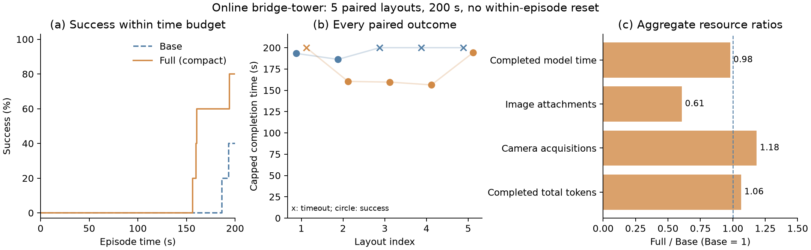

# Online geometric abstraction: five paired layouts at 200 seconds

Full completed 4/5 bridge-tower episodes within 200 seconds, compared with 2/5
for Base. Mean capped completion time was 174.13 seconds for Full and 195.91
seconds for Base, an 11.1% reduction. Full attached fewer images and submitted
fewer placements, but used more recorded tokens and did not have faster model
requests on average. These are exploratory results for the complete geometric
interface on five paired layouts, not a population-level guarantee.

The [registered comparison](ONLINE_COMPACT_TOWER_200_STUDY.md) completed all ten
slots with no replacements, retries or budget extensions. It uses ordinary
unassembled scenes, adapted bridge and stacking skills, explicit metric targets
and continuous execution without resetting after failures. Full uses compact
reference text; both arms share calibrated depth queries, images on request,
model routing and the physical controller. All final audits passed.

## Complete outcomes

| Seed | Base outcome / capped time | Full outcome / capped time | Full minus Base |
| --- | --- | --- | ---: |
| 2028105001 | Success, 193.27 s | Timeout, 200 s | +6.73 s |
| 2028105002 | Success, 186.27 s | Success, 160.43 s | -25.84 s |
| 2028105003 | Timeout, 200 s | Success, 159.62 s | -40.38 s |
| 2028105004 | Timeout, 200 s | Success, 156.32 s | -43.68 s |
| 2028105005 | Timeout, 200 s | Success, 194.27 s | -5.73 s |

Full succeeded where Base timed out on three layouts. Base succeeded where Full
timed out on one layout. Both succeeded on the remaining layout. The adverse
Full result is retained in every aggregate and figure.

| Metric | Base | Full (compact) |
| --- | ---: | ---: |
| Success within 200 s | 2/5 | 4/5 |
| Mean capped completion time, failure = 200 s | 195.91 s | 174.13 s |
| Completed model requests | 36 | 32 |
| Incomplete requests, usage unknown | 1 | 3 |
| Total completed model-request time | 230.96 s | 226.11 s |
| Mean completed request duration, request-weighted | 6.42 s | 7.07 s |
| Mean first request duration | 7.38 s | 9.05 s |
| Image attachments across attempted requests | 33 | 20 |
| Submitted placements, including interrupted attempts | 27 | 22 |
| Metric depth queries | 9 | 5 |
| Camera acquisitions | 561 | 664 |
| Accumulated action time | 731.11 s | 623.93 s |
| Input tokens, including cached input | 503,632 | 536,263 |
| Cached input tokens, already included above | 412,928 | 420,864 |
| Uncached input tokens | 90,704 | 115,399 |
| Output tokens | 3,348 | 2,792 |
| Total tokens from completed receipts | 506,980 | 539,055 |

Full used 39.4% fewer image attachments and 14.7% less accumulated action time.
Completed model-request time fell by only 2.1%, while recorded total tokens rose
by 6.3% and camera acquisitions rose by 18.4%. The shorter mean task time is
accompanied primarily by differences in action execution and action selection,
not faster individual model responses. These observations do not independently
identify the causal contribution of each component.

Token totals and model durations cover completed requests. Token use from four
interrupted requests remains unknown; it is not zero. Image counts include all
archived attempted invocations, including interrupted ones. Cached input is a
subset of input tokens. Camera acquisition, action and feedback timers can have
overlapping scopes and should not be added as independent wall-clock components.
No monetary saving is inferred from the token totals.



**Figure.** Online bridge-tower construction on five paired layouts with a common
200-second budget and one initial reset per episode. (a) Empirical success versus
elapsed time. (b) Every paired capped completion time; crosses indicate timeouts,
and circles indicate success. Connecting lines follow layout indices, not training
iterations. (c) Full/Base resource ratios. Model time and tokens cover completed
requests; image attachments include attempted requests. Unknown usage from
interrupted requests is excluded from those token subtotals and remains a reporting
limitation. See the [editable PDF](media/online_compact_tower_200.pdf),
[episode CSV](media/online_compact_tower_200.csv) and
[verified analysis JSON](media/online_compact_tower_200.json).

## Timing conditioned on success

The following post-hoc descriptive analysis includes only successful episodes.
Completion time still includes perception, model requests, physical actions and
settling; it is not physical-action time alone. Model time is the measured
end-to-end wall time of completed requests, including request waiting, rather
than isolated model compute time. These secondary summaries do not replace the
registered all-episode success rate and capped-time metrics above.

| Success-conditioned metric | Base | Full (compact) |
| --- | ---: | ---: |
| Successful episodes included | 2 | 4 |
| Mean total completion time | 189.77 s | 167.66 s |
| Median total completion time | 189.77 s | 160.02 s |
| Mean cumulative completed model-request time per successful episode | 45.84 s | 36.95 s |
| Completed model requests across the successful subset | 15 | 25 |
| Mean completed requests per successful episode | 7.50 | 6.25 |
| Mean duration per completed model request, request-weighted | 6.11 s | 5.91 s |
| Incomplete requests in successful episodes, excluded from model-time subtotal | 0 | 3 |

Within these success subsets, Full's mean total completion time was
22.11 seconds lower (11.7%). Its mean cumulative completed
model-request time per successful episode was 19.4% lower, while its mean
completed request was only 3.3% shorter. The larger per-episode model-time
difference is associated with fewer completed requests per successful episode
(7.50 versus 6.25), not a comparably large per-request speedup.
Total completed model-request time over the selected subsets was 91.68 seconds
for Base and 147.79 seconds for Full; those totals span different numbers of
episodes and must not be compared as equal-workload costs.

Base's successful seeds were 2028105001, 2028105002; Full's were
2028105002, 2028105003, 2028105004, 2028105005. Because success selects different layouts in the two
arms, the conditional means have selection bias and are not a paired estimate
of speed on a common subset. Full's three interrupted requests in these successful
episodes are absent from the completed-request timing totals, and their token
usage is unknown. Thus the reported model times are completed-request subtotals,
not complete model-wait costs.

### The jointly successful layout

Only seed 2028105002 succeeded in both arms:

| Matched metric | Base | Full (compact) |
| --- | ---: | ---: |
| Total completion time | 186.27 s | 160.43 s |
| Cumulative completed model-request time | 41.61 s | 36.12 s |
| Completed model requests | 6 | 6 |
| Incomplete requests | 0 | 1 |

Full finished 25.84 seconds earlier
(13.9%) on this layout. Its completed model-request subtotal
was 5.48 seconds lower (13.2%), but excludes one
interrupted request. One matched successful layout cannot establish a stable
paired timing advantage.

Across **all five layouts**, the mean completed request was longer for Full
(7.07 versus 6.42 seconds). Filtering to successes changes this direction
(5.91 versus 6.11 seconds). Report success-conditioned timing alongside success
rate and capped time; it does not support a claim that model requests are
universally faster with geometric text.

All numbers in this section are recomputed from `summary.json` by selecting
`records` with `success=true`. Episode means divide by the number of successful
episodes; request-weighted means divide summed `model_seconds` by summed
`completed_requests`. The matched comparison selects pairs where both
`base_success` and `full_success` are true. No episodes were rerun or relabeled.

## What the decisions show

On layouts 2028105002–2028105004, Full preserved one existing foundation and
submitted four placements. After positioning the second foundation and beam,
it requested an image and depth samples when the beam's top reference was
unavailable, then stacked the two upper cubes. These episodes finished between
156.32 and 160.43 seconds. Base moved both foundations on those layouts, and
one episode also repeated an unconfirmed placement. The traces demonstrate use
of current geometric references for choosing and parameterizing physical actions,
with explicit visual fallback rather than blind reliance on unavailable text.

On 2028105005, Full moved both foundations and completed all five placements,
reaching success at 194.27 seconds. Base spent two additional unsuccessful attempts
on its first foundation before recovering; it placed the first upper cube but
did not finish the tower within the budget. This comparison includes the actual
consequences of failure in the continuing scene rather than resetting them away.

On 2028105001, Full submitted fewer model requests but failed to finish its last
placement before timeout. Its completed model requests took 78.31 seconds in
total, versus 50.07 seconds for Base; several Full requests took roughly 13–20
seconds. Base succeeded at 193.27 seconds. We retain these waits as part of
real-time performance and cannot attribute them solely to the representation,
model reasoning or service variability from a single episode.

The representation package therefore showed a practical task-level advantage in
this small comparison, with a cost tradeoff. It does not establish that text
makes each reasoning step faster, that geometric references always improve
recovery, or that Full consumes fewer tokens than Base. The separate raw/compact
Full development pair measured a 6.7% token reduction within Full, which answers
a different question from the present Base/Full comparison.

## Paper-ready interpretation

> In an exploratory online composition experiment on five paired layouts, the
> geometric-reference agent completed four bridge-tower tasks within 200 seconds,
> compared with two for an image-and-depth-query agent sharing the same skills and
> actuator. Its mean capped completion time decreased by 11.1%, and it attached
> 39.4% fewer images. Decision traces show reuse of existing foundations and fewer
> placement attempts. Recorded token use increased, and mean per-request latency
> did not improve, suggesting that the observed benefit was expressed through
> physical decisions and execution rather than uniformly faster model inference.

Five layouts with one episode per condition are insufficient for a stable general
success-rate claim. Full lost one paired layout, and both arms experienced
incomplete model requests. The comparison changes the supplied geometric estimates
and their text presentation together; it evaluates that interface package rather
than isolating the serializer. The previous 180-second result and the development
raw/compact pair have different seeds, budgets or conditions and are not pooled
with this study. All positive and unfavorable outcomes remain available.

## Completion and reproducibility

The ten episodes completed in 611.62 seconds (10.19 minutes) with at most four
workers, in balanced 4/4/2 batches. Each pair had identical initial physical-state
hashes. Every episode reset exactly once at initialization and advanced physics
during actions and model waits. The largest recorded simulation lag was 0.83
seconds, below the registered two-second threshold.

The final source/resource, interface and compact-prompt audits each cover all ten
episodes. They check cumulative token deltas, source snapshots, submitted-target
preservation, pixel-depth calibration, Base reference exclusion, reset counts and
terminal robot contacts. All successful terminal states had no robot contact;
the continuous five-second stability evidence comes from the original private
monitor, not terminal reconstruction alone.

There were 72 attempted prompts: all 72 matched their original public feedback
after independent reconstruction, and 68 completed prompts were also verified in
actual model transcripts. Four interrupted attempts had no archived transcript;
they are reported as unverified delivery, not counted as verified model input.
The audit reconstructed 35 encoded Full prompts. Runtime perception never gained
private evaluator positions or contact data through this audit, which ran outside
the actor and used terminal artifacts only.

Artifacts are under `outputs/online_compact_tower_200_01`. The registered protocol
SHA-256 is `f88702b008f1018abdb7b06c001933375928f1424a881acb40aa7574b3c052ee`.
Reproduce the derived tables and figures without running another episode:

```bash
OPENBLAS_NUM_THREADS=1 OMP_NUM_THREADS=1 .venv/bin/python \
  scripts/plot_online_compact_study.py \
  --root outputs/online_compact_tower_200_01 \
  --output-prefix docs/media/online_compact_tower_200
```

The requested small comparison is complete. No further episodes are scheduled,
and the frozen implementation and all outcomes are retained. The evidence supports
the bounded exploratory claims above; establishing broader reliability or lower
inference cost would require a distinct research question and further evidence.
