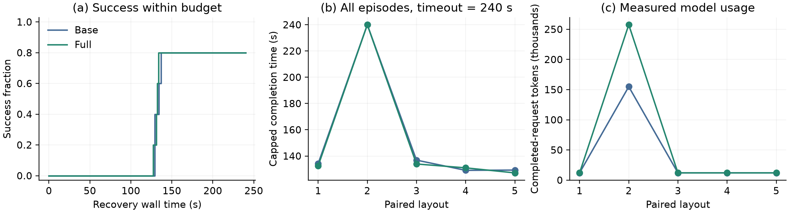

# Controlled online recovery: five paired layouts

The frozen ten-episode comparison completed with four successes out of five in
each arm. Full used fewer image attachments and had a shorter mean first model
request, but did not improve success and used substantially more total tokens.
These results do not establish an overall efficiency advantage for geometric text.

The [protocol](ONLINE_CONTROLLED_RECOVERY.md) tests one kind of disturbance:
a foundation moves after a common construction prefix. Results are exploratory
and specific to this recovery setting. The harder beam and loaded-stack cases
failed separate physical development checks and were not part of this comparison.

## Complete results

| Metric | Base | Full |
| --- | ---: | ---: |
| Successful episodes | 4/5 | 4/5 |
| Mean capped recovery time, timeout = 240 s | 153.88 s | 152.90 s |
| Mean first model-request duration | 8.09 s | 6.95 s |
| Completed model requests | 16 | 23 |
| Total model-request time | 87.32 s | 117.11 s |
| Image attachments, including initial historical views | 35 | 26 |
| Input tokens, including cached input | 201,615 | 304,178 |
| Cached input tokens, already included above | 104,704 | 139,648 |
| Output tokens | 1,224 | 1,429 |
| Total tokens | 202,839 | 305,607 |
| Incomplete requests / missing usage | 0 | 0 |
| Setup failures | 0 | 0 |

Full's mean first request was 14.1% shorter, with four of five paired first
requests faster. Image attachments fell by 25.7%. Total tokens increased by 50.7%,
and total model-request time increased by 34.1%. Five layouts, one repetition and
shared service contention do not support a general latency claim from the first-
request difference. Both arms chose the correct displaced foundation initially
on every layout; neither gained an initial decision-accuracy advantage.

| Seed | Base outcome / recovery time | Full outcome / recovery time |
| --- | --- | --- |
| 2028102001 | Success, 134.18 s | Success, 132.47 s |
| 2028102002 | Timeout, 240 s | Timeout, 240 s |
| 2028102003 | Success, 136.87 s | Success, 133.92 s |
| 2028102004 | Success, 129.07 s | Success, 130.98 s |
| 2028102005 | Success, 129.28 s | Success, 127.13 s |

**Figure.** Controlled foundation recovery on five paired layouts. (a) Success
within the recovery wall-clock budget. (b) Per-layout capped completion time,
counting failures as 240 seconds. (c) Complete measured model-token usage. The
single timeout layout dominates the token difference. Lines connect paired
layout indices for readability and do not indicate a training trajectory.
The [PDF](media/online_controlled_recovery.pdf) is available for editing.

## Why the aggregate advantage did not appear

Four layouts in each arm completed with one model request followed by the same
four-operation local plan. The shared controller already reobserves objects and
binds targets during execution. This leaves little repeated model reasoning for
the geometric representation to simplify; physical execution dominates total time.
Across these successful episodes, total tokens were 47,930 for Base and 48,072 for
Full. Fewer attached images did not translate to fewer tokens: the text itself and
the common actor context also consume input tokens.

On layout 2028102002 both agents first repaired the correct foundation. Both then
encountered an object observation outside the expected tool neighborhood while
executing the beam skill. Subsequent traces contain support movement and
unconfirmed placement. Base made 12 completed requests; Full made 19 and also
attempted another object while one was held. Full used 257,535 tokens in this
failed episode, compared with 154,909 for Base. This is evidence that the current
text and recovery loop do not reliably turn explicit geometry into a better
recovery plan. It is not evidence that extra geometric information must be harmful.

The next development question is how to communicate current prerequisites and
uncertainty, and how to avoid repeated requests without new relevant evidence.
Changes must be developed on separate scenes. This reserved result remains frozen;
it must not be rerun, filtered or tuned into a positive result.

## Integrity, timing and artifacts

All ten episodes used one reset, identical source/skill versions and matched
post-intervention physics hashes within each pair. The recovery clock included
sensing, reasoning, actions and waits. The accelerated common prefix is excluded
and recorded separately; these are recovery-time results, not full construction
latencies. No state edits occurred after the clock started.

Campaign wall time was 522.16 seconds (8.70 minutes). The largest recorded
wall/simulation lag was below 0.35 seconds, beneath the registered two-second
threshold. Balanced parallel batches reduce campaign duration but do not eliminate
model-service contention, which limits causal interpretation of small latency
changes.

Artifacts are under `outputs/online_recovery_01`: `protocol.json`, `progress.json`,
`summary.json`, `audit.json`, per-episode fixtures, raw model transcripts, token
receipts, images, action traces and private physical-success evidence. Independent
auditing verified exact submitted prompts/images against archived conversations,
cumulative token deltas, source snapshots, reset counts, success intervals and
paired state hashes. There were no reported timing or pairing violations.

The protocol SHA-256 is
`c1d7fb37396175422b6fcd647c1bdb89261f8673d4ea5ba05a035cab5368448d`.
The auditor is [audit_online_recovery.py](../scripts/audit_online_recovery.py).
The figure copy has a [provenance record](media/online_controlled_recovery.json).

## Later contact-audit limitation

Subsequent development found that the registered contact helper can miss unnamed
robot collision meshes because it matches geometry names. A body-ancestry check
detected a jaw-housing collision on a separate development failure. The success
counts above remain results under the registered evaluator; archived terminal
physics is insufficient to retrospectively certify them with the corrected check.
This finding does not establish that any recorded success was false. See the
[development diagnosis and correction](ONLINE_REASONING_STATE_DEVELOPMENT.md).
Raw outcomes and source snapshots have not been rewritten.
