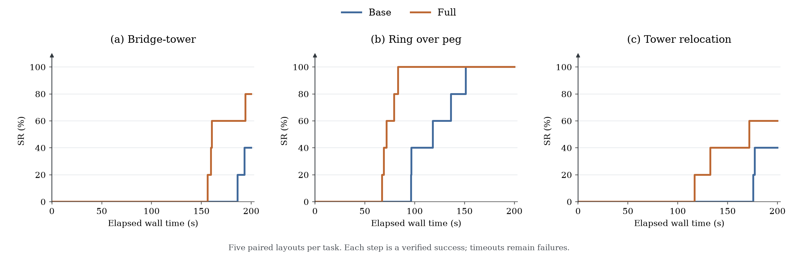

# Online geometric abstraction for agentic policy

This is the historical **five-pair pilot report**. The completed 50-pair results,
figures, and cohort sensitivities are in the
[expanded report](evaluations/online_50/README.md); current paper fragments use
that expansion. Pilot measurements below are preserved.

## Main finding

We evaluate geometric abstraction during continuous language-model reasoning and
execution on three manipulation tasks: bridge-tower construction, ring-over-peg
placement, and tower relocation. Each study uses five paired layouts and a 200-second episode budget.
The scene persists after unsuccessful actions, so decisions must account for the
actual consequences of execution.

On bridge-tower construction, Full completed 4/5 episodes versus Base's 2/5,
with lower mean capped completion time but higher recorded token use. On ring
placement, both arms completed 5/5 episodes; Full finished sooner on every layout,
with 38.0% lower mean completion time and 60.2% fewer recorded tokens. These
construction and placement results illustrate different potential benefits of the interface: choosing useful
physical actions and reducing repeated model interaction. They do not establish a
universal improvement in individual model-request latency.

Tower relocation completed 3/5 Full episodes versus 2/5 Base, with 13.8% lower
mean capped time and 16.7% fewer recorded tokens. Full used fewer model requests
and less cumulative model time, while physical-action time remained similar.

This report covers the completed `online_compact_tower_200_01`,
`online_ring_200_01`, and `online_relocation_200_01` studies: 30 episodes in total.
Each was frozen before its reserved episodes. They were developed sequentially,
not jointly registered as a three-task benchmark. Earlier online pilots,
including null and unfavorable results, remain separate and are linked below.
The [LaTeX fragment](paper/online_experiments.tex) now reports the expanded
study. These original [data and figures](evaluations/online/README.md) sit beside the single-policy
bundle in the [combined experiment index](evaluations/README.md).

## Experimental question and design

Single-policy acquisition evaluates programs revised between reset rollouts. Here,
the language model makes decisions inside one continuing episode. We ask whether
supplying current geometry as text and symbolic references helps the agent use
prior skills and complete a task within a common wall-clock budget.

All three studies use a simulated SO-100 robot, five fresh paired layouts, and
one episode per arm and layout: ten episodes per task, thirty in total. Tower
and Ring start from ordinary task layouts; Relocation starts from a preassembled
column and a separate destination cube. Each episode resets only at initialization. There are no injected
failures, object teleports, replacement layouts, or automatic reruns. Natural
errors remain part of the task. The agent can observe again, revise a target, or
retry an action in the resulting scene. Allowing recovery does not mean that these
experiments establish recovery reliability under controlled disturbances.

A persistent `gpt-6-astra` context with medium reasoning effort selects successive
execution decisions. Within each task, Base and Full share the model settings,
task specification, prior skills, public robot information, action schema, and
private success criterion. Skills run locally without additional model calls.
Unlike the single-policy studies, there are no R0--R3 revisions in these episodes.

The 200-second clock starts immediately after the initial reset and includes
sensor/skill initialization, local computation, observations, model waits, physical
actions, and settling. Physics advances during model waits; it is not paused to
give the agent free reasoning time. At most four episodes run concurrently in
balanced batches of 4/4/2. Campaign wall time and episode completion time are
reported separately. No episode exceeded the registered two-second simulation-lag
threshold; recorded maxima were 0.83 seconds for Tower, 1.73 seconds for Ring, and 0.86
seconds for Relocation.

## Tasks, shared experience, and information boundary

### Bridge-tower construction

The agent constructs a bridge supported by two foundations and places two cubes
in a tower over the center of the beam. Both arms share adapted bridge and stacking
skills. The agent chooses the worksite, construction order, and explicit metric
support-surface targets. The shared actuator executes those targets without
replacing them with a task-specific destination.

Base receives image and qualitative feedback and can request calibrated metric
samples. Full receives current typed references as compact text, with initial and
requested images still available. Unavailable references remain unavailable, and
the agent can fall back to images and pixel-depth queries. Success requires the
prescribed support/contact structure and a five-second stability check.

### Ring-over-peg placement

The agent must align a grasped ring's opening with a fixed peg and release the
ring over it. Both arms receive the same sensor-driven grasp-and-lift skill,
selected by training-only retained success from the completed single-policy Ring
study: Full replica 5 R3, with 4/5 training successes. The skill returns control
before the learned placement procedure executes. Its source is not copied into
the model prompt. Shared qualitative guidance explains wall pinching, slip and
tilt, transport clearance, and the distinction between pad and hole coordinates.

The shared grasp skill internally uses geometry for both arms. Thus Base is not
an end-to-end geometry-free robot. The comparison concerns information supplied
to the online decision maker after matched local grasp assistance. Neither arm
receives a complete task-solving placement skill. The agent chooses world-frame
fixed-finger-pad targets, wrist roll, motion duration, observations, and jaw
opening. Robot-only inverse kinematics preserves the submitted target. Release
opens the jaw, retreats vertically, and allows settling; it does not first align
the opening with the peg.

Both arms receive initial side/wrist images, image requests, encoder and public
jaw information, and calibrated queries of up to 16 pixels from the exact displayed
RGB-D frame. Base receives side images after physical actions. Full instead
receives compact current geometry: hole center, axis and inscribed radius, ring
height and minimum height, and peg top, axis and radius, with evidence and time.
Dense vertices are omitted. A failed observation supplies no replacement pose.
The peg is declared fixed; earlier measurements keep their original timestamp.

The private evaluator requires the peg axis to pass through the opening, the
ring center to be below the peg top, no robot contact, low motion for two seconds,
and drift within 3 mm throughout that interval. Robot-contact checks include
unnamed meshes through body ancestry. This continuous drift check differs from
the endpoint-drift check in the single-policy Ring study.

### Tower relocation

Four equal cubes begin as a source-middle-upper column plus a separate destination
cube. The agent must construct a destination-middle-upper column while restoring
or preserving both foundations at their initial positions. It chooses any temporary
placements, action order, and recovery in the same scene. No relocation plan or
temporary target is supplied. Scene assembly occurs before the sole reset.

Both arms share one-placement skills and explicit world support-surface targets,
with grasp fraction 0.70. Local perception measures the table-supported destination
cube from RGB-D and transfers its dimensions under the public equal-size assumption;
each current object pose must still be visually observed. This shared skill
assistance applies to both arms. Base receives images and qualitative outcomes;
Full additionally receives compact current center/top/bottom references. Both can
request images and calibrated pixel-depth samples.

The private criterion requires the target support structure, no robot contact
(including unnamed meshes), and a five-second stable hold. During the hold both
foundations must be within 5 mm of their initial positions, and every cube must
drift at most 3 mm. Earlier foundation displacement may be repaired. See the
[registered design](ONLINE_TOWER_RELOCATION_STUDY.md) for development evidence and
initialization assumptions.

### What the comparison isolates

Runtime inputs exclude simulator object poses, dimensions, contacts, and private
evaluator state. Raw calibrated sensing and action interfaces are matched within
each task. Full additionally supplies geometric estimation, reference semantics,
and text feedback; automatic image delivery also differs between arms. The
experiment evaluates this interface package, not the serializer alone. Shared
skills are task-specific prior experience, so the study tests their online use
and adaptation to fresh layouts, not acquisition from scratch or novel-shape
generalization. The tasks also use different skills and action granularity;
we do not pool their outcomes into a single success rate.

## Measures

Let T_j be time to first verified success, with T_j infinite for a timeout, and
let B = 200 seconds. Report success within budget and mean capped time:

$$
\operatorname{SR}(B)=\frac{1}{N}\sum_j\mathbf{1}[T_j\le B],
\qquad
\overline T_B=\frac{1}{N}\sum_j\min(T_j,B).
$$

Each arm has N = 5 episodes. Timeouts contribute 200 seconds. Successful-episode
means are secondary because the two arms can succeed on different layouts.

Model-request time is measured end-to-end wall time, including service waiting;
it is not isolated neural-network compute time. We distinguish its cumulative
per-episode value from request-weighted mean latency. Token totals are input plus
output; cached input is already part of input. Incomplete requests with unknown
usage are reported separately, not treated as consuming zero tokens. Image
attachments to model requests and local camera acquisitions are distinct counts.
Action, feedback, and request timers need not form a disjoint decomposition and
must not be added indiscriminately. No monetary cost estimate is inferred here.

## Results

### Task completion and model interaction

All resource totals below cover five episodes per arm and task. Mean model time
per episode divides completed-request time by five, including unsuccessful episodes.

| Metric | Tower Base | Tower Full | Ring Base | Ring Full | Relocation Base | Relocation Full |
| --- | ---: | ---: | ---: | ---: | ---: | ---: |
| Success within 200 s | 2/5 | 4/5 | 5/5 | 5/5 | 2/5 | 3/5 |
| Mean capped completion time (s) | 195.91 | 174.13 | 119.79 | 74.25 | 190.61 | 164.32 |
| Mean completed model time per episode (s) | 46.19 | 45.22 | 94.41 | 41.84 | 78.44 | 48.78 |
| Mean all-attempt model time per episode (s) | 46.23 | 45.68 | 94.42 | 41.84 | 80.03 | 50.55 |
| Mean completed request duration (s) | 6.42 | 7.07 | 7.49 | 6.34 | 6.88 | 5.95 |
| Completed model requests | 36 | 32 | 63 | 33 | 57 | 41 |
| Incomplete requests, tokens unknown | 1 | 3 | 1 | 0 | 2 | 2 |
| Image attachments, all attempts | 33 | 20 | 62 | 10 | 55 | 20 |
| Metric depth queries | 9 | 5 | 21 | 0 | 12 | 2 |
| Camera acquisitions | 561 | 664 | 87 | 123 | 557 | 680 |
| Accumulated action time (s) | 731.11 | 623.93 | 122.70 | 138.10 | 537.26 | 551.51 |
| Accumulated feedback time (s) | 0.59 | 3.26 | 3.60 | 23.54 | 1.00 | 3.00 |
| Input tokens, including cached input | 503,632 | 536,263 | 1,161,890 | 461,801 | 901,501 | 752,135 |
| Cached input tokens (subset) | 412,928 | 420,864 | 986,240 | 379,008 | 782,592 | 652,288 |
| Output tokens | 3,348 | 2,792 | 7,263 | 3,313 | 5,384 | 3,680 |
| Total recorded tokens | 506,980 | 539,055 | 1,169,153 | 465,114 | 906,885 | 755,815 |

Tower's Full arm reduced mean capped time by 11.1% and image attachments by 39.4%,
but recorded 6.3% more tokens. Completed model-request time changed little
(230.96 to 226.11 seconds in total), and mean request latency increased from
6.42 to 7.07 seconds. Full submitted 22 placements versus Base's 27 and used less
accumulated action time. The archived traces show reuse of existing foundations
and visual fallback when a beam reference was unavailable. These observations
are consistent with a benefit through action choices rather than uniformly
faster model inference; they do not identify an isolated causal component.

Ring's Full arm finished sooner on all five layouts, reducing mean completion
time by 38.0%, completed model-request time by 55.7%, and recorded tokens by 60.2%.
Completed requests fell from 63 to 33, while request-weighted mean latency fell
from 7.49 to 6.34 seconds (15.4%). The larger reduction in cumulative model time
therefore accompanies fewer requests, not just faster individual responses.
Images fell from 62 to 10, an 83.9% reduction. Full used more local camera
acquisitions (123 versus 87), more physical operations (33 versus 28), and more
action and feedback time. Its overall advantage is therefore not a reduction
in every cost: additional local geometric processing accompanies fewer model
interactions. This is consistent with the intended use of local perception to
supply actionable text without attaching every observation as an image.

Relocation's Full arm reduced mean capped time from 190.61 to 164.32 seconds
(13.8%) and completed 3/5 episodes versus 2/5. Completed model-request time fell
from 392.21 to 243.89 seconds across each arm (37.8%); completed requests fell
from 57 to 41. Mean completed request duration was 6.88/5.95 seconds (Base/Full).
Recorded tokens fell by 16.7%, and image attachments by 63.6%. Accumulated physical
action time was similar, 537.26/551.51 seconds, while Full acquired more camera
frames (680 versus 557). The measured efficiency gain therefore concerns model
interaction rather than faster physical execution. Full gained two successes on
layouts where Base timed out and lost one where Base succeeded; the result is
not uniformly favorable across layouts.

**Figure caption.** Success within elapsed wall time for three separate online
studies, each with five paired layouts per arm and a 200-second limit. Curves step
only at first verified successes; timeouts never become successes at 200 seconds.
The elapsed times are from complete 200-second episodes, not reruns at smaller
budgets. Physics and the same scene continue during model reasoning and after
unsuccessful actions. These five-layout empirical curves have no inferential bands.

### Model time and token figure

**Figure caption.** Bars show mean model interaction cost across all five episodes
per arm/task, including timeouts; points show each episode. Left: cumulative model
request wall time including interrupted waits. Right: recorded input-plus-output
tokens from completed requests (thousands), counting cached input once. Triangles
identify episodes with unknown additional interrupted usage; the unknown amounts
are excluded, not assigned zero. Horizontal point offsets separate observations
and have no quantitative meaning. No confidence intervals are implied.

[PDF](evaluations/online/model_resources.pdf) ·
[Editable SVG](evaluations/online/model_resources.svg) ·
[Plotted means](evaluations/online/model_resources.csv)

This resource figure uses all-attempt model time, which corresponds to the
all-attempt row in the table above. It separates model interaction cost from the
success-versus-time figure's complete episode clock. Individual episode values
remain available in `episodes.csv`.

### Every paired outcome

Times below are capped at 200 seconds. A timeout is explicitly marked; it is not
a successful completion at the budget boundary.

| Task / seed | Base outcome / time | Full outcome / time |
| --- | --- | --- |
| Tower / 2028105001 | Success, 193.27 s | Timeout, 200.00 s |
| Tower / 2028105002 | Success, 186.27 s | Success, 160.43 s |
| Tower / 2028105003 | Timeout, 200.00 s | Success, 159.62 s |
| Tower / 2028105004 | Timeout, 200.00 s | Success, 156.32 s |
| Tower / 2028105005 | Timeout, 200.00 s | Success, 194.27 s |
| Ring / 2033101001 | Success, 151.19 s | Success, 83.53 s |
| Ring / 2033101002 | Success, 136.49 s | Success, 79.55 s |
| Ring / 2033101003 | Success, 118.21 s | Success, 69.05 s |
| Ring / 2033101004 | Success, 96.28 s | Success, 67.21 s |
| Ring / 2033101005 | Success, 96.79 s | Success, 71.90 s |
| Relocation / 2034101001 | Timeout, 200.00 s | Success, 117.02 s |
| Relocation / 2034101002 | Success, 177.22 s | Timeout, 200.00 s |
| Relocation / 2034101003 | Timeout, 200.00 s | Timeout, 200.00 s |
| Relocation / 2034101004 | Success, 175.82 s | Success, 132.67 s |
| Relocation / 2034101005 | Timeout, 200.00 s | Success, 171.91 s |

In Tower, Full gained three successes on layouts where Base timed out, lost one
layout where Base succeeded, and shared one successful layout. Ring had five
jointly successful layouts. Its timing comparison therefore uses the same success
subset in both arms.

### Successful episodes and interrupted requests

Tower's success-conditioned mean completion times are 189.77 seconds for Base
(two successes) and 167.66 seconds for Full (four). Mean cumulative completed
model-request time is 45.84 and 36.95 seconds, respectively. These compare different
layout subsets and do not establish a paired speed advantage. On the only jointly
successful Tower layout, Base/Full completion times are 186.27/160.43 seconds;
completed model time is 41.61/36.12 seconds, with one additional incomplete Full
request excluded from that subtotal. For Ring, all episodes succeed, so
success-conditioned and all-episode timing summaries coincide.

Tower has one incomplete Base request and three incomplete Full requests; their
tokens remain unknown. Ring has one incomplete Base request: the private monitor
confirmed success during the next model wait, ending that attempt after 0.015
seconds. Its usage is unknown and excluded from recorded token totals. This was
an episode-success interruption, not a timeout or an automatic retry. Full Ring
has no incomplete requests. The reported token reductions concern recorded
completed usage, not exact total billed consumption. Tower's four interrupted
prompts lack archived delivery transcripts, as disclosed in its existing audit.

Relocation's success-conditioned completion means are 176.52 seconds for Base
(two successes) and 140.53 seconds for Full (three). They concern different layout
subsets. The only jointly successful layout is 2034101004: Base/Full finish in
175.82/132.67 seconds, with 44.17/21.42 seconds of completed model time. Both arms
have two requests interrupted at the episode deadline. Their combined durations
are 7.95 seconds for Base and 8.86 for Full; tokens remain unknown. Including this
time gives mean cumulative model time of 80.03/50.55 seconds per episode. No
interrupted request was automatically retried.

The export contains **262 completed model requests and nine interruptions** across
all three studies. Image totals include attachments recorded in invocations of
interrupted attempts; this records submission, not proof of model processing.
Token totals use only completed receipts. The request CSV distinguishes these
scopes explicitly. [Paired timing figure](evaluations/online/paired_completion_times.pdf)
marks timeouts with crosses rather than presenting them as successful completions.

## Evidence, scope, and paper interpretation

All three studies completed their fixed ten slots and passed their source/resource and
interface audits; Tower and Relocation also passed compact-prompt reconstruction.
Relocation passed its additional task-specific anchor/support/hold audit. Paired
initial physical-state hashes match, and the audit checks reset counts, submitted
targets, metric-depth queries, Base geometry exclusion, and terminal physics.
Continuous stability is established by the private monitor's interval records;
a terminal snapshot alone cannot establish the preceding hold. Sources, prior
skills, versions, and attempts are retained. Parallel campaign wall times were
611.62 seconds for Tower, 374.81 seconds for Ring, and 614.11 seconds for
Relocation; these are not agent latency measurements.

Five layouts with one run per condition are exploratory evidence. There are no
repeated trials to separate model/service variability from layout variation, and
no controlled intervention isolates serialization, geometric fitting, feedback
scheduling, or skill choice. The Ring result supports faster successful execution
with the supplied interface in these paired scenes. It does not establish a higher
population success rate when both arms are already 5/5. Tower supports a practical
completion advantage at the fixed budget, while retaining an adverse Full outcome
and higher recorded token cost.

A suitable discussion claim is that geometric abstraction can reduce the effort
of grounding execution decisions, but its benefit depends on the task and shared
skills. Tower illustrates improved completion associated with physical decisions;
Ring illustrates fewer model interactions and lower recorded resource use at equal
observed success. Relocation combines a small completion gain with fewer requests
and lower recorded model cost, while retaining adverse paired outcomes. These
results do not warrant saying that geometric text always makes
each reasoning step faster, that arbitrary failures are recoverable, or that
unseen object geometry has been solved.

Earlier studies remain relevant context: the original online bridge-tower pilot
had equal 6/10 success, and the controlled recovery study had equal 4/5 success
without a material total-time gain. They use different protocols and are not
pooled with the present three studies. Retaining these results matters for a
discussion-oriented account of when abstraction helps.

## Sources and reproducibility

- [Combined single-policy and online index](evaluations/README.md).
- [Online CSV/JSON data, figures, and hashes](evaluations/online/README.md).
- Relocation protocol: [tower relocation](ONLINE_TOWER_RELOCATION_STUDY.md).
- Relocation numerical source: [`summary.json`](../outputs/online_relocation_200_01/summary.json).
- Tower protocol: [200-second study](ONLINE_COMPACT_TOWER_200_STUDY.md).
- Tower detailed results, traces, and figure: [result report](ONLINE_COMPACT_TOWER_200_RESULTS.md).
- Ring protocol and development evidence: [online Ring study](ONLINE_RING_STUDY.md).
- Tower numerical source: [`summary.json`](../outputs/online_compact_tower_200_01/summary.json).
- Ring numerical source: [`summary.json`](../outputs/online_ring_200_01/summary.json).
- Ring interface and resource checks: [`interface_audit.json`](../outputs/online_ring_200_01/interface_audit.json), [`audit.json`](../outputs/online_ring_200_01/audit.json).
- Earlier pilot: [bridge-tower results](ONLINE_BRIDGE_TOWER_RESULTS.md).
- Earlier recovery comparison: [controlled recovery results](ONLINE_CONTROLLED_RECOVERY_RESULTS.md).

Aggregate tables are computed from the three summaries and verified request receipts. Paired rows
come from `records`, joined by seed and arm. Percent changes use Full/Base minus
one; request-weighted latency divides summed completed model time by completed
requests. Successful-subset summaries filter `records` by `success`. No new
rollouts or model requests were made for this report, and frozen evidence was
not modified. Reproduce the export with `scripts/export_online_results.py`.
