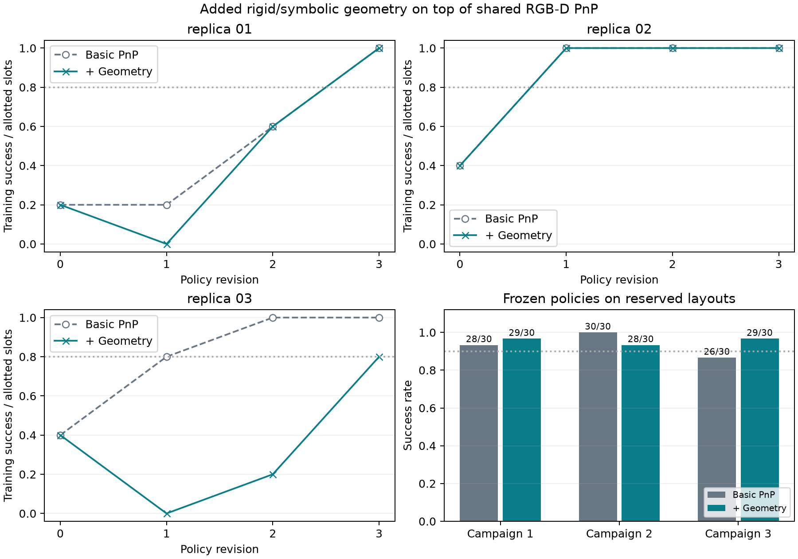
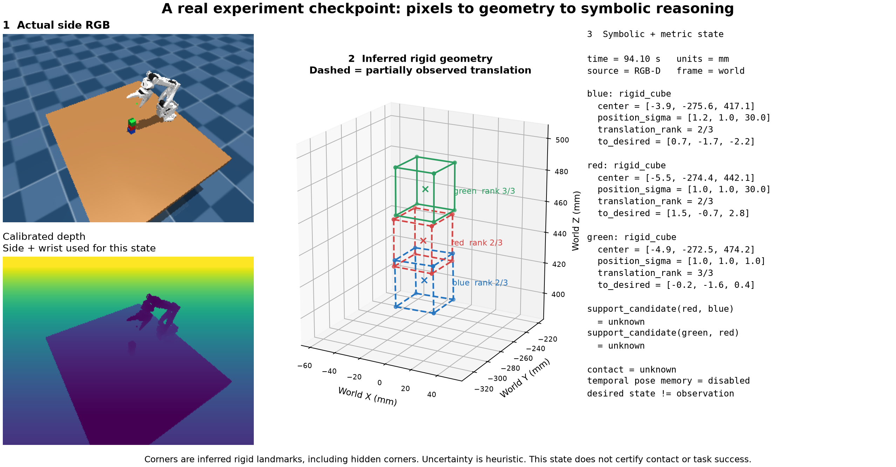

# Online symbolic/metric geometry with shared execution

## Completed v2 repetitions: no demonstrated iteration-efficiency gain

| Campaign | Basic PnP training curve (R0–R3) | Added geometry training curve | First 80% revision, basic / geometry | Reserved basic / geometry |
| --- | --- | --- | --- | --- |
| 1 | 1, 1, 3, 5 / 5 | 1, 0, 3, 5 / 5 | 3 / 3 | 28/30 / 29/30 |
| 2 | 2, 5, 5, 5 / 5 | 2, 5, 5, 5 / 5 | 1 / 1 | 30/30 / 28/30 |
| 3 | 2, 4, 5, 5 / 5 | 2, 0, 1, 4 / 5 | 1 / 3 | 26/30 / 29/30 |

The added abstraction reached the training threshold earlier in zero campaigns,
tied in two, and reached it later in one. Reserved differences were +1, -2 and
+3 successes out of 30. The respective exact paired McNemar p-values were 1.0,
0.5 and 0.375. This does not establish the requested benefit of reaching higher
success in fewer revisions. It also does not prove that geometric abstraction is
useless in other tasks or interfaces.

Pooled descriptive counts are 84/90 basic PnP and 86/90 added geometry. These are
not 90 independent agent replications: each arm has only three policy-generation
chains and uses the same reserved scenes. No pooled binomial interval is reported.
The baseline already exposes simple visual position/height/size estimates and is
strong on this task. This comparison tests additional rigid/symbolic state, not
all geometry versus none.

All 285 physical rollouts ran, with zero source-validation failures. The audit
checked exact actor submissions and execution bundles, recorded tool-free model
turns, matching initial sensor feedback, source snapshots, frozen selection and
actual per-trial outcomes. All six selected policies were frozen before the first
reserved trial. The source-level coordinator gate and file chronology agree.

[Full audited report](evaluations/online_geometry_v2_replications_01.json)
and [comparison figure](media/online_geometry_v2_replications_01.png) retain all
three campaigns. The v1 pilot and feedback-only pilot remain separate evidence.
The research goal is still active; a positive claim cannot be obtained by keeping
only the favorable campaign or by presenting an intrinsic state diagnostic as SR.

## Historical v1 pilot: a weak single-campaign signal

| Outcome | Raw RGB-D | Online symbolic/metric geometry |
| --- | --- | --- |
| Training revision 0 | 0/5 | 0/5 |
| Revision 1 | 2/5 | 4/5 |
| Revision 2 | 4/5 | 4/5 |
| Revision 3 | 4/5 | 4/5 |
| First revision at 80% | 2 | 1 |
| Selected revision | 2 | 1 |
| Reserved success | 13/20 (65%) | 15/20 (75%) |

The treatment reached the training threshold one revision earlier and had two
additional successes on unseen layouts. There were 12 shared successes, three
symbolic-only successes, one raw-only success and four shared failures. The exact
paired McNemar p-value is 0.625; this small single-chain result does not establish
a robust reserved-success advantage. The learning-efficiency direction is
promising and needs independent campaign replication.

All 75 assigned physical rollouts ran, with no source-validation failures. Actor
output tokens totaled 28,131 raw versus 23,271 symbolic across three proposals.
This is descriptive token evidence, not an independently validated efficiency
claim. The audit checked 56 frozen source files/snapshots, matched first-round
images, unchanged selected candidates and freezing before reserved results.
The treatment produced 494 `symbolic_metric_state_v1` runtime records; the raw
actor produced 231 records from its own perception implementation.

[Measured results](evaluations/online_geometry_pilot_01.json),
[provenance/usage audit](evaluations/online_geometry_pilot_01_audit.json), and
[learning curve](media/online_geometry_pilot_01.png) preserve the completed pilot.
The v1 library and candidates remain in its output directory and source snapshot.

This experiment tests an action-free online scene interface plus sensor-derived
feedback. It is distinct from the completed feedback-only pilot, which showed no
learning-efficiency advantage. Neither earlier reserved scenes nor hand-written
workspace solutions are supplied to these actors.

## Interface and treatment

`SceneGeometry` accepts supplied RGB-D frames and public color identities. It
learns rigid cube dimensions and a static table plane from the initial on-table
frame. It exposes current metric poses, inferred vertices, named geometric faces,
three-valued relations, separate desired targets and compact symbolic text.
It never captures a camera, moves a robot, selects a placement site or checks
private contacts/task completion. The PnP actuator remains exactly the shared
implementation used by both arms.

The exported `geometry.scene(initial_frame, colors)` interface disables temporal
pose memory and conditional prediction. Same-timestamp side/wrist observations
can fuse complementary visible directions; a new timestamp discards previous
poses. Missing objects stay unavailable. Dimension models and desired goals are
retained, and their provenance is distinct from observed current poses.

The raw arm receives full runtime RGB-D and can implement its own geometry or
memory. The common PnP primitive also exposes basic visible-surface position,
height, dimensions and normal estimates. Thus this is an additional rigid-object
and symbolic-state abstraction comparison, not a literal zero-geometry baseline. The treatment arm additionally gets the frozen scene interface and
sensor-derived symbolic/metric feedback. This is a combined practical treatment,
not an isolation of relation names from metric estimates or a temporal-memory
ablation. Public numerical methods remain available to both.

## Frozen pilot protocol

Campaign: `outputs/online_geometry_pilot_01`.
Runner: `scripts/run_online_geometry_experiment.py`.

- Shared starter and executor; actors may change only high-level planner code.
- Three revisions per arm, training seeds 61001–61005; common measured baseline
  is 0/5. All five layouts were previously uninspected.
- Twenty reserved layouts, seeds 62001–62020, evaluated only after both selected
  policies are frozen. Highest training success selects; earliest ties win.
- Same model/settings, equal assigned rollout slots and a 30,000-character source
  limit, with an explicit request to aim below 14,000 characters. No free repair.
- The same deterministic feedback-selection rule prefers one failed and one
  successful training trajectory, filling remaining slots in seed order. Initial
  and final RGB/depth views and calibration are provided. Both first-round image
  sets have identical hashes. Later inputs reflect each arm's own executions.
- Geometry recording is enabled for both arms, accepts only caller-provided JSON,
  and returns no object truth. Treatment policies are asked to archive scene
  packets at planner transitions so actual API use can be audited.
- Runtime library, executor, source files and protocol are hashed and copied into
  the campaign source snapshot before execution. Candidates, prompts, model
  events, observations and negative outcomes are retained without manual repairs.

The online interface and protocol boundary passed eleven targeted tests. A real
pick-and-return integration rollout on development seed 51001 recorded three
states and completed without runtime errors. It intentionally did not build a
column, so its task-success flag is not a stacking result. The preceding smoke
attempt exposed a missing geometry-recording flag; it is retained separately.

## Temporal state decision

A separate sensor/encoder replay on five earlier development trajectories compared
instantaneous geometry, retained pose memory, and conditional gripper transport.
Simulator truth was read only after the complete sensor-only estimate sequence
was saved. Matching identical object/frame pairs avoids rewarding a method merely
for outputting extra remembered states.

| Method | Paired estimates | Median center error | 95th percentile | Maximum |
| --- | --- | --- | --- | --- |
| Instantaneous geometry | 341 | 0.096 mm | 3.239 mm | 3.639 mm |
| Pose memory | 341 | 0.094 mm | 12.074 mm | 142.814 mm |
| Conditional encoder transport | 341 | 0.093 mm | 8.020 mm | 15.624 mm |

On 149 pairs with partial instantaneous observations, the 95th percentiles were
3.580, 50.814 and 14.697 mm respectively. Simple static retention fails badly when
hidden coordinates change during transport. A fallible visual-lift/closed-gripper
hypothesis with measured robot SE(3) displacement reduces those errors, but does
not outperform fresh geometry on this diagnostic. This supports keeping temporal
memory disabled in the present pilot, not a general claim that memory is useless.

There were seven visual-lift attachment hypotheses, 73 conditional updates and
three open-command revocations. The revocation logic is an explicitly labeled
offline adapter; a public state transition/revocation API remains future work.
No contact truth or commanded target poses were used to transport estimates.
These are correlated development frames with ideal simulated depth, not policy
success trials or real-sensor evidence.

[Temporal diagnostic](evaluations/temporal_geometry_audit_01.json) preserves the
paired and coverage-separated metrics. Sensor-only estimates and private scoring
are separate artifacts under `outputs/temporal_geometry_audit_01`.

## Runtime fusion counterexample and separate prototype

First-round runtime logs exposed a green robot tool-site marker being interpreted
as the green cube in a wrist view. In one same-time pair, the side view constrained
the correct cube center in all three directions, but the erroneous single-plane
wrist fit moved the fused center by roughly 88 mm. The policy unnecessarily
regrasped the top cube while private task evaluation still passed. The actual
scene/target example in `evaluations/online_geometry_example.json` deliberately
retains this incorrect estimate; it must not be presented as accurate final state.

The unchanged scene builder defines the visible `ee_site` marker with radius
4 mm and green RGBA. `view_scene.py` was absent from the legacy recursive source
manifest. Its unchanged HEAD content/hash and a copy were recorded as supplemental
provenance during this pilot; include it prospectively in future manifests.
No scene settings or frozen candidate/library code were changed.

A separate prototype gates conflicting same-time fits, abstains for equally
supported contradictions, and solves only in observable translation directions.
Its first version fixed the marker case but introduced a 160 mm error through
near-parallel least-squares extrapolation; that failure is retained. The corrected
prototype passed five regression tests and, on 507 paired estimates from all five
first-round treatment trajectories, reduced p95 error from 2.966 to 2.680 mm and
maximum error from 91.271 to 11.126 mm. Coverage stayed 507/513 for both methods.

This is development evidence from inspected trajectories, not a held-out result
or a policy-success improvement. The prototype remains outside the frozen online
pilot. See [the counterexample](evaluations/online_geometry_multiview_failure.json),
[initial prototype failure](evaluations/consistent_geometry_audit_01.json), and
[corrected development replay](evaluations/consistent_geometry_audit_02.json).

## Post-pilot v2 repair and independent repetitions

Only after all v1 evaluations and its source audit completed, the validated
same-time consistency/observability fusion was promoted to `geometric_fusion.py`
and the default instantaneous `SceneGeometry` interface. Rejected views are
reported explicitly, accepted views are fused in an observable subspace, and
camera order cannot let a weaker inconsistent fit override stronger evidence.
The experimental temporal-memory path remains separate and is not enabled in
these policies. Unused task-target construction functions were also removed from
the exported online library. Robot execution is unchanged.

Thirteen interface/protocol tests and five production-fusion tests passed; a new
pick-and-return integration rollout recorded three states without runtime errors.
The new manifests include `view_scene.py` prospectively. Actor instructions now
explicitly distinguish the host wall timeout from simulated time; rollout duration
is not an optimization objective or a 120-s simulation cutoff.

Three independent v2 repetitions completed under
`outputs/online_geometry_v2_replications_01/protocol.json`, coordinated by
`run_online_geometry_replications.py`. Training seed sets are 71001–71005,
71101–71105 and 71201–71205. Each had three revisions per arm and independent
isolated actor contexts. All six selected policies were frozen before any
reserved evaluation on common unseen seeds 72001–72030. Two training campaigns
ran concurrently; reserved evaluation was serialized.

Report each repetition separately. Repeated policies and common reserved scenes
induce dependence, so pooled episode totals are descriptive. Do not pool this
changed method version with the v1 or feedback-only pilots. The research goal
remains active until the benefit is adequately verified.

## Real checkpoint: the representation is not a success certificate

This is the final recorded checkpoint of repetition 2, symbolic revision 1,
training seed 71101, at simulation time 94.10 s. The figure uses archived side
and wrist RGB-D and the exact frozen numerical library. Replayed centers match
the runtime records to their saved 0.01 mm precision. The renderer does not read
`result.json` or `rollout.npz`; it is a representation example, not an independent
accuracy or success measurement.

The green cube has three observed translation directions. The lower red and blue
cubes have only two, with approximately 30 mm heuristic vertical uncertainty.
Their dashed boxes include inferred hidden corners, and the support predicates
remain `unknown`. A visually plausible tower does not make uncertain height,
contact or stability known. The desired deltas are the planner's recorded goals,
kept separate from estimated current centers.

[Vector figure](media/online_geometry_v2_state_example.svg) and
[record plus sensor replay](media/online_geometry_v2_state_example.json) preserve
the example. Reproduce it with `scripts/render_online_geometry_example.py`; the
script checks the frozen library hash and agreement with the actual runtime
checkpoint before drawing the inferred corners.
