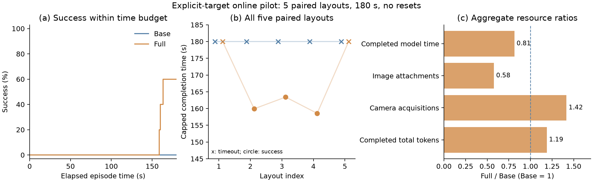

# Online target binding: five paired layouts

Full succeeded on 3/5 layouts within 180 seconds; Base succeeded on 0/5.
Full attached fewer images and spent less time in completed model requests,
but consumed more recorded tokens and acquired more camera frames. This is a
positive exploratory result for the geometric-reference interface as a package,
not evidence of a universal latency or token advantage.

All ten registered episodes completed in balanced parallel batches, with no
reset after an action failure. Source/resource and interface audits passed for
all ten episodes. The [protocol](ONLINE_TARGET_BINDING_STUDY.md) and raw results
are preserved under `outputs/online_bound_tower_01`. The subsequent user change
to 200 seconds applies to future runs; it does not change these observations.

## Outcomes and costs

| Metric | Base | Full |
| --- | ---: | ---: |
| Success within 180 seconds | 0/5 | 3/5 |
| Mean capped completion time, timeout = 180 s | 180.00 s | 168.38 s |
| Completed model requests | 42 | 37 |
| Incomplete requests, token usage unknown | 1 | 2 |
| Total completed model-request time | 264.86 s | 215.82 s |
| Mean completed request duration, request-weighted | 6.31 s | 5.83 s |
| Mean first model-request duration | 7.12 s | 7.98 s |
| Image attachments across attempted requests | 38 | 22 |
| Metric depth queries | 11 | 5 |
| Submitted placements, including interrupted operations | 29 | 25 |
| Camera acquisitions | 508 | 720 |
| Input tokens, including cached input | 609,955 | 727,795 |
| Cached input tokens, already included above | 493,952 | 599,040 |
| Uncached input tokens | 116,003 | 128,755 |
| Output tokens | 4,020 | 3,073 |
| Total tokens from completed receipts | 613,975 | 730,868 |

Full's mean capped time was 6.5% lower. Its completed model-request time was
18.5% lower, and image attachments were 42.1% fewer. Recorded total tokens were
19.0% higher and camera acquisitions were 41.7% higher. Local camera acquisition
and image attachment to the model are distinct costs.

The token and model-time totals cover completed requests only. Missing usage
from one Base and two Full interrupted requests is unknown, not zero; these are
observed subtotals rather than complete billing totals. Image counts include
attachments in all archived request invocations, including interrupted ones.
Cached input must not be added to input tokens again. Action, camera, feedback
and model timers have different scopes and should not be summed as independent
components of a complete wall-clock accounting.

| Layout seed | Base | Full |
| --- | --- | --- |
| 2028104001 | Timeout, 180 s | Timeout, 180 s |
| 2028104002 | Timeout, 180 s | Success, 159.92 s |
| 2028104003 | Timeout, 180 s | Success, 163.42 s |
| 2028104004 | Timeout, 180 s | Success, 158.57 s |
| 2028104005 | Timeout, 180 s | Timeout, 180 s |



**Figure.** Online construction of a bridge with two stacked cubes on five paired
layouts, using a common 180-second budget and no scene reset within an episode.
(a) Empirical success versus elapsed time. (b) Every paired capped completion
time; crosses denote timeouts and circles denote success. Lines connect layout
indices for readability, not a training sequence. The vertical axis is truncated
to show timing differences. (c) Aggregate Full/Base resource ratios. Model time
and tokens cover completed requests; image attachments include attempted
requests. Incomplete usage remains unknown. The [PDF](media/online_target_binding.pdf),
[episode CSV](media/online_target_binding.csv), and
[analysis JSON](media/online_target_binding.json) are available separately.

## What the trajectories support

In all three successful Full episodes, the agent retained one existing foundation
and submitted four placements. It used current references to position the other
foundation and the beam, then requested an image and depth samples when the beam
surface reference was unavailable. It subsequently used the next cube's current
top-face reference. This demonstrates a combination of symbolic reference use and
selective visual fallback, rather than image-free operation.

For example, on 2028104003, Full kept the yellow foundation and first placed blue
at `[0.143692, -0.275353, 0.4]`. It then targeted the red beam at the midpoint of
observed foundation tops. After explicitly observing and sampling the beam's top,
it stacked green and then magenta, reaching success at 163.42 seconds. Base chose
a new worksite, moved both foundations and submitted five placements; the deadline
interrupted its final placement. These are archived submitted targets and action
sequences, not counterfactual estimates of what Base would do with more time.

The successful Full trajectories support an explanation involving spatially
informed action selection and fewer reconstruction queries. They do not isolate
serialization, reference accuracy, worksite selection and saved physical actions
as separate causal effects. Both arms have the same public task, explicit-target
action schema, calibrated pixel-depth query API and controller, but their feedback
representations and default image delivery differ by design.

The two common failures remain part of the result. On 2028104001, Base spent time
on unconfirmed foundation placements and beam recovery; Full recovered a beam
placement but its final cube placement ran into the deadline. On 2028104005, both
arms repeatedly encountered beam placement errors. Full requested fresh views,
tried a relocation and release, and eventually placed the first upper cube, but
did not finish the tower. Geometry did not eliminate these execution failures.
Private terminal-state diagnostics are evaluation evidence only and were not
passed to either actor.

The 180-second cutoff matters. In particular, Base was executing its final cube
placement on layouts 2028104003 and 2028104004 at timeout. We cannot infer its
200-second success rate from these censored trajectories, or relabel these runs
under the new budget. A later 200-second comparison needs its own registration.

## Interpretation for the paper

A defensible description is:

> In an exploratory online composition study on five paired layouts, the
> geometric-reference agent completed three bridge-tower tasks within 180 seconds,
> compared with none for the image-and-depth-query agent. It used fewer image
> attachments and less completed model-request time, while recorded token use
> increased. Decision traces show reuse of existing scene structure and selective
> visual fallback when references were unavailable.

Five layouts and one run per arm/layout do not establish a stable population
success-rate difference. Model-service variability and unequal decision workloads
also limit latency attribution: Full's first request was slower on average even
though its mean over all completed requests was shorter. Claims of universally
faster reasoning, lower token cost, or robust recovery are not supported.

A useful subsequent development target is compact reference serialization.
The current implementation repeats frame, units, source, time and evidence fields
for center/top/bottom references of every object. Reducing that redundancy while
preserving reference semantics and unavailable-state evidence is a testable
hypothesis for reducing input cost. It must be evaluated on development data,
without changing this study's prompts, source snapshots or outcomes. The result
here is not a reason to tune on these reserved failures or rerun until favorable.

## Reproduction and integrity

Campaign wall time was 552.10 seconds (9.20 minutes) for ten episodes with at most
four workers. The maximum recorded simulation lag was 0.83 seconds, below the
registered two-second threshold. Each pair had identical initial physical-state
hashes and every episode had exactly one initial reset. The independent interface
audit checked submitted-target equality, archived RGB-D queries, Base reference
exclusion and terminal robot contacts, including unnamed collision geometry.
Successful terminal states had no robot contact. Continuous five-second stability
was certified by the original private monitor; terminal reconstruction alone is
not a replay of that interval.

The analysis checks the frozen protocol and all archived source hashes, complete
audit coverage, result hashes, receipt totals and invocation image counts. It
reads the archived implementation rather than requiring current working sources
to remain identical after the budget amendment. Regenerate the derived files:

```bash
OPENBLAS_NUM_THREADS=1 OMP_NUM_THREADS=1 .venv/bin/python \
  scripts/analyze_online_bound_results.py \
  --root outputs/online_bound_tower_01 \
  --output-prefix docs/media/online_target_binding
```

This command launches no model requests or episodes and does not overwrite raw
study artifacts. Input artifact hashes are recorded in the generated JSON.
The registered protocol SHA-256 is
`a3adb2ece1c83c9b70fc0458095cacab7afb7543eb3a1e0722660d6952d3efd7`.
