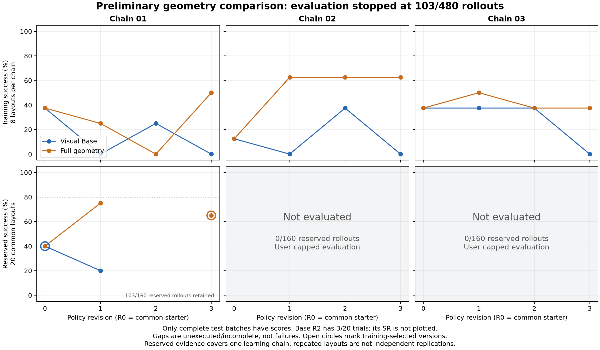

# Geometry abstraction: budget-limited preliminary results

At the user's request, reserved evaluation stopped near 100 rollouts instead of
completing the registered 480. There are **103 completed reserved rollouts**:
102 had finished when dispatch was suspended, and the one in-flight rollout was
allowed to finish. No completed result was discarded. The coordinator exited
with code 143 after that rollout completed; it is not running. Do not resume the
remaining evaluation without a further user request for more tests.

The available fixed-iteration comparison is promising: on the first independent
training chain, after one policy revision, **Visual Base scores 4/20 (20%) and
Full geometry scores 15/20 (75%)** on the same reserved layouts. Their shared R0
starter scores 8/20 (40%) in both arms. This supports a benefit in this chain at
a one-revision budget. It does not establish a repeatable advantage across
independent policy-evolution chains.

## Learning curves



The upper panels show all completed training curves. The lower panels show only
complete reserved batches; missing revisions remain gaps, and chains 2 and 3
have no reserved scores. Open circles mark the versions selected using training
results. The isolated Full R3 point is not connected across the unexecuted R2.
These curves describe the retained evidence rather than a completed replication.

Reproduce the figure from the provenance-checked accounting without running any
new rollouts:

```bash
.venv/bin/python scripts/plot_budget_limited_geometry.py \
  --report docs/evaluations/constraint_geometry_budget_limited.json \
  --output docs/media/constraint_geometry_budget_limited.png
```

## All available reserved batches

All scores below concern chain 1 and the same 20 reserved layouts. The number of
rollout records is not the number of independent scenes or learning chains.

| Policy revision | Visual Base | Full geometry |
| --- | --- | --- |
| R0: common visual starter | 8/20 (40%) | 8/20 (40%) |
| R1: first generated revision | 4/20 (20%) | 15/20 (75%) |
| R2 | 3 of 20 completed; no partial SR reported | Not executed |
| R3 | Not executed | 13/20 (65%) |

Five complete batches account for 100 rollouts. The three additional Base R2
results remain in the evidence and in the total count; they are not erased to
make the budget exactly 100. Missing trials are unexecuted, not failures or
invalid policy slots. No reserved results exist for chains 2 and 3.

Training selected **Base R0 and Full R3**, using highest training SR and the
earliest tied revision. Their reserved scores are 40% and 65%. Full R1's higher
reserved score does not replace the training-selected Full R3. R1 is shown because
fixed-revision SR was a registered endpoint, not because it is now the best test
version. Neither available Full version reaches the registered 80% threshold.

## Matched-layout changes after one revision

A post-hoc descriptive comparison pairs each complete batch by its original
layout seed. Both R0 arms have identical binary outcomes on all 20 layouts.

| Change from the common R0 starter to R1 | Visual Base | Full geometry |
| --- | --- | --- |
| Previously successful, still successful | 3 | 7 |
| Previously failed, now successful | 1 | 8 |
| Previously successful, now failed | 5 | 1 |
| Previously failed, still failed | 11 | 4 |

Full repairs 8 of the starter's 12 failures while losing 1 of its 8 successes.
Base repairs 1 and loses 5. Thus the first-revision difference includes an actual
Full improvement over the common starter, alongside Base regression. Comparing
the two R1 policies directly, 12 layouts succeed only with Full, 1 succeeds only
with Base, 3 succeed with both, and 4 fail with both. These are conditional
outcomes for one pair of generated policies, not 20 independent learning trials.

Later revision is not monotonically better: from Full R1 to the training-selected
Full R3, 3 failures become successes but 5 successes become failures; 10 successes
and 2 failures persist. This reduces reserved SR from 75% to 65%. R3 remains the
training-selected policy; reserved outcomes do not retroactively change selection.

The trace notes also prevent misleading failure categorization. Of Base R1's
16 failures, 14 have no uncaught terminal exception. Seven failed trials end with
a policy note reporting lateral displacement after release (6 beam, 1 cap),
and one reports that construction finished despite failing offline scoring.
Full R1 likewise has a failed trial whose final note says its sequence finished.
These notes reflect policy judgments, not verified physical root causes; a
missing terminal exception or completed action sequence is not task success.
The paired report retains exact notes, terminal errors and per-layout outcomes
with source hashes. No notes or reserved outcomes were sent back to an actor.

Reproduce this analysis without additional simulation or model calls:

```bash
.venv/bin/python scripts/analyze_budget_limited_pairs.py
```

See [paired outcomes and trace provenance](evaluations/constraint_geometry_paired_outcomes.json).
This analysis describes the early-stopped sample; it does not isolate which
geometry component caused the improvement or establish cross-chain repeatability.

## Completed training and execution integrity

All three training chains completed before any reserved rollout: **192 training
rollouts, zero invalid slots, 18 completed model generations**, with 18 exact
prompt/image contexts verified and all 24 candidate versions globally frozen.
There were 20 invocation attempts, including two archived pre-response quota
interruptions. The original 480-slot reserved protocol is retained unchanged;
the later user budget request is recorded separately.

| Chain | Base training successes R0–R3 / 8 | Full training successes R0–R3 / 8 | Training-selected Base / Full |
| --- | --- | --- | --- |
| 01 | 3, 0, 2, 0 | 3, 2, 0, 4 | R0 / R3 |
| 02 | 1, 0, 3, 0 | 1, 5, 5, 5 | R2 / R1 |
| 03 | 3, 3, 3, 0 | 3, 4, 3, 3 | R0 / R1 |

Together with reserved evaluation, 295 rollouts actually executed. The partial
full-study auditor reports 192 because it does not add a chain's reserved phase
until that phase is complete. The separate reserved inspector verifies all 103
completed slots against frozen policy/library hashes, scene/sensor settings,
matched initial RGB and the global freeze timestamp. A final complete-study audit
is intentionally unavailable: 377 registered reserved slots were not executed.

For the completed R0 pair, all 20 reserved layouts pass the same offline parity
checker used for training: physical arrays and action boundaries match, and Base
records contain only event metadata. Private physics arrays are used only for
this offline equality check, never by the policies.

## Scope of the evidence

Both policies use the same hidden visual PnP actuator. Base receives raw RGB-D,
calibration, public task labels, robot proprioception/CAD, action status and
qualitative failure reasons; it can compute its own visual geometry. Full adds
CPU-derived geometric observations and compact active-target feedback. Neither
runtime policy receives simulator object poses/dimensions, contacts or evaluator
state. Binary task success is available only as allowed training feedback or
post-rollout scoring.

The task is one low-rise bridge: two cubes, a flat thin prism and a cylinder,
with varied layouts and unique colors. The treatment includes supplied perception
and geometric abstraction. It does not isolate symbolic operators, partial
constraints, or temporal memory. Complete training analysis finds no literal
reference/relation/align/target/goal_error call sites. The only partial-constraint
feedback packets occur in chain 1 Full R3, so they cannot explain the R1 gain.
Separate motion-memory and manual recovery diagnostics were not used in this
comparison or supplied as actor feedback.

The budget reduction happened after interim results were visible. Report these
as **early-stopped preliminary results**, preserving all available revisions and
previous mixed/negative experiments. Do not claim a completed three-chain
replication, a pooled treatment-effect significance result, 90% success, broad
transfer, or an end-to-end latency improvement. Further learning-efficiency
replication would require additional authorized evaluation budget.

## Evidence

- [Budget-limited accounting](evaluations/constraint_geometry_budget_limited.json)
- [Protocol and full training checkpoint](PARTIAL_GEOMETRY_LEARNING_PROTOCOL.md)
- [Training/freeze audit](evaluations/constraint_geometry_learning_progress.json)
- Study root: `outputs/constraint_geometry_learning_replications_01`
- Stop receipts: `user_budget_stop_request.json` and `user_budget_stop.json`
- Reserved provenance and every completed result hash: `reserved_progress.json`
- R0 parity: `diagnostics/reserved_starter_parity_replica_01.json`

The completion-gated report renderer remains available if a later authorized run
finishes the original protocol. This preliminary document does not declare that
protocol complete or the broader research objective achieved.
