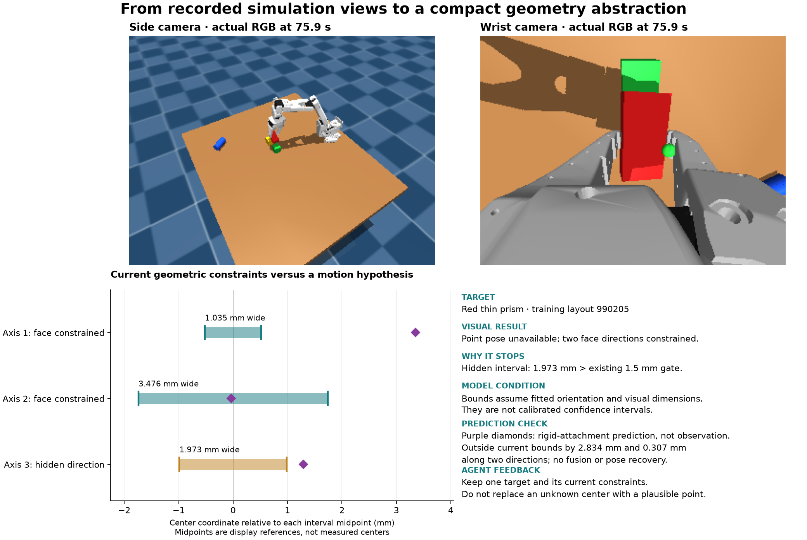

# Visual Base versus compact geometry with partial evidence

This new comparison tests the supplied geometry package, not an isolated effect of
partial constraints. It does not overwrite or pool the completed visual-input study.
The earlier study found mixed iteration benefits across three independent chains.

## Method and development evidence

A failed point-pose fit can still contain useful geometric constraints. The Full
interface now retains a unique current-view cuboid correspondence as an oriented
center region, while keeping the point pose unavailable. It supplies the fitted
basis, finite coordinate intervals, face observability, visual dimensions and
model-update count for one current target. The source is calibrated RGB-D plus
public robot masking; no object truth, contact or evaluator state enters it.
The bounds depend on correct association, orientation and estimated dimensions;
they are not calibrated confidence intervals or a certificate of attachment.
No center is invented, and the executor's fit acceptance stays unchanged.

The prototype repeats evidence extraction only after a failed fit and uses the
already captured frames. It retains one packet, clears it on the next observation,
and exposes it only for the same object and timestamp. It does not create global
scene history, inferred contacts, a predictive tracker, or new actuator capabilities.

Five inspected development training trajectories (990201–990205) were replayed.
All actions, camera archives, opaque physics archives and previous geometry records
remain identical, excluding terminal CPU timing metadata and the new constraint
field. There is one new partial packet, in layout 990205; that checkpoint is 903
characters. Success remains 1/5. Four tests verify the recorded failure, missing or
stale evidence, focus isolation and Base-interface separation. This is interface
validation, not improved task performance.

The existing two-example image selector would choose layouts 990201 and 990203
and omit the new packet in 990205. Accordingly, the new feedback rule separates
text coverage from image selection: every training layout supplies its latest two
target checkpoints, with a combined 16,000-character cap. If necessary, every
layout contributes only its last checkpoint; if these still exceed the cap, context
construction fails explicitly. Missing checkpoints are marked, and no outcome-based
layout filtering occurs. The five development layouts need 3,728 characters before
coverage metadata. Both arms use this rule. Image selection and image count remain
unchanged. Three tests cover budget behavior, latest-execution/arm isolation, frozen
registration and deterministic prompt reconstruction.

An additional real-fixture coordinate check, run after launch without changing any
frozen runtime source, translates both camera transforms and the visual table plane.
The exported world constraint region translates with them (within 5 micrometers of
text rounding), while measured dimensions remain unchanged. This checks coordinate
consistency, not absolute pose accuracy or general perception robustness.

## Recorded example



The figure uses the exact recorded simulation views at 75.9 s and the reproduced
failed fit, with source hashes beside the image. Colored bars show conditional
center intervals in fitted axes; purple diamonds show the separate rigid-attachment
prediction. Their zero reference is each interval's midpoint for display only, not
an observed center. The visual model and prediction disagree along two directions;
this is not a pose recovery or a success-rate result.

## Registered comparison

Root: `outputs/constraint_geometry_learning_replications_01`.
The root protocol and child manifests are authoritative. Registration audit passed
with zero prior seed collisions across 183 experiment metadata files. Thirteen
focused geometry, feedback, Base-interface and experiment-gate tests passed before
launch. The campaign is running; no learning-effect result is yet available.

- Three independent chains per arm, disjoint training layouts:
  992101–992108, 992201–992208, and 992301–992308.
- Twenty common reserved layouts: 993001–993020.
- Same low-rise two-cube bridge, thin-prism beam and cylinder cap; unique colors
  permuted. Same public initial orientation assumptions and visual dimension fitting.
- Same policy-owned RGB-D starter, R0 plus three revisions per chain, same model
  settings and budgets: 18 generations, 192 training and 480 reserved rollout slots.
- Base receives raw RGB-D, calibration, public labels and robot proprioception/CAD;
  it may implement its own geometry. Full additionally receives target geometry,
  symbolic operators and partial constraints. Both share the same hidden visual PnP
  executor. Partial feedback does not supply a stronger controller to Full.
- All candidate versions and exact actor contexts freeze before any reserved trial.
  Select by highest training SR, earliest tie; retain every regression and invalid
  slot. No reserved selection, result-dependent stopping or human policy repairs.
- No inspected development records, repaired candidates, diagnosis text or prior
  evolved policies enter actor contexts. The new generic interface description is
  shared consistently within the registered variant.

Primary outcomes remain reserved SR at every fixed revision, mean SR over R0–R3,
first revision reaching 80%, and training-selected reserved SR. Report all paired
chain differences and their mean/range. Common reserved layouts and repeated
revisions are not additional independent policy replications. Three chain pairs
provide limited inferential strength; do not pool episode counts into a treatment
confidence interval. Compared with the earlier study, both the interface and
training coverage change, so historical differences cannot isolate their causes.
No latency benefit is inferred; rollout duration is not an optimization target.

## Artifacts

- Builder: `scripts/build_partial_geometry_session.py`.
- Compact packet: `policies/partial_geometry_state.py`.
- Five-trajectory evidence: [partial_geometry_development.json](evaluations/partial_geometry_development.json).
- Exact-input diagnosis: [CONDITIONAL_ATTACHMENT_EVIDENCE.md](CONDITIONAL_ATTACHMENT_EVIDENCE.md).
- Experiment: `scripts/run_constraint_geometry_experiment.py`.
- Replications: `scripts/run_constraint_geometry_replications.py`.
- Audit: `scripts/summarize_constraint_geometry_replications.py`.

Before model calls, each chain's paired R0 must pass the existing full trajectory,
camera-count and action-boundary parity checks, including Base geometry isolation.

## Infrastructure interruption and resumption

After chain 1 completed R0–R2, both R3 model calls failed before emitting any
response because the service quota was exhausted. All 48 completed training
rollouts and four generated policies were retained. While generation was
unavailable, the other two independent chains completed their registered R0 runs:
80 valid rollouts in total, zero invalid policy slots, and all 24 paired R0 checks
passed. No reserved layout was executed.

The two failed invocations, exact prompts, image digests and raw error logs were
archived byte-for-byte under `interrupted_actor_attempts/batch_001`, with an audit
receipt. Four archival checks reject completed/emitted responses, generated
candidates, and non-quota failures. The independent study audit reconstructs every
archived context and includes both interruptions in the invocation count; they are
not generated policies or task failures.

After the user confirmed the quota reset, the same frozen campaign resumed at R3.
`resume_receipt_01.json` verifies identical model commands except fresh temporary
paths, identical prompts, and identical image digests. No candidate was repaired,
no model was substituted, and no completed rollout was discarded. Interrupted
calls remain separate from the 18 planned completed policy generations.

### Completed training and global freeze

The resumed campaign completed all **192 training rollouts with zero invalid
slots**, 18 policy generations, and 18 exact prompt/image context checks. Its
20 invocation attempts include the two archived pre-response quota interruptions.
All 24 paired R0 checks pass. The global freeze audit passes before reserved
execution; all 24 candidate versions are frozen, including regressions.

| Chain | Base training successes R0–R3 / 8 | Full training successes R0–R3 / 8 | Selected Base / Full |
| --- | --- | --- | --- |
| 01 | 3, 0, 2, 0 | 3, 2, 0, 4 | R0 / R3 |
| 02 | 1, 0, 3, 0 | 1, 5, 5, 5 | R2 / R1 |
| 03 | 3, 3, 3, 0 | 3, 4, 3, 3 | R0 / R1 |

Selection uses highest training SR and the earliest tied version. These are
training results, not reserved-set evidence. The coordinator has begun the
registered 480 reserved slots; no candidate changes are allowed during evaluation.

Complete training-only interface analysis records median checkpoint lengths of
113 characters for Base and 366 for Full, with maxima of 293 and 1,074. Nine
generations per arm use 224,849 input tokens for Base and 241,517 for Full;
output-token totals are 78,672 and 80,092. These totals do not show reduced model
latency or token cost. No submitted candidate has a literal `reference`, `relation`,
`align`, `target`, or `goal_error` call site; method-name counts are static, can
include unrelated receivers, and are not runtime frequency or internal reasoning.

Only one training trace emits partial-constraint packets: chain 1 Full R2, seed
992107. Its two packets appear in that chain's Full R3 context. Earlier gains and
those of the other chains cannot be attributed to receiving these packets. The
contrast remains the entire geometry package, without a feature-level ablation.
Frozen training analyses are `interface_usage_training_complete.json` and
`feedback_coverage_training_complete.json` under the study output root.

Separate [conditional-region](CONDITIONAL_ATTACHMENT_EVIDENCE.md) and
[explicit recovery](EXPLICIT_OPEN_GRIPPER_PROTOTYPE.md) diagnostics use development
traces only. Their results and human-authored interventions are neither actor
feedback nor changes to this frozen campaign.

### Final report generation

After the coordinator finishes, generate the independent complete audit, its
figure, and the report in order. These commands fail on an incomplete study;
report rendering also checks that the figure references the same audit hash.
The report preserves every revision and training-selected versions, without
substituting test winners. Its automatic descriptive text is not a declaration
that the research objective or a significance claim has been established.

```bash
OPENBLAS_NUM_THREADS=1 OMP_NUM_THREADS=1 .venv/bin/python \
  scripts/summarize_constraint_geometry_replications.py \
  --root outputs/constraint_geometry_learning_replications_01 \
  --output docs/evaluations/constraint_geometry_learning_replications_01.json
OPENBLAS_NUM_THREADS=1 OMP_NUM_THREADS=1 .venv/bin/python \
  scripts/plot_visual_input_replications.py \
  --audit docs/evaluations/constraint_geometry_learning_replications_01.json \
  --output docs/media/constraint_geometry_learning_replications_01.png
.venv/bin/python scripts/render_constraint_learning_report.py \
  --audit docs/evaluations/constraint_geometry_learning_replications_01.json \
  --figure docs/media/constraint_geometry_learning_replications_01.png \
  --output docs/PARTIAL_GEOMETRY_LEARNING_RESULTS.md
```


### Exception-channel inspection

A source inspection of the frozen Base library additionally checked dynamic
exception strings, including the shared near-tool observation gate and cuboid
correspondence failures. These paths report labels, qualitative reasons, or a
hypothesis count, not measured object coordinates/dimensions. Inspection of the
completed Base trials' surfaced `policy_error` strings found no decimal-valued
object geometry. This is a bounded source/trace check, not a general proof about
arbitrary future third-party exception behavior. Base retains qualitative actuator
and perception failure messages; it should not be described as perception-free.
Normal action returns remain restricted to `status` and `held`, and target records
to event metadata. Runtime object truth remains outside both policy interfaces.

### Reserved progress and common-starter parity

During evaluation, the inherited full auditor counts a chain's reserved trials
only after that chain's complete summary exists. The separate read-only
`scripts/inspect_reserved_progress.py` reports completed reserved slots meanwhile;
it checks frozen policy/library hashes, task and sensor configuration, matched
initial RGB, and that execution artifacts postdate the global freeze. It reports
SR only for complete 20-layout batches and does not replace the final full audit.
Its rolling receipt is `reserved_progress.json` under the study root.

After chain 1's two R0 batches completed, the same `audit_starters` checker used
for training was applied offline to all 20 reserved layouts via temporary read-only
path mappings. All pairs have identical physical arrays and action boundaries;
Base target records contain event metadata only. Both R0 batches score 8/20.
The receipt is `diagnostics/reserved_starter_parity_replica_01.json` under the
study root. Private physical arrays are read only for this offline equality check,
never supplied to policies or actors. This parity check does not establish a
learning benefit and does not modify any candidate or trial.

## User-directed evaluation budget change

After 99 reserved rollouts had been reported, the user requested approximately
50 or 100 tests instead of 480. Dispatch was suspended with 102 already complete;
the single in-flight rollout finished, leaving 103. The coordinator then exited
with code 143. Preserve the original registration and all outcomes; do not mark
the 480-slot study complete or resume without a further request for more tests.
See the [budget-limited preliminary report](PARTIAL_GEOMETRY_BUDGET_LIMITED_RESULTS.md).
The final-report commands above remain gated and are not appropriate for this
incomplete run. Analysis can continue within the retained evidence.
