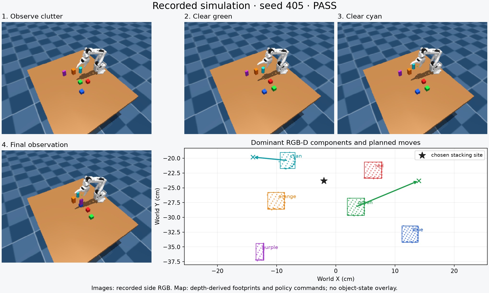

# Upright slender-prism stacking with active clutter removal

The task is to place the purple **1.5 × 3 × 6 cm** rectangular prism upright
on the blue **3 cm cube**. The scene also contains red and green 3 cm cubes,
an orange 3 × 3 × 6 cm prism, and a cyan cylinder of radius 1.5 cm and height
6 cm. All six start upright with zero yaw. The original randomized layout
distribution and private success criteria are unchanged.

This is code-as-policy optimization through simulator trials, not neural-network
weight training. The previous three-cube policy is preserved separately.

## What the clutter policy does

1. Fit the tabletop and estimate colored object footprints from calibrated side
   RGB-D. Infer prism dimensions, face planes, centroids, and hidden vertices.
2. Score reachable stacking sites using robot-only IK previews, clearance, and
   the number of objects that need moving. Prefer avoiding an extra move of the
   slender target. The search allows at most two blockers.
3. Find empty reachable parking cells, accounting for space around the gripper.
   Move each blocker, withdraw, and confirm its new location through the camera.
   Reobserve the stacking site before continuing.
4. Move the blue cube to the selected site. Measure visible finger reach before
   grasping, verify a lift through depth, and corroborate it with wrist RGB.
5. Visually align the purple prism over the blue support and lower it in stages.
   Use inferred bottom corners and support margin to gate release. Withdraw and
   observe the result; a separate evaluator checks five seconds of stability.

The final stack retains the strict release gate (bottom gap −5 to +5 mm,
lateral error at most 5.5 mm). A temporary blocker placement allows 10 mm
lateral error on an empty tabletop cell, followed by visual relocation and
worksite checks. Each pick/place allows two attempts.

When the free gripper occludes an object, the policy can move the arm to recover
the view. During a visually confirmed grasp, two observed faces can update the
constrained coordinates while the unobserved coordinates propagate from the
previous visual pose and robot motion. Hidden vertices are model estimates,
not directly observed corners or simulator annotations.

## Observation boundary

The isolated worker receives side RGB-D, wrist RGB, camera calibration, and
robot proprioception. IK previews expose robot kinematics only. Object body
poses, simulator object dimensions, contacts, and evaluator status are not
available to the policy. Initial dimensions are measured from depth.

Post-trial success feedback is used during development. The evaluator privately
uses simulator state to check actual contacts, support margin, withdrawal,
velocity, and the prism's long axis within 8 degrees of vertical. That evaluation
state is not an execution-time policy input. Saved physics states are also used
to render experiment replays, separately from policy observations.

## Evaluation

| Frozen policy evaluation | Successes |
| --- | --- |
| Development, 70 randomized layouts | **66/70** |
| Fresh reserved, 50 randomized layouts | **47/50 (94%)** |
| Fresh nominal layouts | **5/5** |
| Earlier non-rearranging policy, the same 50 reserved layouts | **42/50 (84%)** |

The new policy succeeds on seven reserved layouts where the earlier policy
failed, and fails on two where the earlier policy succeeded. In the reserved
set, **21 successful trials include visually confirmed blocker relocation**;
three failures also include a confirmed move. This is evidence of active
rearrangement, rather than only selecting a different empty stacking site.

Reserved failures are 412 (cyan grasp/visibility), 439 (purple grasp followed
by an unreachable retry), and 444 (cyan relocation not visually confirmed).
The two cyan-related cases, 412 and 444, are regressions against the
earlier policy. Development failures 110 and 113 leave the prism horizontal;
219 and 226 fail during blocker handling. No worker errors occurred, but
controlled stops still count as failed trials.

The full blackout test issues **zero robot motion commands**. A deliberately
missed first purple grasp on seed 101 recovers and completes, taking **20.7
additional simulated seconds**. All 125 normal trials used the exact published
source; 8,950 side RGB-D and 323 wrist RGB frames were audited. Wrist frames
contain no depth. The suite ran 40 tests: 39 passed and one platform-specific
test was skipped.

Results and the exact frozen source hash are recorded in
[`evaluations/prism_clutter.json`](evaluations/prism_clutter.json).
Published policy SHA-256:
`b0b426b7f3c777f663297e4599a221f329819b7c54073d4f38a9b0f0c828b2df`.

Development uses random seeds 101–120 and 201–250 (70 layouts). Seeds 201–250
were previously a reserved set for the earlier non-rearranging prism policy;
after those failures informed this work, they became development data.
Fresh reserved seeds 401–450 and nominal seeds 501–505 are evaluated only after
freezing the new source. They are not used to select another version.

## Recorded example and commands

Reserved seed 405 clears the green cube and cyan cylinder before stacking.
The older policy fails on this same layout. These are actual recorded sensor
frames; the XY diagram uses dominant RGB-D components and planned moves from
the policy log. It contains no ground-truth object overlay.



[Watch the actual physics replay at 2×](media/prism_clutter_405.mp4).
The replay's large external view is for the human viewer; the policy receives
the side RGB-D and wrist RGB views shown alongside it.

```bash
uv run python view_scene.py --vision-task prism \
  --vision-policy policies/stack_prism_upright_visual.py \
  --vision-layout random_xy --seed 405 \
  --vision-output outputs/prism_view_405

# Reproduce a headless trial in a fresh output directory.
MUJOCO_GL=egl uv run python scripts/run_vision_trial.py --task prism \
  --candidate policies/stack_prism_upright_visual.py \
  --layout random_xy --seed 405 --output outputs/prism_recheck_405

# Rebuild the figure from recorded sensor data and API notes.
uv run python scripts/plot_prism_clutter_trial.py \
  --trial outputs/prism_training_02/reserved/seed_405 \
  --output outputs/prism_405_figure.png
```

Full local artifacts are in `outputs/prism_training_02/`: the frozen policy,
split declaration, all sensor frames, API calls, notes, private evaluation,
and physics rollouts. The portable evaluation manifest, figure, example
feedback/result, and video are committed with this report.

## Limits

This is a bounded rearrangement policy for the six-object simulation scene.
It is not a complete task-and-motion planner: it searches a finite set of
sites, moves at most two blockers, and does not certify full-arm collision
clearance. Parking uses visible footprints, which can underestimate occluded
extent. Color segmentation depends on the scene's rendering and lighting.

The cuboid model assumes initially upright, axis-aligned objects and small
rotations. The policy has not learned a general lying-to-upright reorientation
skill. A toppled prism, severe occlusion, failed grasp, or unreachable parking
cell can still prevent completion. These results are simulation evidence and
do not establish real-robot performance.
