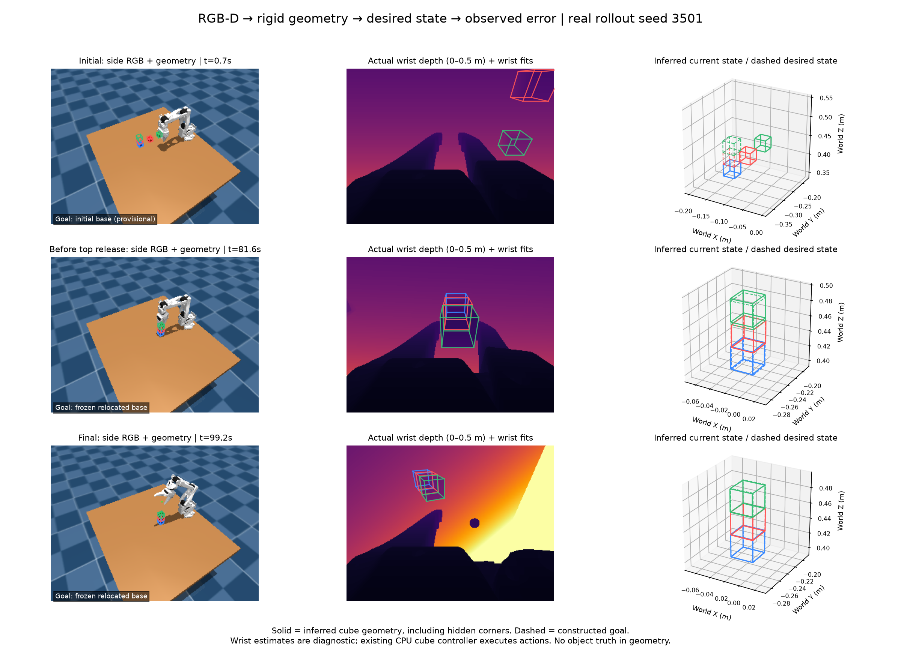
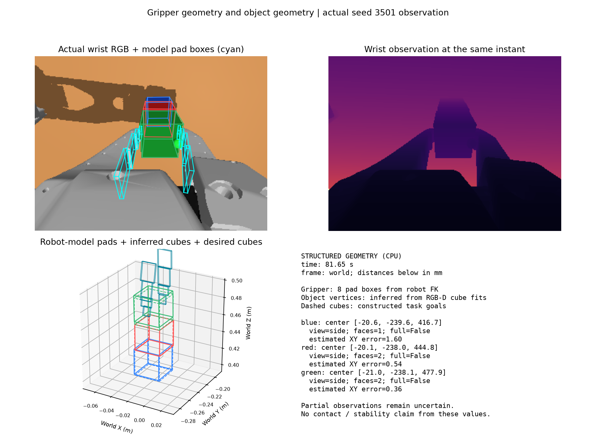

# Rigid geometry observations and desired 3D state

This experiment exposes simple rigid cube geometry as structured data: current
visual estimates, constructed desired poses, and estimated errors between them.
It adds optional wrist depth and robot-model finger pad geometry. It does not
train a new policy or demonstrate improved success rate from wrist depth.





## Runtime boundary

- Object inputs are calibrated RGB-D pixels and public task identities. Cube
  dimensions are measured in the initial upright tabletop view, then retained.
  No simulator object positions, dimensions, contacts, segmentation IDs or
  evaluator results are supplied to the geometry observer or controller.
- `--wrist-depth` adds `depth_m` and `valid_depth` to `api.camera('wrist')`.
  Historical trials still receive wrist RGB by default. Both cameras use
  optical-axis depth with right/down/forward camera coordinates. Inventory
  trials use pixel-center sampling. This is ideal simulated depth, without
  real-sensor noise, minimum-range failures or calibration error.
- `api.gripper_geometry()` returns eight named finger pad boxes, their vertices,
  robot joint angles, frame and timestamp. Fresh forward kinematics uses only
  the six robot joint angles. It returns no object/contact state. Pad boxes are
  a partial gripper model; housing meshes and full collision checking are absent.
- CPU NumPy/SciPy code fits the cubes and computes targets/errors. Simulation
  and rendering may use a GPU. There are no VLM calls in this demonstration.

## Geometry and targets

The observer records both views independently and selects the best-supported
single view for each uniquely colored cube. It does not fuse point clouds.
Every estimate retains face count, constrained axes, fit residual, inlier
fraction and observability flags. All eight vertices are inferred from the cube
model, including hidden corners. A partial fit is not a fully observed pose.

A target is a rigid pose, not eight independently movable points. The base's
measured horizontal edge direction defines alignment, with an upright goal
relative to the measured table normal. Successive centers are separated by the
sum of their measured half-heights. Target vertices follow the same rigid
transform. Rotation errors account for all 24 proper cube symmetries.

The initial target column is provisional because the existing controller chooses
a reachable worksite and relocates the base. After the base is released and the
arm withdraws, the observer freezes a new visual anchor and records that target
revision. Later drift is compared with that frozen goal, rather than moving the
goal to match every new observation. Target-anchor uncertainty is recorded.

Records include center/rotation/vertex error, signed lowest-vertex distance to
the supporting face, and projected center-to-edge margin. These are geometric
estimates, not contact or stability certificates. A negative estimated gap is
not proof of physical penetration.

## Actual example: seed 3501

The existing `cube_alignment_policy` (`refine=False`) ran a three-cube task with
three objects, default NoSlip 0 physics, blue/red/green bottom-to-top order.
The diagnostic wrapper records initial, transport, pre-release, post-withdrawal,
level-confirmation and final observations. It leaves control decisions with
the existing controller; **new wrist geometry does not command corrections**.

Both the wrist-depth run and its same-seed depth-disabled control passed the
private final evaluator. Their 109 action calls and complete recorded physics
trajectories were identical. This validates the observation wiring, not a
success-rate improvement. Neither an agent reasoning from text nor a repeated
VLM-check baseline was evaluated here.

| Per-view fits across 13 checkpoints | Side RGB-D | Wrist RGB-D |
| --- | ---: | ---: |
| Attempts | 39 | 39 |
| Returned geometry, including partial estimates | 37 | 35 |
| Fully reliable poses under the fitter's criteria | 17 | 5 |
| Selected for the combined diagnostic state | 34 | 5 |

Wrist depth supplied partial geometry for two observations where the side fit
failed, but these were not fully observed poses. The final estimated XY errors
relative to the relocated-base target were 0.40 mm (blue), 1.02 mm (red), and
0.56 mm (green). Only green had a fully reliable final pose; these numbers are
not ground-truth alignment accuracy.

CPU replay of 72 successful single-cube fits took approximately 6.4 ms median
and 7.0 ms p95. This excludes acquisition, RPC, rendering, agent reasoning,
serialization and actions. It does not establish end-to-end realtime behavior.

The earlier `outputs/rigid_state_demo_01` is retained as a diagnostic run: its
anchor hook expected shape-based names rather than runtime instance IDs, so
its final target errors were invalid. The controller still stacked the cubes.
The hook was fixed and regression-tested; `_02` is the corrected example.

## Artifacts and reproduction

- [Paired summary and provenance](evaluations/rigid_geometry_state.json)
- [Structured final packet for an agent](evaluations/rigid_geometry_agent_packet.json)
- [All 13 sensor-derived geometry records](evaluations/rigid_geometry_states.json)
- Local raw runs: `outputs/rigid_state_demo_02` and
  `outputs/rigid_state_demo_side_02`. Each includes its bundled policy, manifest,
  raw RGB-D NPZs, RPC log, geometry records, physics replay and evaluator result.
  Evaluator results are separate from the runtime geometry packets.

From the repository root, use fresh output directories:

```bash
OPENBLAS_NUM_THREADS=1 MUJOCO_GL=egl .venv/bin/python scripts/run_rigid_state_demo.py \
  --output outputs/rigid_state_wrist_new --seed 3501
OPENBLAS_NUM_THREADS=1 MUJOCO_GL=egl .venv/bin/python scripts/run_rigid_state_demo.py \
  --output outputs/rigid_state_side_new --seed 3501 --side-only
```

`--record-geometry` enables `api.record_geometry(record)` in the underlying
trial runner. It saves finite JSON diagnostics without exposing evaluator data.
The demo's observation hooks use the current controller's note events; they are
instrumentation for this experiment, not a general controller event interface.

Calibration, sensor blackout, rigid-transform invariants, cube symmetries,
partial-observation flags, target re-anchoring and robot/object independence are
covered by tests. The historical geometry ablation tests also pass. The next
control experiment should use observable local geometric constraints for a
bounded pre-release correction and compare paired scenes with identical sensors.

The [mixed-shape bridge experiment](MIXED_RIGID_GEOMETRY.md) extends these
observations to uniquely colored cubes, a rectangular beam and a cylinder.
