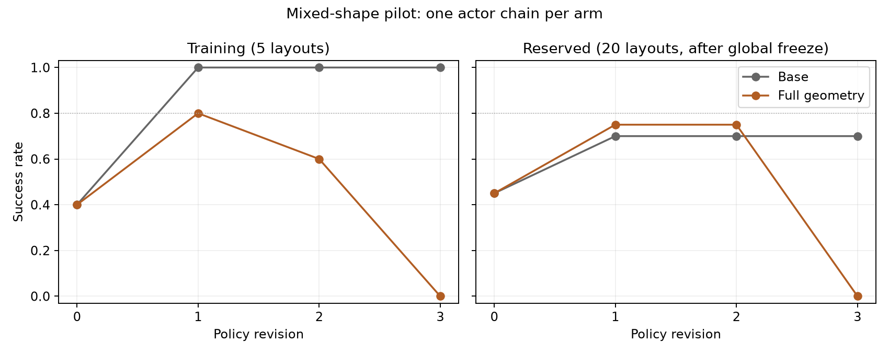

# Shared-observer base/full pilot: completed results

The training-selected full-geometry policy succeeds on 15/20 reserved layouts (75%),
versus 14/20 (70%) for base. Both are revision 1. This single-chain pilot does **not**
establish fewer revisions to higher success: the selected paired comparison has one
base-only and two geometry-only successes (exact unadjusted McNemar p = 1.0), and
neither arm reaches the registered 80% reserved threshold.

| Revision | Base training /5 | Full training /5 | Base reserved /20 | Full reserved /20 |
|---|---:|---:|---:|---:|
| R0 | 2 | 2 | 9 | 9 |
| R1 | 5 | 4 | 14 | 15 |
| R2 | 5 | 3 | 14 | 15 |
| R3 | 5 | 0 | 14 | 0 |

Mean reserved success across the registered revisions is 63.75% for base and 48.75%
for full geometry. The predeclared secondary training-retention rule keeps R1 after
its discovery: base 45%,70%,70%,70%; full 45%,75%,75%,75%. This is a retrospective
budget summary, not a separate evolution run that retained a different parent.
The R3 regression remains part of the primary evidence. The training-only diagnosis
recorded before reading reserved outcomes found that full R3 issued no motion: its
new orientation-preserving corridor screen rejected every proposed worksite. That
explains the training failure mechanism, but does not establish that large context
caused the regression or that the scenes were infeasible.

Both arms share the mixed RGB-D observer, initial perception assumptions and PnP
executor. Base receives surface measurements; full receives rigid fields and
symbolic references/operators. R0 pairs have byte-identical physical trajectories.
The auditor verified all 200 valid rollouts (40 training, 160 reserved), zero invalid
slots, all six exact actor contexts, source/library hashes, training-only selection
and the global freeze before reserved execution. There is one independent actor
chain per arm. Twenty layouts are not twenty independent learning replications.



Artifacts: [protocol](SHARED_OBSERVER_LEARNING_PROTOCOL.md),
[audited results](evaluations/shared_observer_learning_pilot_01.json), and
`outputs/shared_observer_learning_pilot_01`. Reproduce the audit and plot:

```sh
PYTHONPATH=outputs/shared_observer_learning_pilot_01/source_snapshot/scripts:scripts \
  OPENBLAS_NUM_THREADS=1 OMP_NUM_THREADS=1 .venv/bin/python \
  -m summarize_shared_observer_experiment \
  --root outputs/shared_observer_learning_pilot_01 \
  --output docs/evaluations/shared_observer_learning_pilot_01.json \
  --figure docs/media/shared_observer_learning_pilot_01.png
```

The next interface uses only active-object action checkpoints. It was motivated by
the user's abstraction requirement and training-context footprint before reserved
results were inspected. Its offline text reduction and paired development rollout
are interface evidence, not a demonstrated learning benefit. It must use a newly
registered comparison and fresh reserved layouts.
