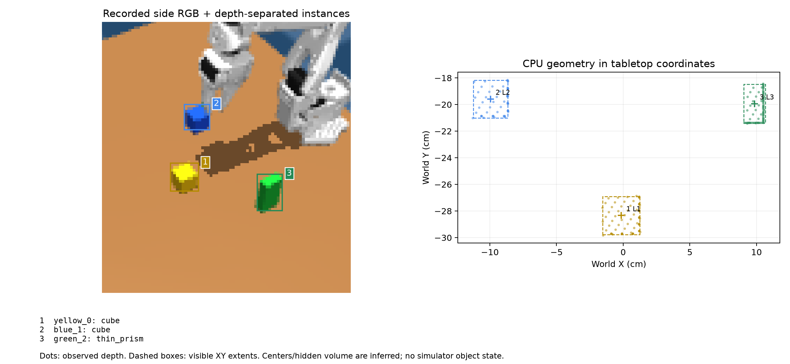
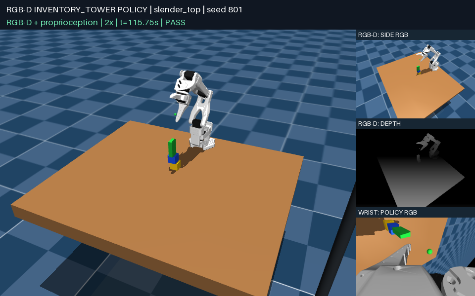

# Task-defined single columns: first generalization baseline

The project goal is to construct varied towers from the five-shape, four-color
inventory. The first curriculum covers **upright single columns with different
colors, shapes and level counts**. Bridges and pyramids come later.

This change adds a reusable task representation, task-conditioned scenes,
whole-column evaluation, replay and a CPU policy baseline. It does **not**
establish a general tower-building policy: several taller/mixed recipes failed
all their reserved trials.

## Public goals and private scenes

`TowerRecipe` specifies an ordered list of 2–4 distinct inventory identities.
The policy reads only the symbolic goal through `api.task()`:

```json
{
  "kind": "single_column",
  "levels": [
    {"color": "yellow", "shape": "cube"},
    {"color": "blue", "shape": "cube"},
    {"color": "green", "shape": "thin_prism"}
  ]
}
```

The order is bottom to top. This is an instruction, not a state observation:
it contains no positions, dimensions, masses, contacts, scene seed or evaluator
status. The actor resolves each requested identity to a visual instance ID and
measures geometry from RGB-D. The policy still uses CPU; simulation/rendering
may use GPU.

The scene generator includes every required object, reserves central source
slots for them, and optionally samples distractors from the remaining library.
Objects initially stand upright with zero yaw. Named recipes, deterministic
random recipes and explicit user-provided orders are supported. Replay retains
the ordered goal and sampled object identities, and validates scene metadata.

`random` samples cube, prism or cylinder for interior levels; the final level
may additionally be a thin prism. The `wedge_cap` recipe represents a triangular
prism at the top. An upright wedge has no horizontal upper support face, so the
schema rejects it inside a column. Its grasp and physical stability have not
been validated; the current controller explicitly stops before motion when a
triangular cap is requested. All five shapes can still occur as distractors.

## What changed in control and evaluation

The new controller binds all levels from the goal instead of assuming a blue
base and red target. It retains instance-based clearing and uses the same
observed base axis for successive placements. Release drift is measured from
images and provides bounded compensation for subsequent objects of that shape.
Two settled observations check visible drift before adding another level.

Robot-only IK previews cover every placement height. Source approach height is
separate from transport clearance; a remote grasp should not require reaching
the final tower's height first. Parking accounts for the open gripper extending
below the tool. When the soft default orientation prevents reaching a waypoint,
a robot-only IK preview can supply an achievable orientation. These heuristics
still need stronger collision and stability reasoning, especially for four
levels and tall caps.

The private evaluator checks the required identities and order, every support
contact, verticality within 8°, geometric support height, robot withdrawal,
distractor contacts, velocity and five seconds of whole-column stability with
a 3 mm drift limit. Each interface uses the **entire upper substack's center of
mass**, rather than checking only the immediately adjacent object. Cylinder
support uses a disk, not its bounding square. Mesh bounds use transformed mesh
vertices. These quantities stay inside the evaluator.

The new task permits **300 RPC calls per requested level**: 600, 900 or 1200 for
2, 3 or 4 levels. Its wall timeout remains 120 seconds. The historical
`inventory_prism` task and its 600-call budget are unchanged. These are distinct
tasks and budgets; their success rates should not be pooled.

## Frozen evaluation

Source: `policies/stack_column_cpu.py`.

```text
cf9c9fba5fb1917f6a7eb69485ba4804e3f6dd3f8e5b1ec47185cc45a1f6f30e
```

Development used seeds 801–803 per named recipe. The source was frozen before
reserved seeds 821–825. These groups contain only the recipe's required objects:

| Recipe | Bottom-to-top order | Development | Reserved |
|---|---|---:|---:|
| `cube_pair` | Blue cube, red cube | 3/3 | **5/5** |
| `cube_triple` | Blue, red, green cubes | 3/3 | **5/5** |
| `cube_quad` | Blue, red, green, yellow cubes | 1/3 | **0/5** |
| `mixed_triple` | Blue prism, green cube, red cylinder | 1/3 | **0/5** |
| `slender_top` | Yellow cube, blue cube, green thin prism | 3/3 | **1/5** |
| `cylinder_base` | Green cylinder, yellow cube, red cube | 3/3 | **5/5** |

Three-level random recipes passed 2/3 development seeds 804–806, then **0/5**
reserved seeds 826–830. With two sampled distractors, reserved seeds 821–825
passed **5/5** for `cube_triple` and **4/5** for `slender_top`.
Changing object count also changes source poses; the distractor results are
not a paired causal comparison with the minimal scenes.

The frozen reserved evaluation therefore contains **45 trials** across named,
random and clutter groups, with **25 successes**. No reserved result was used
to tune this source. In particular, the development examples below do not
override the failed reserved four-level and random-recipe results.

Failure modes include occluded held objects, shape ambiguity, unreachable
clearance, uncertain placement and collapse/drift after visually plausible
placement. Several failed trials ended with a policy note saying all levels
were placed; the independent physical evaluator still rejected them. Visual
completion notes are not success labels.

Next development priorities are cylinder pose estimation under occlusion,
collision-aware high-level transport/retreat, and whole-stack load/settling
prediction. Triangular-cap manipulation requires a separate validated skill.
Bridges and pyramids remain outside this milestone.

## Actual recorded examples

This initial frame binds yellow cube, blue cube and green thin prism to levels
L1, L2 and L3 using the public goal and visual instance geometry:



Selected **development** successes, both seed 801:



[Three-level mixed-shape replay](media/column_slender_801.mp4) ·
[Four-cube development replay](media/column_quad_801.mp4)

These restore actual physics states. The four-cube example demonstrates a
successful development execution, while the frozen four-cube reserved score
remains 0/5. External camera views are for display, not policy input.

## Run, inspect and evaluate

```bash
# Three-level goal with no distractors; execute, then open the recorded replay.
uv run python view_scene.py --vision-task inventory_tower \
  --tower-recipe cube_triple --object-count 3 --seed 821 \
  --vision-policy policies/stack_column_cpu.py \
  --vision-output outputs/column_view_821

# Choose the exact identities and order yourself.
uv run python view_scene.py --vision-task inventory_tower \
  --tower-order green_cube yellow_cube blue_cube --object-count 3 --seed 831 \
  --vision-policy policies/stack_column_cpu.py \
  --vision-output outputs/custom_column_831

# Inspect task-conditioned initial objects without executing a policy.
uv run python view_scene.py --scene-only --scene-task single_column \
  --tower-recipe random --tower-levels 4 --object-count 6 --seed 17

# Evaluate a frozen source on an explicit seed set. This also supports random
# recipes via --recipes random --levels 3, and clutter via --distractors 2.
MUJOCO_GL=egl OPENBLAS_NUM_THREADS=1 OMP_NUM_THREADS=1 \
  uv run python scripts/evaluate_columns.py \
  --candidate policies/stack_column_cpu.py --output outputs/columns_new_eval \
  --recipes cube_pair cube_triple cylinder_base --seeds 841 842 843 --jobs 3

# The worker receives only the symbolic goal plus its usual sensor inputs.
MUJOCO_GL=egl uv run python scripts/run_vision_trial.py \
  --task inventory_tower --layout sampled --tower-recipe slender_top \
  --object-count 3 --seed 801 --candidate policies/stack_column_cpu.py \
  --output outputs/slender_column_801

uv run python scripts/inspect_instances.py \
  --frame outputs/slender_column_801/camera_001.npz \
  --goal outputs/slender_column_801/result.json --output outputs/column_geometry

# Rebuild after editing the reusable column controller.
uv run python scripts/build_inventory_policy.py --controller column_policy \
  --output policies/stack_column_cpu.py
MUJOCO_GL=egl uv run python -m unittest discover -s tests
```

Key modules: `tower_tasks.py`, `inventory_tower.py`, `column_policy.py`.
The prior two-object policy remains byte-for-byte frozen and passed its
six-object seed 601 regression. Column sensor blackout caused zero motion.
Tests: **65 passed, one platform-specific skip**, including task validation,
pose-free public goals, circular support, ordered 3/4-level physical fixtures,
replay identity checks, cache goal separation and unsupported-cap abstention.
The fixture checks validate the evaluator; they do not count as policy trials.

[Portable results, notes, private final checks and source hashes](evaluations/single_columns.json)
cover the final development and frozen evaluation groups. Full local artifacts
are in `outputs/columns_01/`. Maintained documentation, comments and docstrings
use English; historical raw experiment inputs remain unchanged.

An additional frozen-source CLI smoke test explicitly requested green cube →
yellow cube → blue cube at seed 831 and passed. It verifies the custom-order
entry point and is recorded separately from the declared 45-trial matrix.
