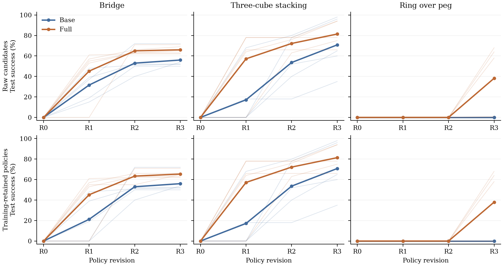

# Single-policy acquisition: consolidated results

The three completed comparisons evaluate executable-program acquisition from an
observation-only scaffold. Full adds supplied sensor-grounded geometry to the
shared observation and action interface. This report uses the **new contract-only
Bridge** study, contract-only Stacking, and paired Ring. Historical source-disclosed
Bridge/Stacking runs and development Ring pilots are not pooled into these results.

[Combined experiment index](evaluations/README.md) ·
[Setup and protocols](SINGLE_POLICY_EXPERIMENTS.md) ·
[All data and figures](evaluations/single_policy/README.md) ·
[Paper LaTeX](paper/single_policy_experiments.tex)

## Final outcomes

Each task has five paired training chains, five training layouts per pair, R0–R3,
and 100 shared held-out layouts. All three studies are complete: 12,000 test
slots, 600 training slots, and 90 completed program generations in total.
Ring additionally has two interrupted model requests. Failed and invalid
candidates remain in the denominator; its 100 invalid-policy test slots did not
execute a simulation. Completion does not mean successful execution.

The primary table uses the policy retained after R3 **using training outcomes
only**. Values are mean success percentages across five chains; differences are
percentage points. Raw R3 denotes the final generated candidate, whether retained
or rejected.

| Task | Base retained | Full retained | Full − Base | Base raw R3 | Full raw R3 |
| --- | ---: | ---: | ---: | ---: | ---: |
| Bridge | 56.0% | 65.4% | +9.4 | 56.0% | 66.0% |
| Stacking | 70.8% | 81.4% | +10.6 | 70.8% | 81.4% |
| Ring | 0.0% | 38.0% | +38.0 | 0.0% | 38.2% |

Full has higher mean final retained success on all three tasks. The paired chain
outcomes are heterogeneous: Full is ahead in 4/5 Bridge pairs, 3/5 Stacking pairs,
and 3/5 Ring pairs (the other two Ring pairs tie at zero). These are descriptive
results for the registered tasks and layouts, not a claim of statistical
significance or a task-independent effect size. We do not pool the tasks into one
success rate.

## Acquisition curves

**Figure caption.** Single-policy acquisition on Bridge, three-cube Stacking, and
Ring over peg. Top: every generated candidate. Bottom: policies retained using
strict improvement of the training success set. Bold lines show means over five
paired training chains; faint lines show individual chains. Every version is
evaluated on the same 100 held-out layouts per task after training freezes. R0
is an observation-only scaffold. No test result is used for policy retention.

| Task | Arm | Retained R1 | Retained R2 | Retained R3 |
| --- | --- | ---: | ---: | ---: |
| Bridge | Base | 21.2% | 53.0% | 56.0% |
| Bridge | Full | 45.2% | 63.4% | 65.4% |
| Stacking | Base | 17.2% | 53.6% | 70.8% |
| Stacking | Full | 57.2% | 72.2% | 81.4% |
| Ring | Base | 0.0% | 0.0% | 0.0% |
| Ring | Full | 0.0% | 0.0% | 38.0% |

Bridge and Stacking show earlier acquisition with Full: their retained R2 means
(63.4% and 72.2%) already exceed Base's R3 means (56.0% and 70.8%). This compares
observed revisions, not matched token budgets or a universal time-to-threshold
claim. Ring behaves differently: both arms have zero mean test success through
R2, and Full's gain appears at R3 in three chains. Its retained final chain rates
are 64%, 58%, 0%, 0%, and 68%; the abstraction does not make learning uniformly
reliable across chains.

Retention can reject a test-useful candidate. For example, Ring Full replica 3's
R3 reaches 1/100 test success but does not improve its training success set, so
R0 remains retained. This explains the difference between Ring's 38.2% raw and
38.0% retained means. Test success is never used to override that decision.

## Paired final policies

Each cell reports retained test success and selected revision. Chain IDs are
paired within a task, not across tasks.

| Task | Chain | Base | Full | Full − Base (pp) |
| --- | ---: | ---: | ---: | ---: |
| Bridge | 1 | 50% (R2) | 63% (R2) | +13 |
| Bridge | 2 | 72% (R3) | 65% (R3) | -7 |
| Bridge | 3 | 54% (R3) | 66% (R2) | +12 |
| Bridge | 4 | 52% (R3) | 71% (R2) | +19 |
| Bridge | 5 | 52% (R2) | 62% (R2) | +10 |
| Stacking | 1 | 35% (R3) | 94% (R3) | +59 |
| Stacking | 2 | 98% (R3) | 94% (R3) | -4 |
| Stacking | 3 | 65% (R3) | 75% (R3) | +10 |
| Stacking | 4 | 96% (R3) | 66% (R1) | -30 |
| Stacking | 5 | 60% (R3) | 78% (R1) | +18 |
| Ring | 1 | 0% (R0) | 64% (R3) | +64 |
| Ring | 2 | 0% (R0) | 58% (R3) | +58 |
| Ring | 3 | 0% (R0) | 0% (R0) | +0 |
| Ring | 4 | 0% (R0) | 0% (R0) | +0 |
| Ring | 5 | 0% (R0) | 68% (R3) | +68 |

The 500 evaluations per arm/version reuse 100 layouts across five trained
policies. They are not 500 distinct layouts or independent training runs.
`mean_curves.csv` reports sample SD across chains; it is not a confidence interval.
The curves preserve pairing and display the substantial chain variation directly.

## Model resources

All values below are **per-chain means across the complete R1–R3 acquisition**,
including proposals later rejected by training retention. Tokens are from
completed requests. Model-request wall time includes service/transport waiting
and is not parallel campaign duration, rollout time, or online decision latency.

| Task | Arm | Input tokens | Output tokens | Total tokens | Cached input | Completed request time (s) | Attached images |
| --- | --- | ---: | ---: | ---: | ---: | ---: | ---: |
| Bridge | Base | 94,399.0 | 31,341.4 | 125,740.4 | 47,155.2 | 927.8 | 8.0 |
| Bridge | Full | 97,703.8 | 29,341.8 | 127,045.6 | 51,148.8 | 894.9 | 7.6 |
| Stacking | Base | 103,169.2 | 34,910.2 | 138,079.4 | 51,020.8 | 1,059.2 | 7.6 |
| Stacking | Full | 99,471.0 | 23,913.6 | 123,384.6 | 41,932.8 | 730.5 | 6.4 |
| Ring | Base | 115,042.0 | 51,769.8 | 166,811.8 | 63,488.0 | 1,652.7 | 6.0 |
| Ring | Full | 127,066.0 | 36,070.8 | 163,136.8 | 70,041.6 | 1,060.7 | 6.0 |

Cached input is already included in input, and reasoning output is included in
output. Full's completed-token use is 1.0% higher for Bridge, 10.6% lower for
Stacking, and 2.2% lower for Ring. Thus the data do not support a universal token
reduction claim.

Ring Base also has two interrupted requests totaling **1,800.0 seconds** and four
image attachments across the arm (360.0 seconds and 0.8 attachments per chain
when averaged over all five). Their token usage is unknown, not zero. The last
two completed generations used the authorized HTTP transport amendment; the
other settings and completed history were preserved. Ring's completed-token
comparison is consequently not a comparison of fully measured total consumption.
`model_requests.csv` retains the interrupted rows with blank token fields, while
`resources.csv` keeps interrupted time and images separate.

[Token-axis curves (PDF)](evaluations/single_policy/learning_curves_tokens.pdf)
plot the same outcomes against cumulative completed tokens per chain. Bold points
pair mean tokens and mean SR at each revision; thin lines use each chain's own
costs. These are acquisition trajectories, not estimates at a common fixed token
budget. Token curves omit the unknown consumption of Ring's interrupted attempts.

## Evaluation scope and limitations

- **Bridge attribution:** the primary result is `geometry_bridge_contract_01`,
  with executor source withheld from both arms and fresh training/test layouts.
  Its full 4,000-slot evaluation matrix was registered before training. The older
  `geometry_parallel_01` result remains historical evidence, not another replicate.
- **Stacking extension:** the final 100 layouts combine the original 20 with a
  post-hoc extension of 80, without retraining or test feedback. On the additional
  80 alone, retained R3 is **69.5% Base / 79.5% Full**, a 10.0 pp difference.
  The subset is exported separately and not counted twice.
- **Matched arms, differing tasks:** executor source is withheld in all three
  primary studies. Bridge/Stacking share visual pick/place assistance; Ring uses
  explicit pad/jaw commands and a different image-feedback schedule. Prompt,
  actuator, geometry bundle, and transport differences limit comparisons of
  absolute difficulty or efficiency across tasks.
- **Physical success:** Bridge/Stacking retain the historical contact helper,
  which can miss unnamed robot collision geometry. Ring uses body-ancestry
  robot-contact checks. These frozen outcomes have not been retrospectively
  re-certified with a changed evaluator. Ring has generous nominal clearance
  (12 mm per side), so its result is not a precision-insertion claim.
- **Interpretation:** the comparisons evaluate the supplied geometry interface
  as a package. They show layout generalization within the specified object
  families, not arbitrary novel-object reconstruction, cross-task transfer, or
  an isolated benefit of text serialization. Online latency is evaluated separately.

## Data provenance and reproduction

| Task | Primary study | Training seeds | Shared test seeds |
| --- | --- | --- | --- |
| Bridge | `geometry_bridge_contract_01` | 2032100101–2032100125 | 2032101001–2032101100 |
| Stacking | `geometry_cube_stack_contract_01` | 2029090101–2029090125 | 2029091001–2029091100 |
| Ring | `ring_peg_comparison_01` | 2031101001–2031101025 | 2031109001–2031109100 |

The [exporter](../scripts/export_single_policy_results.py) checks all 12,000 test
result SHA-256 hashes, reconstructs retention from training success sets, and
recomputes chain/mean curves and per-turn token totals against the frozen
summaries. The [bundle index](evaluations/single_policy/README.md) documents all
columns, missing values, and reproduction commands. Original studies are read
only; source paths and hashes remain in the export. This consolidation runs no
policies or model requests.
