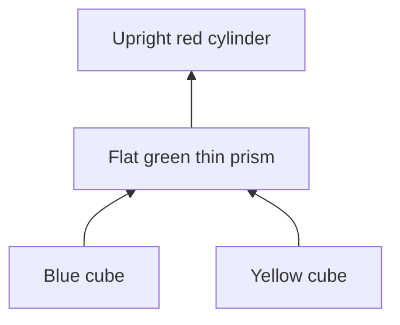
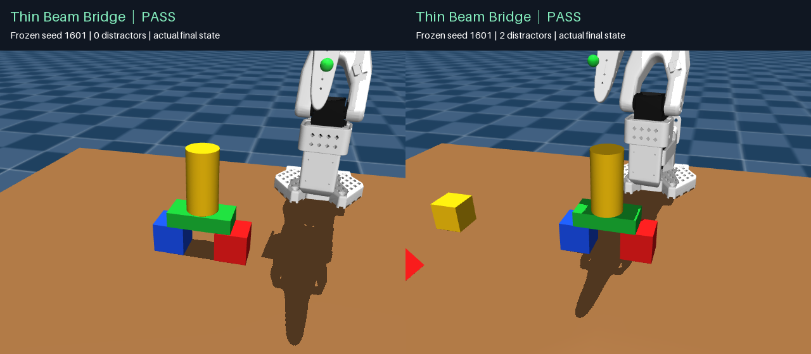

# A thin beam across two cubes, with a cylinder cap

`thin_beam_bridge` builds a four-object support graph:

- Two 3 cm cubes with a nominal **3 cm clear gap** between their inside faces.
- A 1.5 × 3 × 6 cm thin prism lying across both cubes. Its 6 cm axis follows
  world X, its 3 cm axis follows world Y, and its 1.5 cm axis is vertical.
- An upright cylinder, radius 1.5 cm and height 6 cm, centered on the beam.

The nominal overlap is **1.5 cm on each cube**, and the total height is **10.5 cm**.
The default colors are blue/yellow foundations, a green beam, and a red cylinder;
the evaluation runner also supports bijective color permutations.



## Initial scene and capability boundary

The task initializes the beam **flat on the tabletop**, at its sampled source XY
position. The other objects start upright. The reset keyframe applies this source
orientation before the episode; the passive viewer, isolated trial runner, and
recorded playback use the same initialization. Source positions retain the
existing jittered inventory sampling, including farther reachable slots.

The robot actually picks up the beam, moves it over the two placed cubes,
releases it, withdraws, and places the cylinder. The controller never teleports
objects. This task does **not** implement turning an initially upright prism
through 90 degrees or recovering a beam that has fallen onto another face.
Those are additional manipulation skills, not demonstrated by these results.

## Visual geometry and CPU policy

The public goal adds the symbolic desired orientation `flat_x`. Its grid places
foundation centers two **visually measured cube widths** apart. It does not
provide source poses, metric block dimensions, contacts, or evaluator results.

The online beam recognizer combines a planar top, a rectangular finite silhouette,
and thickness above the fitted tabletop. Shape hypotheses use dimension ratios;
metric dimensions are measured from RGB-D. A thin slab may expose only one
usable face, so the geometry model preserves previously observed orientation
through partial post-release views. The longest and shortest fitted physical
axes determine whether the beam is aligned; fitted axis ordering is immaterial.

The controller measures visible fingertip reach near the source, checks each
support patch and the whole graph's force/moment balance, and checks orientation
before release and after placement. Its broader workspace search and additional
staging clearance apply only to graphs containing a flat beam. Perception,
association, support optimization, planning, and control run on CPU. Rendering
may use the GPU.

The independent private evaluator uses the beam's actual broad top/bottom faces,
rather than treating its intrinsic long axis as vertical. It requires both
cube contacts, the cylinder contact, the prescribed relative positions and
orientations (8-degree tolerance), no robot contact, and five seconds of stable
motion with at most 3 mm drift. Offline physical fixtures establish geometric
feasibility, separately from robot policy trials.

## Measured results and limitations

The final frozen CPU candidate passed **10/20 fresh trials (50%)**. This new task
has not reached the earlier 90% target. The previous 29/30 result for upright
structures does not transfer to a thin horizontal beam.

| Final reserved matrix | Successes |
| --- | ---: |
| Seeds 1601–1610, color permutations, four task objects | 6/10 |
| Same seeds/colors, two additional sampled distractors | 4/10 |
| Total, strict five-second whole-structure check | **10/20** |

There were no worker errors or policy exceptions. The ten failures include two
initial beam-identification stops, four unconfirmed/conflicting beam observations
after pickup, two later cylinder sources that could no longer be recovered
visually, one blocked foundation workspace, and one rejected/retried placement.
The main remaining work is a stable thin-beam grasp at distant source locations,
collision-aware source/staging motions, and recovery from partial observations.
Changing the allowed source distribution would require a separate curriculum
and report; this evaluation retains the existing sampled source XY locations.

The first frozen attempt scored **9/20** on seeds 1501–1510. Those results remain
archived. Its failure audit motivated explicit top-boundary fitting; only then
were those seeds moved into an **expanded development** set. The last development
matrix scored **19/26** on seeds 1401–1403 and 1501–1510, with color permutations
and zero/two distractors. The final freeze used a separate, previously untested
1601–1610 matrix. The 9/20 and 10/20 figures use different scenes and are not a
paired improvement estimate.

The final bundle also passed 3/3 existing-recipe regressions, and a visual
blackout produced one camera call and **zero motion/gripper/IK calls**. The full
suite ran 141 tests: 140 passed, one platform-specific test skipped. Median
worker compute was 5.00 CPU seconds per attempt (p95 7.26), including early stops
and excluding simulator, rendering, RPC serialization, and host robot IK.



[Watch the complete actual assembly](media/thin_beam_bridge_1601.mp4): final
candidate, seed 1601, no distractors, played at 6×. Frames come from saved physics
states. The external presentation camera is for display only and does not feed
the policy. Both pictured trials passed the original five-second check.

**Longer stability is not yet reliable:** in two selected 60-second passive
continuations, the no-distractor example passed, while the two-distractor example
exceeded the 3 mm cylinder drift limit. This is **1/2 selected examples**, not a
20-trial long-duration success estimate. The strict failure is retained even
though the initial assembly passed the task's five-second window.

Portable evidence:

- [Final frozen matrix, all successes/failures and runtime hashes](evaluations/thin_beam_bridge_heldout.json)
- [First frozen matrix, retained unchanged](evaluations/thin_beam_bridge_first_heldout.json)
- [Development history, including a rejected reset regression](evaluations/thin_beam_bridge_development.json)
- [CPU profile, blackout, regressions and test counts](evaluations/thin_beam_bridge_runtime.json)
- [Both 60-second continuation checks](evaluations/thin_beam_bridge_durability.json)
- [Video selection and provenance](evaluations/thin_beam_bridge_replays.json)

Final candidate SHA-256:

```text
80bfb487e1b35ec08ceb83e06c298dc40354eca3df17fbf1ce2ff1aad50e9504
```

The first beam candidate is preserved as
`policies/archive/assemble_beam_4a0403_cpu.py` (SHA-256
`4a040317a306500e1f2334eb17873468a271d400bb8ac9f553cad6a8d821ca64`).

## Reproducibility

The previous 29/30 low-structure report belongs to the byte-for-byte preserved
`policies/assemble_structure_v1_cpu.py`. It does not measure the beam task or the
updated controller. Historical inventory and single-column bundles remain
unchanged. See [the earlier report](LOW_STRUCTURES.md) for that evidence.

```bash
# Inspect the initial four-object scene.
uv run python view_scene.py --scene-only --scene-task support_graph \
  --structure-recipe thin_beam_bridge --object-count 4 --seed 1601

# Execute the policy and view its actual recorded rollout.
uv run python view_scene.py --vision-task inventory_structure \
  --structure-recipe thin_beam_bridge --object-count 4 --seed 1601 \
  --structure-color-map '{"red":"yellow","yellow":"red","blue":"blue","green":"green"}' \
  --vision-policy policies/assemble_structure_cpu.py \
  --vision-output outputs/thin_beam_demo_1601

# Rebuild the current CPU bundle.
uv run python scripts/build_inventory_policy.py --controller structure_policy \
  --output policies/assemble_structure_cpu.py
```

Reproduce the final reserved matrix in a new output directory:

```bash
MUJOCO_GL=egl OPENBLAS_NUM_THREADS=1 OMP_NUM_THREADS=1 \
  uv run python scripts/evaluate_structures.py \
  --candidate policies/assemble_structure_cpu.py \
  --output outputs/thin_beam_reproduction --recipes thin_beam_bridge \
  --seeds 1601 1602 1603 1604 1605 1606 1607 1608 1609 1610 \
  --distractors 0 2 --permute-colors --jobs 3 --split heldout \
  --frozen-sha256 80bfb487e1b35ec08ceb83e06c298dc40354eca3df17fbf1ce2ff1aad50e9504
```

The passive scene command uses the default colors. The policy command includes
the video trial's exact color mapping. An existing trial can also be replayed
without rerunning the policy. Do not overwrite frozen output directories.
