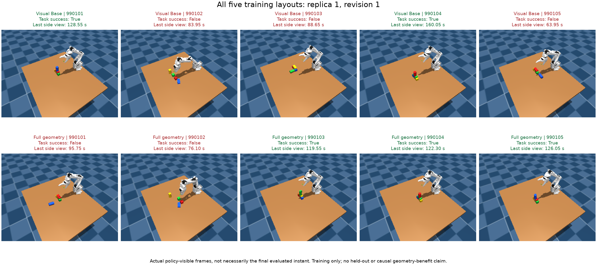
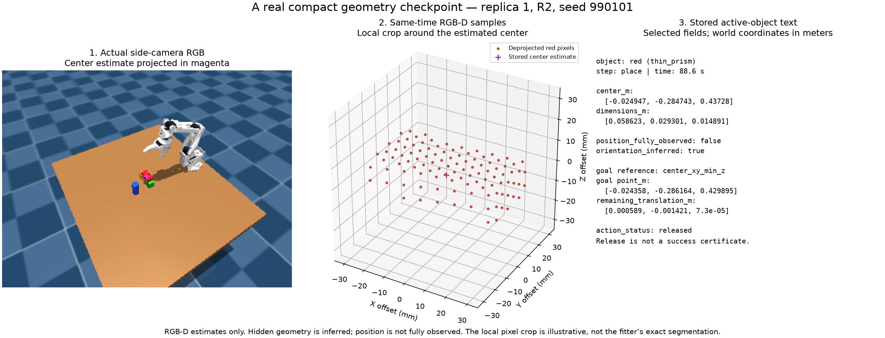

# Visual-input Base versus supplied geometry abstraction

Completed study: [all results and limits](VISUAL_INPUT_LEARNING_RESULTS.md).
The historical progress sections below preserve observations made during execution;
the linked completed report is authoritative for final outcomes.

The user revised the experimental boundary: Base must not directly receive
precomputed object centers or other geometry. Earlier Base centers were estimated
from calibrated RGB-D, **not simulator object truth**, but that already supplied
part of the abstraction. Preserve those completed studies as strong-baseline
comparisons. Do not relabel their results as a raw-visual comparison.

The next comparison has only two arms:

| Input or capability | Base | Full geometry |
|---|---|---|
| Side/wrist RGB-D pixels and camera calibration | Yes | Yes |
| Robot proprioception/CAD and public shape/color task labels | Yes | Yes |
| Supplied object center, dimensions, vertices, relations or goal errors | No | Yes, derived from RGB-D |
| Actor-written visual processing, geometry calculations and memory | Allowed | Allowed |
| Identical CPU pick/place actuator | Yes | Yes |
| Simulator object poses, dimensions, contacts or evaluator state | No | No |

`VisualInputSession` exposes only time/tool proprioception, pick/place composition,
and action-boundary logging. It has no observe/get/table_z/reference/state methods.
Action returns contain only status and held flags: observations, coordinates, XY
errors and surface gaps are filtered. Base checkpoints contain only object identity,
step, timestamp and action status. A checkpoint never provides a camera refresh;
Base obtains evidence explicitly through `api.camera()`. Public task grids describe
a desired relative structure and contain no measured world object positions.

Both conditions retain the exact same hidden RGB-D PnP executor. It estimates poses
from camera evidence internally to carry out pick/place and confirm a lift. Base
cannot query those internal estimates; the actor validator blocks internal access.
Thus this is a comparison of high-level visual planning with and without supplied
geometry, not raw pixels-to-torques versus a stronger robot controller. Full may
benefit from the supplied perception/geometry package as well as its representation;
a positive result would not isolate a purely symbolic-text effect.

The common initial planner is `policies/support_graph_visual_starter.py`. Its own
camera deprojection, table fit and visible-top locator are adapted from the original
`stack_three_blocks_vision.py`; yellow segmentation is added for the four-color
inventory, and the public support graph replaces the fixed stacking order. Both
arms receive the same source. Any center computed by this planner is its own visual
estimate, not a supplied coordinate or a hidden truth lookup. The estimator is a
simple historical visible-top method, not a validated general rigid-body fitter.
Actor revisions may replace it; do not prohibit Base from learning good geometry.

The new campaign is registered in `outputs/visual_input_learning_replications_01`.
Its authoritative protocol and child manifests freeze all sources, libraries and
splits before the first rollout. Training layouts are 990101–990105, 990201–990205
and 990301–990305; all three isolated chain pairs share fresh reserved layouts
991001–991020. Each arm has R0 plus three model revisions: 120 training slots,
480 reserved slots and 18 model generations across the study. Runtime progress and
execution output are in `progress.json` and `coordinator.log`. The unlaunched
strong-baseline replication draft was removed when the user changed the comparison.

Every chain completes training and exact prompt/image auditing before any reserved
trial. All candidate versions freeze, and training SR selects the winner with an
earliest-revision tie break. Report each paired chain's reserved curve, mean SR over
R0–R3, first revision reaching 80%, and training-selected SR, plus the mean and range
of paired differences. Keep invalid slots and regressions; do not stop early based
on SR. Repeated layouts and policy revisions are not independent actor replications.
Three chain pairs give limited inference. No reserved outcome, inspected diagnosis,
previous policy or another chain's output enters an actor context. Do not pool this
study with the previous strong-baseline experiments.

Runner: `scripts/run_visual_input_experiment.py`; exact-context audit:
`scripts/summarize_visual_input_experiment.py`; the replication coordinator reuses
the existing global freeze gate. Six focused interface/harness tests pass.

Development checks: `tests/test_visual_input_session.py` verifies the public-method
boundary, all action-return projections, checkpoint logging, the full interface and
sensor dependence. Shifting camera-to-world calibration translates the policy's
own estimate by the same amount; invalid depth produces failure, not a fixed pose.
Paired simulation and blackout evidence are saved in
`outputs/visual_input_development_01` and
[evaluations/visual_input_development.json](evaluations/visual_input_development.json).
These are integration checks, not learning or generalization evidence.

The completed seed-75103 development pair succeeds in both conditions, with
byte-identical physical trajectories and 51 camera calls per arm. The separate
Base depth-blackout control fails during tabletop perception after one camera call
and executes zero motion/gripper commands. Three focused tests pass. This demonstrates
the tested interface boundary and sensor dependence, not universal absence of every
possible leak or an SR advantage. The new actor-learning study is registered separately from these development checks.

## First-revision training observations

The first chain's R0 has 2/5 successes in each arm with identical paired physics.
At R1, Visual Base has 2/5 and Full geometry 3/5; all twenty R0/R1 trials are valid.
This is training-only progress, not a held-out learning advantage. The submitted
planners choose different visual work sites and recovery rules, so an individual
outcome difference cannot establish a geometry-precision mechanism.

The gallery includes every registered training layout and both arms, including the
Base-only success. Images are actual last side-camera observations, not necessarily
the final evaluation instant. Binary success is reported separately from the image.
Frame paths, timestamps and hashes are in
[evaluations/visual_input_r1_training_frames.json](evaluations/visual_input_r1_training_frames.json).
This post-submission gallery and analysis are never provided to experimental actors.

## Actual compact abstraction example

This example uses replica 1, R2, seed 990101 at 88.6 simulated seconds. It projects
the stored red thin-prism center into the actual same-time side RGB image, shows
107 deprojected red depth pixels in a local visualization crop, and displays selected
fields from the stored target-only record. The crop is illustrative, not a replay of
the fitter's exact association mask. The record explicitly says position is not fully
observed and orientation is inferred. Desired `center_xy_min_z` is an extent target,
not a material face point or a contact certificate. No simulator object geometry was
used. [Provenance and the complete record](evaluations/visual_input_abstraction_example.json)
include the original sensor/record hashes and reproducible renderer path. This
analysis-only figure is never supplied to experimental actors.

## First chain training freeze

Replica 1 completed all 40 training trials with no invalid submissions. Base's
success counts are [2,2,3,0]/5 and Full's [2,3,4,3]/5 across R0–R3. Both select R2
using training only. Exact prompt/image auditing passed for all six actor contexts.
Base R3 issued zero motion commands on every layout after rejecting all candidate
work sites; Full R3 physically executed all five, with two failures reported as
visual separation during beam placement and an unconfirmed-pick exception for the
cap. These log-based stages are not causal proof of an abstraction effect. Complete
R3 notes and source hashes are retained in the study's
`replica_01_training_regression.json`. The two later chains and all reserved results
remain necessary for the registered learning comparison.

## Second chain first revision

Replica 2's matched R0 succeeds on 2/5 layouts in each arm. At R1 both arms regress
to 1/5, with no invalid submissions. This repetition has not reproduced the first
chain's initial Full improvement. The initial beam-observation failure on seed
990204 occurs in both arms and remains in the data. The protocol and methods stay
frozen; R2 proceeds from each arm's own feedback. These training counts must not be
pooled with the first chain or interpreted as reserved generalization performance.

Replica 2 R2 completes at Base 3/5 versus Full 2/5, with zero invalid submissions.
Its current training curves are [2,1,3]/5 and [2,1,2]/5, the opposite R2 ordering
from replica 1. This variability rules out presenting the first chain as a stable
learning advantage. R3 proceeds unchanged; all reserved layouts remain unexecuted
until the study-wide freeze gate.

## Second chain training freeze

Replica 2 completes all 40 valid training trials with Base [2,1,3,1]/5 and Full
[2,1,2,0]/5 across R0–R3. Base selects R2; Full selects R0 under the registered
earliest-tie rule. Exact auditing passes for all six actor contexts. This is
negative training evidence for a consistent supplied-abstraction advantage; no
candidate or budget is changed in response. R3 policy-visible notes and motion
counts are preserved in `replica_02_training_regression.json` under the study root.
Replica 3 has started; reserved evaluation remains behind the global freeze gate.

## Third chain first revision

Replica 3's matched R0 succeeds on 3/5 layouts in each arm; R1 remains 3/5 for both.
All ten R1 trials are valid. Thus the first-revision training pattern across the
three chains is one Full improvement, one shared regression, and one shared tie.
This is descriptive training evidence only. R2 continues without changing the method,
budget, selection rule or held-out freeze gate.

Replica 3 R2 also completes at 3/5 for each arm, with zero invalid submissions.
The current third-chain curves are [3,3,3]/5 for both conditions. R3 is running;
all test layouts remain behind the study-wide training freeze. This unchanged
training curve is retained alongside the differing outcomes in the other chains.

## Global training freeze

All three chain pairs completed 120 training rollouts and 18 actor generations.
All 24 candidate versions froze before any reserved trial; each child training audit
verified all six exact prompt/image contexts. Replica 3 finished with success counts
[3,3,3,4]/5 for both arms and selects R3 in both. Replica 1 selects R2 in both arms;
replica 2 selects Base R2 and Full R0. Training evidence is mixed across chains and
does not establish a generalization or iteration advantage. The coordinator has
started the registered 480 reserved trials.

The analysis-only renderer `scripts/plot_visual_input_replications.py` requires a
completed independent study audit and shows all chains and all revisions. It never
feeds analysis back to actors.

## Training interface usage (descriptive only)

A post-submission pass over all 18 generated planners finds no explicit attribute
call sites named `reference`, `relation`, `align`, `target`, or `goal_error`. Five
of nine Full planners contain an `observe` call site. This does not establish how
the actor used supplied text internally; attribute-name counts also do not resolve
receivers or measure runtime frequency. The common visual starter and actor-written
CV remain available in both conditions.

Across stored training checkpoints, the median serialized record is 114 characters
for Visual Base and 363 for Full (Full maximum 680). These counts include all
recorded steps, not only the subset attached to actor prompts. Total actor input
tokens are 220,701 for Base and 232,470 for Full across nine generations per arm;
median output tokens are 8,821 and 7,569 respectively. Neither record length nor
token totals establish a real-time or latency benefit. Reproduction:
`scripts/analyze_visual_input_usage.py`; complete training-only evidence:
`outputs/visual_input_learning_replications_01/training_interface_usage_complete.json`.
These measurements and their interpretation are never fed back to the actors.

## Robot-only reachability diagnostic

The second chain's Full R3 rejects every candidate site on four layouts and makes
no motion; its fifth layout fails during initial object observation. Replaying all
119 recorded IK requests from the four no-motion logs uses only the six-joint robot
CAD model, public robot joint observations, and requested points. The robot-only
model reproduces every recorded tool position and rotation within 1e-9 (position
error is exactly zero). No object state, contacts, task score, or rollout arrays are
read.

All 119 requested points meet the common actuator's default 5 mm position threshold.
The actor's stricter 2.5 mm guard rejects 24 of them: six site candidates per layout.
Largest default IK residuals are 4.025, 2.907, 2.894, and 3.392 mm for seeds 990201,
990202, 990203, and 990205. Contrary to the initial orientation-mismatch hypothesis,
none of these requests requires the actuator's relaxed-orientation fallback. This
is evidence of a guard/controller threshold mismatch, not evidence that a repaired
planner would succeed. Only actually requested points were replayed; early-rejected
sites can contain later unqueried waypoints. Sequential IK, collisions, grasping,
and object stability remain untested.

Reproduction: `scripts/replay_robot_reachability.py`; complete requests and source
hashes: [evaluations/visual_input_robot_reachability.json](evaluations/visual_input_robot_reachability.json).
The diagnostic source is also archived in the study directory. It never enters
actor feedback or changes any frozen policy. A future interface should expose the
actual controller acceptance contract consistently to both arms before studying
additional action-relevant geometric abstractions. Merely adding more coordinates
to the state would not fix this demonstrated mismatch.

## Frozen observer sensor-dependence check

A separate replay uses the frozen Full library and one real initial RGB-D fixture
(two cubes, one flat thin prism, one cylinder). Translation of the calibrated world
frame shifts estimated centers while retaining dimensions. A 1.15 scaling of depth
and camera translation scales estimated centers and freshly learned dimensions.
Maximum center equivariance residual is 0.168 mm; maximum dimension residual is
0.000278 mm. All four targets reject depth blackout. These are consistency residuals
under synthetic sensor transformations, not absolute pose accuracy, new physical
size-generalization trials, or task-SR evidence.

The source trace confirms that initial heights and dimensions are fitted from RGB-D
and subsequently retained as visual object models. Public shape labels, initially
on-table geometry and orientation assumptions remain; the fitters also impose
shape/range priors (for example, aspect-ratio gates for a flat thin prism). Do not
describe this as unconstrained reconstruction of arbitrary unknown geometry.
No metric catalog dimensions or runtime object truth are passed to the observer.
The test does not prove the absence of every possible information leak.

Reproduction: `scripts/check_visual_geometry_dependence.py`; frozen library and
sensor hashes, all transformed residuals, and blackout errors are recorded in
[evaluations/visual_input_geometry_dependence.json](evaluations/visual_input_geometry_dependence.json).
The diagnostic source is archived in the study directory and is not actor feedback.

## Geometry use through action returns

Some planners without explicit `observe` calls still consume supplied geometry from
action results. Replica 2 Full R1's `cylinder_bias` reads the pick observation's
normal; R2's `release_evidence` reads the place observation's center, normal and
bottom, requiring a fully observed position. Thus explicit observation-call counts
are not counts of all geometry-using planners. Source excerpts and hashes are in
`outputs/visual_input_learning_replications_01/training_action_geometry_usage.json`.
This source inspection does not establish runtime frequency or a causal benefit.
