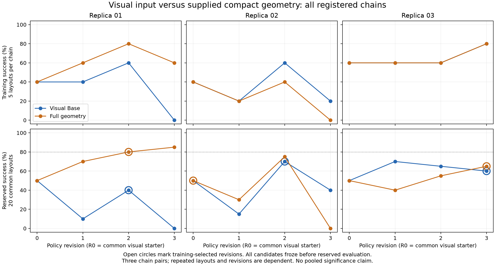

# Visual input versus supplied geometry: completed replication study

Full geometry improves the average outcome, but this study does **not establish a
stable learning advantage**. One chain benefits strongly; the other two have lower
mean revision-curve SR with Full. Only one Full chain reaches 80% reserved SR, at
R2; no Base chain reaches 80%. The variation across three chains is substantial.

The final independent audit passes: **600 valid rollouts, zero invalid slots,
18 completed model generations from 18 invocation attempts**, and all 18 exact
prompt/image contexts verified. The budget is 120 training and 480 reserved slots.
All 24 candidate versions froze after all training and before any reserved trial.
The coordinator exited successfully. No candidate was repaired or replaced during
this study; failures and regressions remain in the results.

## All registered learning curves

Each reserved SR uses the same 20 fresh layouts. R0 is the common visual starter;
R1–R3 are independently generated model revisions. Training uses five disjoint
layouts per chain. The chains share test layouts, so their episodes and repeated
policy versions must not be treated as additional independent actor replications.

| Chain | Visual Base R0 → R3 | Full geometry R0 → R3 |
|---|---|---|
| 01 | 50% → 10% → 40% → 0% | 50% → 70% → 80% → 85% |
| 02 | 50% → 15% → 70% → 40% | 50% → 30% → 75% → 0% |
| 03 | 50% → 70% → 65% → 60% | 50% → 40% → 55% → 65% |



Open circles identify training-selected versions. The plot shows every registered
chain and revision, including both R3 collapses. It was rendered from the completed
independent audit and visually inspected. Its adjacent JSON records the source
report and renderer hashes.

## Training selection and registered summary metrics

Selection is highest training SR, with earliest-version tie breaking. No selection
uses reserved scores.

| Chain | Selected Base / Full | Selected reserved Base / Full | Mean R0–R3 Base / Full |
|---|---|---|---|
| 01 | R2 / R2 | 40% / 80% | 25.00% / 71.25% |
| 02 | R2 / R0 | 70% / 50% | 43.75% / 38.75% |
| 03 | R3 / R3 | 60% / 65% | 61.25% / 52.50% |

Across chain pairs, training-selected SR averages **56.67% for Base and 65% for
Full**. Paired differences are +40, -20 and +5 percentage points: mean +8.33 points,
range -20 to +40. Mean SR across R0–R3 averages **43.33% for Base and 54.17% for
Full**. Its paired differences are +46.25, -5 and -8.75 points: mean +10.83 points,
range -8.75 to +46.25. These descriptive gains are dominated by the first chain.
No pooled Bernoulli interval or treatment-effect significance claim is appropriate.

The first chain supports faster improvement in that chain: Full reaches 80% at R2
and 85% at R3. The second and third chains do not reproduce that threshold result.
At fixed budget R2, mean SR is 58.33% for Base and 70% for Full, with paired
Full-minus-Base differences of +40, +5 and -10 points. This is a slice of the
registered curves, not a newly selected primary endpoint.

Selection itself is limited by five training layouts. In chain 2, Full R0 and R2
tie in training at 2/5, so R0 is retained even though R2 later scores 75% on reserved
layouts versus R0's 50%. In chain 3, R0–R2 tie at 3/5 in both arms; both select R3
at 4/5. Test-better earlier versions are not substituted. The audit also reports the
secondary curve obtained by retaining the training-best version at each budget.

## What was compared

Visual Base receives raw side/wrist RGB-D and calibration, robot proprioception/CAD,
public task labels, and a starter that computes its own visual estimates. No object
center, dimensions, vertices or goal residuals are supplied through its public
session interface. Full additionally receives compact, target-focused visual
geometry, references, relations and desired-state operators. Both use the exact
same hidden RGB-D PnP actuator. Policy computation runs on CPU; simulation may use
GPU rendering. Runtime object truth, contacts and evaluator state are unavailable
to both policies. Training feedback includes final binary success.

This is a supplied **perception/geometry package** comparison, not an isolated test
of symbolic representation or raw pixels-to-torques control. The task is one low-rise
support graph: two cube foundations, a flat thin prism and a cylinder. Colors and
layouts vary; this does not establish transfer to new task families or arbitrary
shapes. Keep this study separate from historical strong-baseline experiments.

## Compact state, usage and diagnostic evidence

State records concern one current object and are updated at action boundaries.
They distinguish observations, estimated changes and desired placement points;
missing/stale data remain unavailable. Full training checkpoint size has median
363 characters and maximum 680, versus 114 median characters for the geometry-free
Base event record. These are all recorded steps, not only model-attached feedback.
Input-token totals are 220,701 for Base and 232,470 for Full across nine generations
per arm. Record length and token totals do not establish a latency benefit.

None of the 18 generated planners has explicit reference/relation/align/target/
goal_error call sites. Five Full planners call observe. Other Full planners still
use geometry through action returns: chain 2 R1 reads the picked cylinder's normal;
R2 reads release center, normal and bottom. These source-level findings do not show
internal model reasoning or establish a causal mechanism. Geometry text is also
present in Full's training feedback even when runtime queries are absent.

The current align operator returns desired geometry without executing rotation;
the common place primitive targets center XY and minimum Z. An arbitrary desired
rigid pose is therefore not automatically executable. A desired-state record is
not a contact, stability or feasibility certificate.

Separate, training/development-only diagnostics provide narrower evidence:

- Frozen geometry follows translation and 1.15 scaling of a real RGB-D recording;
  all four objects reject depth blackout. Maximum center consistency residual is
  0.168 mm. This is sensor dependence, not absolute accuracy or physical size transfer.
- Robot-only replay of chain 2 Full R3 reproduces the logged tool poses exactly.
  Of 119 requested points, all pass the controller's default 5 mm position gate;
  24 are rejected by the actor's 2.5 mm guard. No relaxed orientation is needed for
  those queried points. Later unqueried points, collisions and execution remain
  untested; this is not evidence that a repaired planner would succeed.
- Earlier conditional held-object prediction probes compare robot-motion predictions
  with later visual estimates. They do not establish contact truth, robust occluded
  tracking or task-SR benefit. Predictions were not fused into this learning study.

Shape labels, initial on-table orientation assumptions, and estimator shape/range
priors remain. Initial metric dimensions are learned from RGB-D, not a catalog or
simulator object state. None of these diagnostics or our failure analyses entered
actor feedback.

## Separate guard counterfactual and next development decision

A development-only follow-up changed exactly one guard in a copy of chain 2 Full
R3: default IK position error threshold 2.5 mm → 5 mm. The frozen candidate, library,
learning curves and actor contexts were not edited. All five original training
layouts were rerun with identical initial RGB and simulator/sensor settings; no
reserved layout or new model call was used.

The original policy issued zero motion commands in all five cases and scored 0/5.
The modified copy executes in four cases (53, 49, 70 and 46 motion/gripper commands)
and scores **1/5**. The fifth still stops during initial perception. This intervention
shows that the strict guard prevented execution on these layouts, but correcting
it is insufficient for reliable construction. It is not a new learned-policy result
or an abstraction treatment-effect estimate.

Protocol, source snapshots, exact one-line replacement and all paired records are
in `outputs/visual_guard_threshold_development_01`; the summary is
[evaluations/visual_guard_threshold_development.json](evaluations/visual_guard_threshold_development.json).
Reproduction uses `scripts/run_visual_guard_counterfactual.py` and refuses to
overwrite evidence. The repaired candidate is never actor feedback.

The requested stable iteration-efficiency benefit remains unproven. The next
method change should address observed action/geometry failure mechanisms rather
than simply loosening gates or expanding scene state. Broader training/selection
coverage and a clearer mapping from desired geometric constraints to the actual
controller are hypotheses to test with fresh evaluation, not demonstrated repairs.

A subsequent [conditional attachment replay](CONDITIONAL_ATTACHMENT_EVIDENCE.md)
separates one contradicted rigid-motion hypothesis from one unresolved occlusion.
It recovers no pose and changes no controller.

## Reproduction and evidence

Protocol: [VISUAL_INPUT_COMPARISON.md](VISUAL_INPUT_COMPARISON.md).
Full audit: [visual_input_learning_replications_01.json](evaluations/visual_input_learning_replications_01.json).
The study root is `outputs/visual_input_learning_replications_01`; it retains frozen
sources, candidates, contexts, training records and every reserved trial.

```bash
OPENBLAS_NUM_THREADS=1 OMP_NUM_THREADS=1 .venv/bin/python \
  scripts/summarize_visual_input_replications.py \
  --root outputs/visual_input_learning_replications_01 \
  --output docs/evaluations/visual_input_learning_replications_01.json
OPENBLAS_NUM_THREADS=1 OMP_NUM_THREADS=1 .venv/bin/python \
  scripts/plot_visual_input_replications.py \
  --audit docs/evaluations/visual_input_learning_replications_01.json \
  --output docs/media/visual_input_learning_replications_01.png
```

These commands require the currently frozen runtime sources. After subsequent
runtime edits, use the archived source snapshot for audit reproduction rather than
silently accepting changed dependencies. Diagnostic source snapshots and input
hashes are retained separately; intermediate progress receipts are historical.
