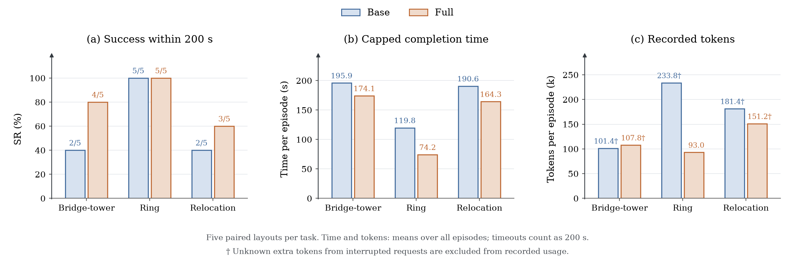
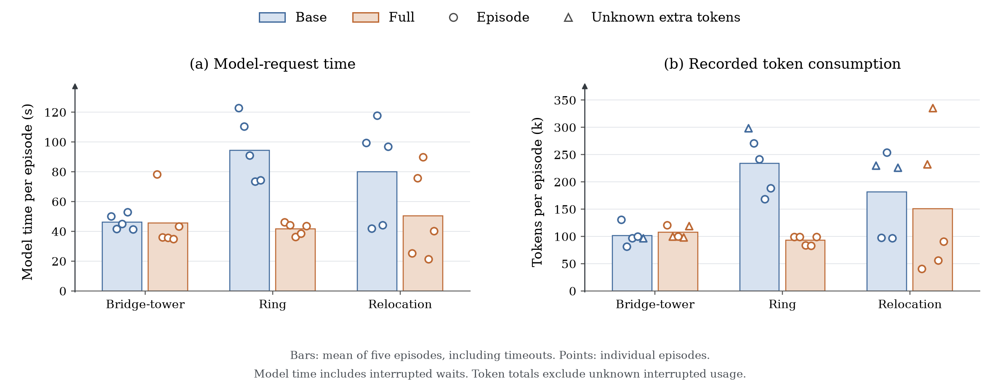

# Online results and data

Three completed five-pair, 200-second studies: bridge-tower construction, Ring,
and tower relocation. [Combined experiment index](../README.md) ·
[Online report](../../ONLINE_EXPERIMENTS.md) ·
[Paper main text](../../paper/online_experiments.tex) ·
[Paper appendix](../../paper/online_appendix.tex) ·
[Single-policy data](../single_policy/README.md).

| File | Contents |
| --- | --- |
| [summary.json](summary.json) | Six task/arm aggregates and campaign completion/audit status |
| [episodes.csv](episodes.csv) | All 30 episodes, including unsuccessful ones |
| [paired_outcomes.csv](paired_outcomes.csv) | All 15 layout pairs and capped-time differences |
| [model_requests.csv](model_requests.csv) | 262 completed receipts and 9 interrupted attempts |
| [arm_summary.csv](arm_summary.csv) | Success, time, model resources, and local execution totals |
| [success_vs_time.csv](success_vs_time.csv) | Event-time empirical success curves |
| [outcome_bars.pdf](outcome_bars.pdf) / [PNG](outcome_bars.png) / [SVG](outcome_bars.svg) | Main figure: grouped success, capped time, and cumulative episode-token bars |
| [outcome_bars.csv](outcome_bars.csv) | Six plotted condition/task means, success counts, and unknown-usage flags |
| [success_vs_time.pdf](success_vs_time.pdf) / [PNG](success_vs_time.png) / [SVG](success_vs_time.svg) | Three-task success curves |
| [model_resources.pdf](model_resources.pdf) / [PNG](model_resources.png) / [SVG](model_resources.svg) | Model-time and token bars with all five episode points per arm/task |
| [model_resources.csv](model_resources.csv) | The six plotted arm/task resource means and unknown-usage counts |
| [paired_completion_times.pdf](paired_completion_times.pdf) / [PNG](paired_completion_times.png) | All paired completion times; timeouts marked with crosses |
| [provenance.json](provenance.json) | Source/export SHA-256 hashes and exporter identity |

## Paper figures

The main text uses the workflow/task illustration, grouped outcome bars, and
model-resource episode plot. The numerical table and success-versus-time curves
appear in the appendix. All costs in the table and plots are per-episode
means, including timeouts.



The three panels show success within 200 seconds, mean capped completion time,
and mean cumulative recorded tokens per episode. Labels on the success bars
show counts out of five; timeouts count as 200 seconds in time means. Daggers
on token labels identify conditions containing interrupted requests with unknown
additional usage. All bars start at zero. The plots summarize five paired layouts
per task and do not show inferential intervals.

The success-versus-time figure uses the same blue/orange colors, serif typography,
and arrow axes as the single-policy figure. SVG labels remain editable text.



**Resource figure caption.** Model interaction cost in three online tasks. Bars
show means over all five episodes per arm and task, including timeouts; points
show individual episodes with small horizontal offsets for legibility. Left:
cumulative end-to-end model-request time per episode, including interrupted waits.
Right: recorded input-plus-output tokens per episode, in thousands, from completed
requests. Cached input is included once. Triangles in the token panel identify
episodes with unknown additional usage from interrupted requests; their plotted
values exclude that unknown consumption. Blue denotes Base and orange Full.
Points are observations, not error bars; no inferential interval is shown.

Model-time bars and the paper's numerical table both include interrupted waits. The figure does not claim that the
component timers sum to episode duration or that recorded tokens are complete
billed consumption. Both panels include successful and unsuccessful episodes.

## Definitions and scope

- Task identifiers are `tower`, `ring`, and `relocation`. Source arms `basic` and
  `symbolic` become `Base` and `Full`. Pair by task and seed, not by row position.
- `capped_seconds` counts each timeout as 200 seconds. `success_seconds` is empty
  for a timeout; a capped value of 200 is not a successful completion.
- `success_rate` is a fraction; figures show percentages. Each task/arm has five
  episodes. The empirical time curve uses first successes from the original
  200-second runs, not separate runs at each smaller budget.
- Successful-only means compare different subsets when arms succeed on different
  layouts. They are secondary to success and capped completion time.
- Token fields are completed-request input/output deltas, with cached input
  included once. Blank interrupted token cells mean unknown, not zero. No complete
  billed-cost claim is possible for arms with interruptions.
- `completed_model_seconds` excludes interrupted waits; `all_model_seconds` adds
  them. These are end-to-end request times, not isolated inference compute time.
  `mean_completed_request_seconds` is request-weighted; episode means divide by five.
- In `arm_summary.csv`, fields without `mean_` generally sum all five episodes;
  `success_rate`, `episodes`, and the explicitly named successful-only mean are
  exceptions. `usage_complete` is true only when there are no interrupted requests.
- `images` includes attachments in completed receipts and interrupted invocations.
  Invocation records establish submission, not processing by the model. Episode
  rows separate `completed_images` and `incomplete_images`; request rows include
  `image_count` even when token usage is unknown.
- Image attachments, camera acquisitions, and metric-depth queries are different
  measures. Fewer attachments do not imply fewer camera frames or less local work.
- `operations` (Ring) and `target_bindings` (Tower/Relocation) describe different
  action units. Missing fields are unavailable, not zero; do not compare these
  counts as equivalent actions. Component timers need not form a disjoint sum.
- Campaign wall time describes parallel execution; it is not episode latency.
- All three studies are exploratory and separately registered. Do not pool their
  success rates or treat each model request as an independent experimental unit.
  Earlier null/mixed online studies remain linked in the report.

## Reproduction and verification

From the repository root:

```bash
OPENBLAS_NUM_THREADS=1 OMP_NUM_THREADS=1 .venv/bin/python scripts/export_online_results.py
```

The exporter checks completion and audit status, matches each original result
hash to its audit, verifies paired initial states, and sums all completed and
interrupted receipts. It cross-checks outcomes, token totals, model time, and
image attachments against the frozen study summaries. The original source and
interface audits are retained; this export does not re-execute their physics
checks or model calls. Tower's four interrupted prompts lack archived delivery
transcripts, as disclosed in the original audit.

All source paths are repository-relative. Raw images, prompts, private monitor
traces, and policy/skill source remain in the original output directories and
are not duplicated here. The report and paper prose are maintained separately
from the exporter. No original study artifacts are rewritten.
