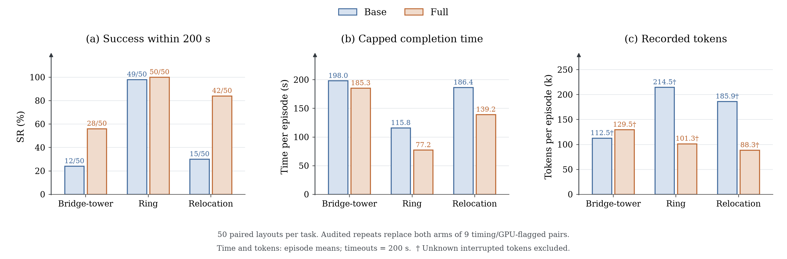
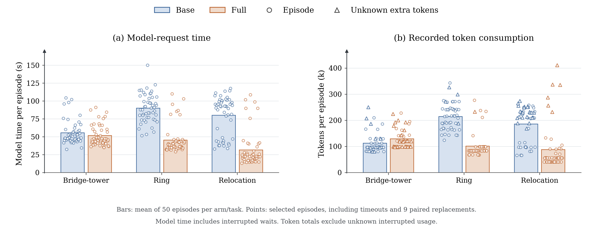
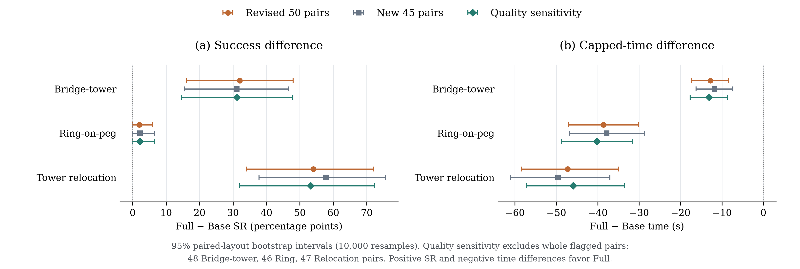

# Online results: 50 paired layouts per task

The revised primary analysis contains **300 selected episodes**: 50 paired layouts
for each of Bridge-tower, Ring-on-peg, and Tower relocation, with a 200-second
budget and no reset after failure. The figures include the original five pairs
and 45 new pairs per task. Both arms of nine timing/GPU-flagged pairs use their
audited repeat: **282 original episodes + 18 repeats**.

[Combined experiment index](../README.md) ·
[Protocol and runtime amendments](../../ONLINE_SAMPLE_EXTENSION_50.md) ·
[Original five-pair exports](../online/README.md) ·
[Paper main text](../../paper/online_experiments.tex) ·
[Paper appendix](../../paper/online_appendix.tex)

The [targeted runtime repeat](../../ONLINE_TARGETED_REPEAT.md) completed all 18
episodes and passed audit. The user then requested incorporating every selected
repeat into the primary report. This is a reporting amendment after inspecting
repeat outcomes, with no best-of-two selection: worse outcomes also replace the
originals. Original evidence remains unchanged; [replacements.csv](replacements.csv)
records every substitution and [original_attempts.csv](original_attempts.csv)
preserves the previous 300-episode dataset with verified token recovery.

## Results

All numbers below include timeouts and the nine paired replacements. Time is mean
capped completion time, assigning 200 seconds to timeouts. Tokens are recorded
input plus output per episode, with cached input included once.

| Task | Condition | Success | Time (s) | Model (s) | Tokens (k) | Requests | Images |
| --- | --- | ---: | ---: | ---: | ---: | ---: | ---: |
| Bridge-tower | Base | 12/50 (24%) | 198.0 | 55.5 | 112.5 | 7.88 | 7.50 |
|  | Full | 28/50 (56%) | 185.3 | 51.8 | 129.5 | 7.32 | 4.28 |
| Ring-on-peg | Base | 49/50 (98%) | 115.8 | 90.0 | 214.5 | 11.88 | 10.94 |
|  | Full | 50/50 (100%) | 77.2 | 45.6 | 101.3 | 6.90 | 2.72 |
| Tower relocation | Base | 15/50 (30%) | 186.4 | 80.3 | 185.9 | 11.58 | 11.34 |
|  | Full | 42/50 (84%) | 139.2 | 31.7 | 88.3 | 5.36 | 3.00 |

Full's construction success advantage is **32 percentage points** on Bridge-tower
and **54 points** on Relocation. Ring has near-ceiling success in both conditions;
Full reduces mean capped time by **33.3%**, cumulative model-request time by
**49.4%**, and recorded tokens by **52.8%**. Full finishes sooner in 45/50 Ring
pairs (44/49 pairs where both succeed). These comparisons include failures;
they do not select only successful episodes for the primary time means.

Relocation combines more completions with **25.3%** lower capped time, **60.5%**
lower model time, and **52.5%** fewer recorded tokens. Its mean accumulated
physical-action time is similar: 103.2 s Base and 104.5 s Full. Bridge-tower uses
**15.1% more recorded tokens** under Full, despite more completions and 6.4%
lower capped time. Token savings are therefore task-dependent. All three tasks
show fewer LLM image attachments under Full despite more local camera frames.

### Paired effects and uncertainty

| Task | Full − Base SR (pp), 95% CI | Full − Base capped time (s), 95% CI |
| --- | ---: | ---: |
| Bridge-tower | +32.0 [16.0, 48.0] | -12.8 [-17.3, -8.4] |
| Ring-on-peg | +2.0 [0.0, 6.0] | -38.6 [-47.0, -30.2] |
| Tower relocation | +54.0 [34.0, 72.0] | -47.2 [-58.4, -35.0] |

Intervals use the registered paired-layout percentile bootstrap (10,000 resamples,
seed 1050 per task). Resampling keeps each Base/Full pair together. Intervals are
marginal, without multiplicity correction. The near-ceiling Ring success
difference does not establish a reliable success-rate advantage; its stronger
evidence concerns time. Intervals describe layout variation within these tasks,
not new object families or repeated-run variability on a fixed layout.

### Original, new, and quality-sensitivity cohorts

| Task | Original 5: Base / Full | New 45: Base / Full | All 50: Base / Full | Quality sensitivity: Base / Full |
| --- | ---: | ---: | ---: | ---: |
| Bridge-tower | 2/5 / 4/5 | 10/45 / 24/45 | 12/50 / 28/50 | 12/48 / 27/48 |
| Ring-on-peg | 5/5 / 5/5 | 44/45 / 45/45 | 49/50 / 50/50 | 45/46 / 46/46 |
| Tower relocation | 2/5 / 3/5 | 13/45 / 39/45 | 15/50 / 42/50 | 14/47 / 39/47 |

The expansion was registered after viewing the original pilot, so the new 45
pairs are reported separately. The model client changed from 0.155.0-alpha.16.3
to 0.159.2; model settings, skills, prompts, and physical success criteria stayed
fixed. GPU runtime and Ring camera-pacing repairs introduced execution epochs,
whose separate aggregates are in [runtime_epochs.csv](runtime_epochs.csv).
Epochs are provenance strata, not randomized ablations.

Four episodes exceeded the two-second simulation-lag gate; sixteen had a failed
dispatch GPU query, with two episodes in both groups. All nine affected pairs now use audited repeats in the main results. Original
failures remain in the provenance and superseded-attempt export. The quality
sensitivity excludes those **whole pairs**, including the repeats (9 pairs / 18
episodes), leaving 48, 46, and 47 pairs respectively. Full still has higher
construction SR and lower capped time on every task: 197.95/184.83 s,
115.30/75.15 s, and 187.07/141.17 s for Base/Full.

Two additional Ring outcomes had a terminal-image archival error. Independent
saved physical and input evidence verified both successes without changing
outcomes or resource values; their missing-image and recovery labels remain.
A further new-cohort sensitivity excludes that recovered pair as well as quality
flags: Ring is Base 39/40 versus Full 40/40, with capped times 114.41/75.54 s.
That archive-recovered pair was not rerun. See [quality_flags.csv](quality_flags.csv)
for historical flags on selected records and the detailed
[runtime record](../../ONLINE_SAMPLE_EXTENSION_50.md). The original-attempt
50-pair summary remains in `cohort_summary.csv` as `original_attempts_50`.

The larger sample supports the direction of the pilot findings. It still compares
the full geometry-and-feedback package, with one selected episode per condition/layout.
It does not separate measurement quality, symbolic references, and text feedback,
or estimate repeated-run stochastic variability.

## Figures and files

All five figures have **PDF, 300-dpi PNG, and editable-text SVG** versions. The
blue/orange palette, serif type, and arrow axes match the original paper figures.

| File | Contents |
| --- | --- |
| [outcome_bars.pdf](outcome_bars.pdf) / [PNG](outcome_bars.png) / [SVG](outcome_bars.svg) | Main grouped bars: success, capped time, recorded tokens; all 50 pairs |
| [model_resources.pdf](model_resources.pdf) / [PNG](model_resources.png) / [SVG](model_resources.svg) | Mean model time and tokens with all individual episodes |
| [success_vs_time.pdf](success_vs_time.pdf) / [PNG](success_vs_time.png) / [SVG](success_vs_time.svg) | First-success curves over the same 200-second episodes |
| [paired_effects.pdf](paired_effects.pdf) / [PNG](paired_effects.png) / [SVG](paired_effects.svg) | Full − Base effects and paired CIs: pooled 50, new 45, and quality sensitivity |
| [paired_completion_times.pdf](paired_completion_times.pdf) / [PNG](paired_completion_times.png) / [SVG](paired_completion_times.svg) | Every pair; successes, timeouts, and paired replacements |
| [episodes.csv](episodes.csv) | All 300 outcomes, costs, original/new cohort, runtime epoch, quality and recovery metadata |
| [model_requests.csv](model_requests.csv) | 2,546 completed request receipts and 77 interrupted attempts |
| [interrupted_usage_audit.json](interrupted_usage_audit.json) | Classification of all 77 selected interruptions and counter evidence for 4 recovered usages |
| [recovered_interrupted_usage.csv](recovered_interrupted_usage.csv) | The four verified terminal usage deltas, totaling 90,796 tokens |
| [arm_summary.csv](arm_summary.csv) | Six pooled task/arm aggregates, all episode means |
| [cohort_summary.csv](cohort_summary.csv) | Original 5, new 45, revised 50, original-attempt 50, and three paired sensitivities |
| [paired_outcomes.csv](paired_outcomes.csv) | All 150 paired layouts with differences and sensitivity eligibility |
| [paired_differences.csv](paired_differences.csv) | Paired effects and bootstrap bounds, by cohort |
| [runtime_epochs.csv](runtime_epochs.csv) | Per-task/arm aggregates for each runtime epoch |
| [quality_flags.csv](quality_flags.csv) | Selected records for 18 historical-flag replacements plus 2 recovered archive outcomes |
| [replacements.csv](replacements.csv), [replacement_manifest.json](replacement_manifest.json) | All 18 original/repeat mappings, hashes, outcome changes, and reporting amendment |
| [original_attempts.csv](original_attempts.csv), [superseded_attempts.csv](superseded_attempts.csv) | All 300 original attempts and the 18 superseded records, including their costs |
| [success_vs_time.csv](success_vs_time.csv) | Plotted event-time curves |
| [outcome_bars.csv](outcome_bars.csv), [model_resources.csv](model_resources.csv) | Plotted means, counts, and unknown-usage flags |
| [summary.json](summary.json) | All aggregates, paired intervals, runtime/recovery records and separate startup overhead |
| [provenance.json](provenance.json) | Source/export SHA-256 hashes and exporter identity |







The main paper uses outcome bars and model-resource plots; success curves and
paired-effect intervals appear in the appendix. Primary bars are descriptive
means without per-bar inferential intervals; the paired-effects plot supplies
the comparison intervals. Points in the resource plot are episodes, not error
bars. The jitter is deterministic and has no measured horizontal meaning.

## Measurement definitions

- `capped_seconds` is success time or 200 on timeout. `success_seconds` is blank
  on failure. Timeouts never add successes to the empirical time curve at 200 s.
- `mean_success` is a fraction. Plotting converts it to percent; the difference
  CSV retains fractions, while its figure converts SR differences to points.
- Model time includes interrupted waits and service latency. It is not isolated
  inference compute time. Component timers need not sum to episode time.
- Tokens are input plus output, with cached input included once. **41,603,662**
  selected-episode tokens are recorded (37,239,110 from new layouts). Completed
  receipts account for 41,512,866; agreeing CLI/session counters recover another
  90,796 from four interrupted requests. Usage from **73** remains unknown and
  is not imputed. All six conditions retain daggers/triangles where appropriate.
- The **18 superseded attempts** used another **2,745,300** recorded tokens and
  contain two unknown usages. The 18 repeats used 2,672,667 recorded tokens,
  already included in selected-episode totals. Including superseded attempts
  and startup overhead, recorded campaign cost is **44,446,998 tokens**;
  unreported interrupted usage remains additional. No attempt's cost disappears.
- Eight startup attempts before any submitted policy action used another
  **98,036** recorded tokens. They remain separate infrastructure overhead,
  outside the 300-episode means, with artifacts in `summary.json`.
- Requests count completed requests. Images count newly attached images across
  completed and interrupted attempts, not local camera acquisitions. Attachments
  establish submission, not necessarily model processing.
- All 77 selected interruptions occurred at episode termination: 48 at the time
  limit, 29 after verified physical success. The four recovered usages remain interrupted
  decisions: their responses were not returned to the controller. They do not
  increment completed requests or change success, clocks, or images. Columns
  `decision_completed_in_episode` and `token_usage_recovered` separate these facts;
  `receipt_total_tokens` preserves the original episode accounting. Empty counters
  in the remaining 73 requests do not establish zero consumption.
- Blank GPU-query fields on original pilot rows mean the extension's dispatch
  diagnostic is not present, not that a query was run. Existing pilot audits
  remain their evidence. `pair_in_quality_sensitivity` excludes both arms of any originally flagged
  pair, even when its selected repeat passed. `historical_*` fields preserve
  original flags; `timing_valid` and `gpu_dispatch_query_ok` describe the selected
  attempt. `attempt_replaced` distinguishes the 18 replacements.
- Pair by `(task, seed)`. Do not pool success across different tasks or treat model
  requests as independent experimental units. New cohort and runtime epochs are
  retained in every relevant table. All `mean_` columns include failed episodes.

## Reproduction and verification

From the repository root:

```bash
OPENBLAS_NUM_THREADS=1 OMP_NUM_THREADS=1 .venv/bin/python scripts/export_online_extension_results.py
```

The exporter verifies the completion receipt's summary/CSV hashes, every original
result hash, paired initial states, all completed/interrupted request totals,
token arithmetic, and image-attachment counts. It independently recomputes all
cohort/epoch means and paired bootstrap intervals and matches them to the frozen
summary before applying verified token recovery and all nine paired substitutions. The correction
requires an append-only actor transcript, matching session identity, matching
CLI/session totals, and agreement with last-turn token deltas. The integration registration pins the repeat results and final audits; initial
states, budgets, and full pair coverage must agree. The original pilot and three unaffected sensitivity cohorts retain their
previous aggregates. It performs no
simulation or model request and does not modify source
evidence or the [original-five exports](../online/README.md).

Source paths identify the repository output archives; raw prompts, observations,
and private traces are not duplicated here. The original completion evidence is
under `outputs/online_extension_50_01/terminal_resume_01/`. The old supplementary
ZIP still contains the original five-pair online report; it has not been silently
replaced by this expanded figure export.

The exact previous report (including figures) is archived in
`outputs/online_targeted_repeat_01/report_integration_01/previous_export/`.
The integration never changes original experiment logs or reuses discarded
attempts as additional layouts.
