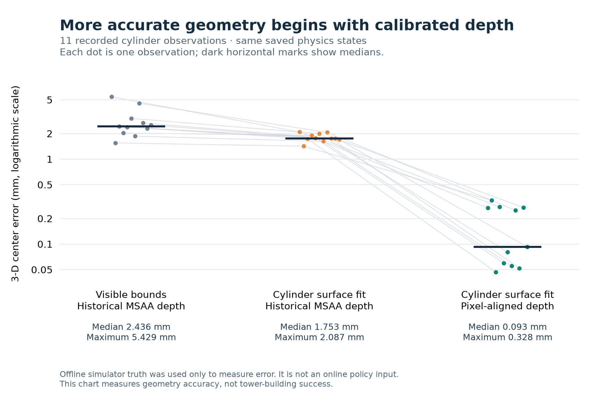

> Historical record. Commands and status statements describe that experiment;
> see the [current documentation](../README.md) before running anything.

# CPU visual geometry for column construction

The column pipeline estimates object dimensions, centers and support surfaces
from calibrated RGB-D. Correcting the sensor's depth sampling and fitting curved
surfaces reduced cylinder center error in an offline diagnostic: across 11
recorded observations, the median error decreased from **2.436 mm** for a visible
bounds estimate to **0.093 mm** for the surface fit with corrected depth. This
measures geometry accuracy, not the success rate of the complete policy.

## Depth must match the calibrated pixel ray

The historical side-camera renderer used multisample antialiasing (MSAA). Its
depth resolve could select a subpixel depth sample that did not correspond to the
pixel-center ray described by the camera intrinsics. A fitted surface could
therefore have a small internal residual while its absolute position was biased.
The intrinsics' principal point was correct; shifting it was not the fix.

In one archived scene, a rendered table surface at 0.400 m was reconstructed near
0.401192 m with MSAA. Re-rendering the **same saved physics state and camera**
without multisampling reconstructed it near 0.400003 m. The initial blue
cylinder's center error decreased from 2.087 mm to 0.268 mm with the same circle
fitting method.

[`OverheadRGBD(..., pixel_aligned=True)`](../../src/aspire_so100/rgbd.py) constructs
an offscreen renderer with zero multisamples. It restores the model's rendering
default immediately after construction. The column task opts into this mode;
the historical tasks retain their default renderer. RGB edge appearance also
changes because RGB and depth share the renderer. Physics and success checks
are unchanged, but these are changed observations and must be recorded when
comparing policies.

The [analytic plane regression](../../tests/test_rgbd_calibration.py) computes
expected optical depth directly from the published camera rays. It requires
maximum error below 0.01 mm in pixel-aligned mode and verifies that sensor
construction leaves the model's default multisample setting unchanged. This
checks the camera contract independently of any block dimensions.

## Surface models and partial observations

[`column_geometry.py`](../../src/aspire_so100/column_geometry.py) uses NumPy and
SciPy on CPU. It receives an isolated instance's RGB-D pixels, camera calibration,
a visually fitted table plane and, when available, a previously learned object
model. Its principal operations are:

- **Cylinder dimensions and center:** interior depth normals distinguish the
  curved side from the planar cap. Projected side samples constrain a circle;
  robust least squares estimates its center and radius. The top plane and
  observed tabletop constrain the initial height. Dimensions are measured,
  including in tests with sizes outside the catalog.
- **Cuboids:** visible face planes constrain the corresponding center
  components. A cube's learned height constrains all three side lengths, so a
  narrow silhouette does not turn its model into an undersized box.
- **Goal identities:** an uncertain cylinder classification can be recovered
  from distributed curved-side normals and a consistent circle fit. A matching
  color or a requested shape alone does not establish object identity.

A partial observation constrains only part of a pose. The implementation keeps
that distinction explicit:

| Visible evidence | Updated quantities | Quantities retained from the prior |
| --- | --- | --- |
| One cuboid face | Its normal, perpendicular translation and finite extent bounds | Unresolved in-plane translation and rotation about its normal |
| A narrow cylinder side arc | Radial displacement | Tangential displacement and hidden axial position |
| Cylinder cap only | Cap orientation and axial position | Hidden circle-center coordinates, subject to a visible-surface residual check |
| Sufficient curved-side normal variation | Cylinder axis, validated by the curved surface fit | Axial position if neither cap is observed |

The prior comes from a previously observed pose propagated through **robot**
proprioception. Hidden coordinates are inferred, not newly measured. Fits expose
fields such as `geometry_reliable`, `inferred_orientation`,
`inferred_translation` and `orientation_evidence`. A single cuboid face must not
replace an unobserved tilt with an arbitrary world-aligned basis. Likewise, an
ill-conditioned cylinder arc must not invent tangential motion.

Partial updates reject center corrections larger than 8 mm relative to the
propagated grasp. A cylinder rotation that disagrees with the prior needs
independent visible orientation evidence. Contradictory or insufficient depth
causes an explicit failure; the model is not an object-state oracle. The
[geometry tests](../../tests/test_column_geometry.py) cover tilted one-face cuboids,
narrow cylinder arcs, hidden caps, incompatible grasp predictions, blackout and
classification ambiguity.

## Finite faces constrain missing center coordinates

An observed face plane constrains only translation normal to that face. Its
**finite visible extent** provides additional information: a learned box must
contain the observed points. For a box axis with learned length `s` and robust
projected point bounds `[lo, hi]`, its center lies in
`[hi - s/2 - tolerance, lo + s/2 + tolerance]`.

The fitter intersects this interval with the propagated center. If a visible
edge nearly spans the learned dimension, an otherwise unobserved translation
axis becomes tightly bounded. A wide interval retains uncertainty; it does not
become a new observed face. The model exposes the intervals, their widths and
which previously unconstrained axes became tightly bounded. Cube dimensions and
measured height stay fixed. Other horizontal dimensions can be refined only
inside their initial calibrated pixel uncertainty intervals, as described below.

This addressed a development grasp in which jaw closure had shifted a cube by
about 13 mm along an axis not constrained by the two visible face planes. A
rigid grasp prior retained the pre-close location, while the finite surface
bound recovered the shifted center to approximately 0.1 mm in the offline
comparison. The shift happened during closure, before release.

Before computing finite bounds, the fitter checks the **outward half-spaces of
observed faces**. A convex cuboid must lie behind every observed outward plane.
Interior depth samples determine each plane's normal, level and outward sign;
points more than 0.25 mm in front of any plane are excluded. This test does not
use the learned dimensions or predicted center, so it cannot hide an incorrect
size by filtering against the model being checked. It also retains legitimate
narrow faces with too few samples to fit their own plane, unlike requiring every
point to lie near an already fitted plane.

Bounds then use inward-rounded order statistics for the central 98% of retained
points. Interpolating a 99th percentile across roughly 70 pixels could otherwise
retain part of an erroneous extreme. Three actual development observations had
61–72 colored cube pixels, one or two silhouette samples 1.91–5.85 mm in front of
a measured face, and interior plane RMS errors of 1.31–2.50 micrometers. The
half-space test excluded exactly those samples; the remaining unseen-axis center
intervals were 0.55–0.98 mm wide. The
[sensor fixtures and provenance](../../tests/fixtures/README.md) preserve these
cases. Wrong fixed dimensions still fail the finite-surface consistency check.

Contradictory finite dimensions or plane positions raise a typed
`ColumnGeometryConflict`. The controller must preserve that rejection through
legacy fallback and support refresh. It may not silently replace a contradiction
with an earlier pose. After the payload has already been released, a rejected
observation is logged as unconfirmed while the empty gripper completes its
withdrawal; rejection does not authorize a new object pose. Tests cover noncatalog
dimensions, partial faces, rotated axis correspondence, equal-sided cube invariance and rejection through the real
controller's helper closures.

## Horizontal dimensions retain pixel uncertainty

An initial point-cloud bounding box is a lower estimate of a non-cubic object's
horizontal extent: pixel centers do not generally land on both silhouette edges.
The fitter therefore stores the initial widths and a separate upper bound. It
intersects calibrated pixel-corner rays with the learned top plane to measure a
world-space pixel footprint. Allowing up to one footprint at each endpoint gives
an upper bound of the initial width plus two footprints. These initial bounds
remain fixed; later observations cannot expand their own uncertainty budget.
At low resolution the interval can be wide, so it is an uncertainty bound, not a
claim that the true width has been measured to pixel accuracy. It assumes the
initial tabletop view exposes the relevant edges apart from sampling gaps;
severe occlusion is not covered by a two-pixel endpoint allowance.

Later trusted finite surfaces may prove that a width is too small. The fitter
returns a new model with only the minimum required horizontal increase, inside
that initial interval. It never changes measured height or a cube's equal side
lengths, and a supplied model without pixel uncertainty remains fixed. The input
model and pose prior are not mutated. Growth beyond the upper bound still raises
`ColumnGeometryConflict`; the mechanism does not merely relax the containment
tolerance.

Physical axis identifiers keep each learned length attached to the same object
axis when visible face clusters reorder or the object rotates. The controller
persists a successful fit's model and dimensions in its object registry, so
subsequent captures and robot-propagated held poses use the refined dimensions.
This also applies to initial models supplied by the legacy visual locator; its
uncertainty is measured from the same isolated RGB-D and table plane.

Two development failures illustrate the distinction from edge contamination:

| Development observation | Initial width | Refined width | Trusted pixels | Interior plane RMS |
| --- | ---: | ---: | ---: | ---: |
| Random three-level seed 903, thin prism | 13.5809 mm | 13.6248 mm | 73/73 | 2.31 micrometers |
| Random three-level seed 904, thin prism | 29.4283 mm | 29.5387 mm | 86/86 | 2.09 micrometers |

Every pixel passed the independent half-space test. The later surfaces exceeded
the fixed-width containment test by 0.0429 and 0.1094 mm after its existing
tolerance. The small increases above resolve those particular observations;
they are lower visual size estimates, not measurements of the true dimensions.
Both trials were used for development, not held-out evaluation. Their initial
and later sensor frames, visually learned models and the rotated 904 pose prior
are preserved as [regression fixtures](../../tests/fixtures/README.md).
[Geometry tests](../../tests/test_column_geometry.py) keep height, fixed-model
contradictions and upper limits strict; a
[controller regression](../../tests/test_column_policy_state.py) checks that an
unchanged noncatalog prism observed at improved resolution refines its width
once and preserves that result across later captures.

## Wrist RGB can observe a hidden translation axis

[`column_wrist.py`](../../src/aspire_so100/column_wrist.py) is an optional research
helper, not part of the currently deployed column policy bundle. It provides an
independent constraint when side depth does not observe a held object's center
along every axis. It projects a visually learned solid model into the calibrated
wrist RGB image and fits the complete colored silhouette. Only translation
coordinates unobserved by side depth can change; observed side coordinates and
object orientation remain fixed. Finite side-face center intervals also remain
hard limits, expressed in the side fit's absolute rotated world coordinates.
Known visual dimensions supply metric scale;
the wrist has no depth channel.

The helper requires an independently observed orientation and a unique complete
silhouette. It checks contour bounds, interior coverage, outlying color pixels,
fit conditioning and the correction bound. It rejects clipped or occluded masks,
ambiguous same-color objects and conflicts with the side-camera constraints.
For a narrow cylinder arc, the caller must supply its radial constraint explicitly
because two Boolean horizontal-axis flags cannot describe that direction.

In two development observations from seed 907, closure had moved cubes along an
axis absent from the side fit. Wrist RGB reduced center error from **13.175 to
0.108 mm** for the red cube and **9.927 to 0.118 mm** for the green cube, while
leaving the observed side axes fixed. Bounding-contour residuals were 0.281 and
0.290 pixels. Single-shot fits took 3.68 and 2.36 ms CPU time. These are two
observations from one trial, not a held-out benchmark. The
[portable wrist diagnostic](../evaluations/column_wrist_geometry.json) preserves
measurement scope and results; object truth was only an offline error oracle.
The [wrist tests](../../tests/test_column_wrist.py) also cover noncatalog cuboids,
cylinders, partial masks, conflicting depth, unobserved orientation and two
individually valid but jointly ambiguous silhouettes.

## Recorded accuracy and CPU cost

The diagnostic uses every initial cylinder in ten archived trials: random
three-level recipes at seeds 826–830 and `mixed_triple` at seeds 821–825. One
trial contains two cylinders, giving **11 observations**. These earlier
evaluation examples were explicitly reused as development data; they are not a
new held-out sample. The calibrated images were rendered from the exact recorded
physics states at the original observation times.

| Geometry and observation | Median 3-D center error | Maximum error |
| --- | ---: | ---: |
| Instance visible bounds, historical MSAA depth | 2.436 mm | 5.429 mm |
| Cylinder surface fit, historical MSAA depth | 1.753 mm | 2.087 mm |
| Cylinder surface fit, pixel-aligned depth | **0.093 mm** | **0.328 mm** |

The visible-bounds baseline is the instance center estimate, not the complete
historical controller. Error is the Euclidean distance to the object's center
in offline physics replay. Simulator object truth was used **only to measure
these errors**, never as an input to the geometry function or online policy.
These measurements were collected during initial cylinder fitting development,
before later partial-occlusion refinements.

On an Intel Core i9-14900K with one BLAS thread, the corrected cylinder fit took
**5.24 ms median and 5.61 ms maximum CPU time** across these eleven single-shot
measurements. This includes instance-mask isolation and numerical fitting. It
excludes tracking, the rest of the policy, RPC, robot IK, simulation and rendering;
it is not an end-to-end latency benchmark. Full per-observation values, timing
scope and evaluation provenance are in the portable
[geometry evidence JSON](../evaluations/column_geometry.json).

## Tall-manipulation development findings

The optional [`column_grasp.py`](../../src/aspire_so100/column_grasp.py)
robot-orientation helper is also a research tool and is not included in the
currently deployed column policy bundle. Robot-only orientation feasibility is
useful for proposing experiments; it does not establish a physical grasp or
successful placement.

A separate bounded experiment tested six isolated controller variants in **27
physical trials**, using repeated development seeds and different trial matrices.
Lower tall-object grips reduced some grasp-induced tilt but increased occlusion
and brought fingers closer to the supporting level. The best small development
sample achieved **2/6**, constructing the 15 cm towers
`green_cube → red_prism → green_thin_prism` and
`blue_prism → green_cylinder → green_cube`. The other variants achieved 0/3,
0/3, 1/5, 1/6 and 0/4. These adaptive experiments do not establish a general
success rate, and the variants were not merged wholesale. All outcomes, ordered
goals, source hashes and final failure notes are preserved in the portable
[tall-manipulation development evidence](../evaluations/tall_manipulation_development.json).

The experiment exposed an important distinction: jaw closure can shift or rotate
an object before the first lift. A complete post-lift visual fit can establish a
confirmed grasp; the pre-close source pose remains a tentative prior. Numerical
IK feasibility alone did not establish collision-free transfer or stable release.
A strict uprightness preview rejected some physically successful placements, and
relaxing the preview did not resolve collisions or release drift.

A later contact-release ablation used the corrected visual geometry and unchanged
physics. Tightening target clearance to 0.75 mm and opening through an intermediate
0.5 rad angle achieved **0/6** random three-level towers, compared with **1/6** for
the frozen baseline; both retained **3/3** on the tested four-cube color permutations.
Restoring direct full opening with the same low clearance recovered the baseline's
one success on a three-seed diagnostic subset. Offline replay found payload tilts
of 15–25 degrees and moving-jaw contact while objects rocked toward upright during
the intermediate opening. No robot-to-support contact appeared in those inspected
release windows. These twelve additional development trials do not support a
release change; all trials, including the nine reused baseline results, are in the
[contact-release evidence](../evaluations/contact_release_development.json).

A separate [passive settling diagnostic](../evaluations/column_settling_audit.json)
continued three selected **development** checkpoints for another 60 seconds with
saved controls and physics unchanged: failed four-cube trials 907 and 909, plus
matched successful trial 908. Neither failure acquired any passing window under
the original five-second structural checks and 3 mm drift limit. Their top cube
centers dropped more than 30 mm after 0.55 and 11.45 seconds. Trial 908 passed the
first additional five-second window with only 0.156 mm maximum drift, but its top
cube also dropped more than 30 mm after 49.25 seconds. Times start at the saved
final checkpoint, 6.8 seconds after policy completion. Checks were sampled every
50 ms; simulator truth was used only by this offline diagnostic. These selected
examples do not support a waiting-only fix, and a five-second pass does not
establish minute-long durability. They do not alter the recorded benchmark
outcomes or claim a long-duration success rate.

## Runtime boundary

Online policy inputs remain side RGB-D, wrist RGB, camera calibration, robot
proprioception, robot-only IK previews and the public symbolic task order. There
are no simulator object poses, catalog dimensions, contacts or evaluator results
in the geometry API. Initial upright appearance, color separability and
sufficient visible surfaces are assumptions of this method. Learned dimensions
and prior poses improve occlusion handling, but they do not remove those limits.
GPU simulation and rendering are allowed; geometry, tracking and policy control
remain CPU computations.
