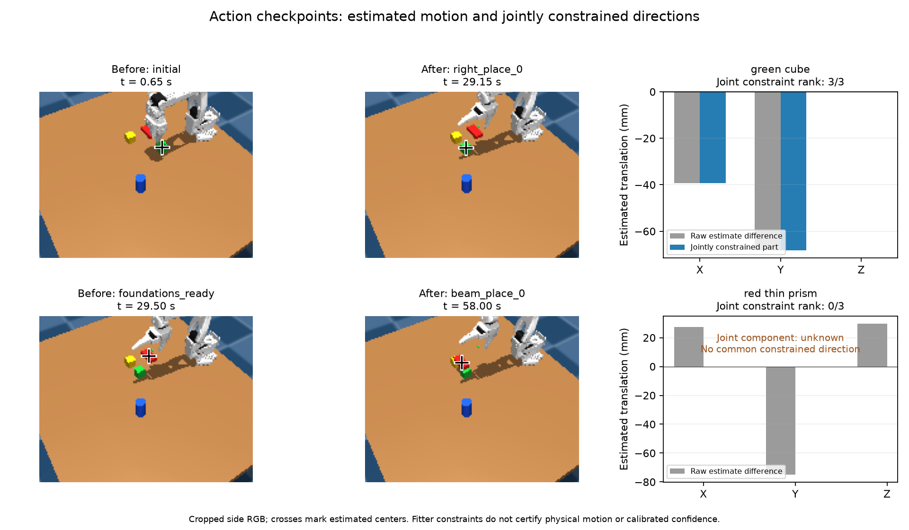

> Historical record. Commands and status statements describe that experiment;
> see the [current documentation](../README.md) before running anything.

# Observation changes and action-checkpoint changes

The current ledger's `change` field compares successive internal observations.
That is a valid local estimate difference, but it is often the wrong time span
for an agent asking what changed across a completed pick/place action. Repeated
observations at the end of an action can replace a large earlier displacement
with a near-zero latest-observation difference.

## Sensor-only diagnostic

The offline diagnostic reads only the five symbolic R2 **training** geometry
records from `mixed_scene_learning_pilot_01_schema_corrected`. It does not read
private object poses, task success labels, physics trajectories or reserved data.
It compares consecutive explicit `planner_state` checkpoints within each rollout.

Across 30 checkpoint pairs and 118 pairs of available object estimates:

- 15 estimated center differences exceed 10 mm.
- All 15 have an internal successive-observation difference below 1 mm.
- Nine of the 15 have both endpoint estimates marked fully observed by the fitter;
  all nine also have the small internal difference.

For example, training seed 76001's `green` center estimate changes by about
(-39.3, -68.1, 0.0) mm between `initial` and `right_place_0`, while the current
ledger's internal change is zero because its latest two observations share the
final timestamp. These are differences between sensor-derived estimates, not
certified physical displacements. The fitter's observability flag is not a
calibrated probability of correctness.

This finding does not invalidate the current experimental contrast: numeric and
symbolic use the same ledger, and its published semantics say successive estimate
differences. It identifies a missing, distinct abstraction for action-level reasoning.
The frozen experiment remains unchanged.

## Separate prototype

`scripts/checkpoint_geometry_prototype.py` compares two caller-selected current
state packets. It preserves frame, units, interval and endpoint observability.
Unavailable or stale endpoints yield an unknown change, rather than a fabricated
zero or a predicted position. Targets are not read, current poses are not changed,
and no temporal pose fusion or grasp assumption is introduced. Checkpoints must
belong to the same episode/world frame; the audit compares only within one file.

Four tests cover the lost-action-difference example, unavailable/stale estimates,
frame/unit/time mismatches, missing entities, nonfinite positions and input
immutability. The prototype is not exported to the frozen policy library.

A future state interface should keep three quantities separate:

1. The most recent sensor estimate and its provenance.
2. Change since an explicitly named reasoning/action checkpoint.
3. A conditional predicted effect and disagreement on reobservation.

Merely retaining the last two distinct camera timestamps would still lose much
of an action's effect when there are many intervening observations. Explicit
checkpoint boundaries are needed. They may support compact JSON/text summaries
without requiring the agent to reconstruct movement from a full image history.
This diagnostic does **not** demonstrate improved perception accuracy, policy
success, or learning speed; that would require a separate controlled ablation.

```bash
OPENBLAS_NUM_THREADS=1 OMP_NUM_THREADS=1 .venv/bin/python \
  scripts/checkpoint_geometry_prototype.py \
  --records outputs/mixed_scene_learning_pilot_01_schema_corrected/symbolic/round_002/trials/seed_7600{1,2,3,4,5}/geometry_records.json \
  --output docs/evaluations/checkpoint_changes_diagnostic.json
```

See [the complete diagnostic and source hashes](../evaluations/checkpoint_changes_diagnostic.json).

## Bounded reasoning-state prototype

`scripts/reasoning_checkpoint_state.py` now wraps explicit checkpoints in an
`episode`-scoped, bounded store. It remains excluded from the frozen experimental
libraries. The interface is `remember(label, packet, episode=...)`,
`expect_transform(label, object, transform, condition, episode=...)`, and
`compare(label, packet, episode=...)`.

Checkpoint labels cannot overwrite an existing checkpoint. Eviction also removes
its associated expectations. Available positions require matching observation and
packet timestamps. Cross-episode use, backward time, malformed rigid transforms,
and malformed observability metadata are rejected. No earlier desired states or
predictions are ingested as current observations.

A conditional effect transforms a checkpoint's visually estimated center under a
caller-supplied rigid-motion assumption. It is not a learned dynamics model or a
verified grasp. Its condition remains unverified even when the observed residual
is small. Reobservation reports both the raw estimated residual and, when supplied
by the fitter, its projection onto currently constrained translation directions.
Source and current observability flags remain explicit; this projection does not
remove uncertainty in the source estimate. Missing current observations produce
unknown comparisons, not a predicted replacement pose. Expectations are immutable
and cannot be added to a checkpoint after a later observation has been ingested.

Five tests cover prediction/evidence separation, projection of partially observed
residuals, missing evidence, episode/time guards, stale timestamps, bounded eviction,
immutability and invalid transforms. A sensor-only replay of the same five pilot
training records preserves all 30 checkpoint intervals, 118 available object pairs,
and 15 estimated changes above 10 mm. The replay has no conditional effects because
the original experiment did not record any. Conditional-effect behavior is currently
supported by synthetic tests only, not a physical prediction-accuracy experiment.

See [the replay and an actual action-checkpoint packet](../evaluations/reasoning_checkpoint_replay.json).
This is a candidate state interface for a later ablation. It does not establish
improved SR, calibrated uncertainty, or faster agent reasoning, and it does not
replace full rigid geometry queries with center-only summaries.

## Jointly constrained directions

The prototype now distinguishes a raw center-estimate difference from the part
constrained at both endpoints. With reported world-space translation projectors
`P_before` and `P_after`, their range intersection is the eigenspace of
`P_before + P_after` with eigenvalue two. The implementation uses a numerical
tolerance of `1e-8`; it is not a calibrated sensor-noise threshold. An empty
intersection returns a null vector with rank zero, not a reassuring zero residual.

For a conditional rigid effect, the source constraint directions are first
transported by its rotation: `R @ P_before @ R.T`. The comparison then intersects
that subspace with the current one. A fully observed endpoint does not eliminate
uncertainty in the source, and agreement in a projected subspace does not verify
the attachment/no-slip condition or the unobserved directions. These are reported
fitter constraints, not proof of physical displacement or calibrated confidence.
Finite interval constraints are not converted into equality directions by this
prototype, so this comparison can remain unknown even when other geometry is useful.

Eight tests now cover these boundaries, including orthogonal constraint directions
and transport through a 90-degree rigid rotation. The versioned sensor-only replay
contains the same 30 checkpoint pairs and 118 available object pairs. Of the fifteen
estimated center changes above 10 mm, nine have joint rank three, one has rank two,
and five have rank zero. Ten have a jointly constrained component above 10 mm.
The five rank-zero cases remain unknown; they are not classified as no movement.
No conditional effects were added retrospectively to these recorded rollouts.

[Versioned replay and example](../evaluations/reasoning_checkpoint_replay_02.json):

```bash
OPENBLAS_NUM_THREADS=1 .venv/bin/python scripts/replay_reasoning_checkpoints.py \
  --records outputs/mixed_scene_learning_pilot_01_schema_corrected/symbolic/round_002/trials/seed_7600{1,2,3,4,5}/geometry_records.json \
  --output docs/evaluations/reasoning_checkpoint_replay_02.json
```

This remains a center-translation prototype. It does not establish material-point
identity for symmetric vertices, recover unobserved directions, or replace the
existing rigid geometry interface. Its learning benefit still needs a separate
controlled ablation after the current replication study.

## Recorded visual example



Both rows come from pilot training seed 76001. The top row follows the green cube
between `initial` and `right_place_0`; the bottom follows the red thin prism between
`foundations_ready` and `beam_place_0`. Each displayed side image has the same
simulation timestamp as its checkpoint. Crosses project the fitted center through
the recorded camera calibration. They do not mark directly observed material points.
The identical display crop in each before/after pair changes no sensor evidence.

Gray bars show center-estimate differences. Blue bars show the jointly constrained
component where it exists. The red-prism example has joint rank zero, so no blue
zero-height bar is drawn: the component is unknown. This example illustrates state
semantics, not prediction accuracy or a policy-success comparison. Selection uses
the first rank-three and first rank-zero large changes in the declared training
replay; it does not select by evaluator success.

The figure is generated by `scripts/render_checkpoint_constraints.py`. Its
[provenance record](../evaluations/checkpoint_constraints_figure.json) identifies the
source records, exact sensor frames, projected coordinates and file hashes. The
renderer reads no simulator object poses, physical trajectory arrays, task outcome
labels or reserved layouts.
