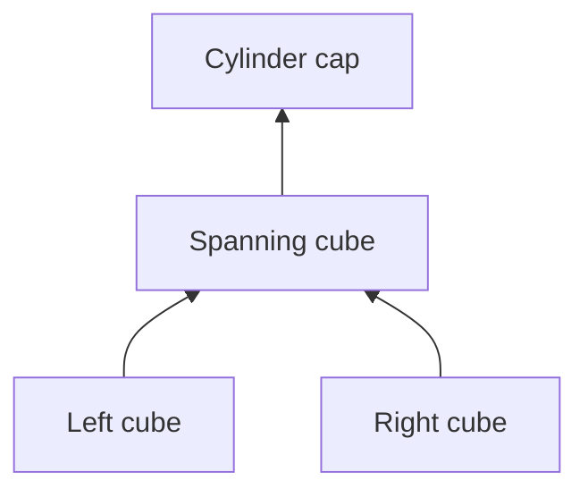

> Historical record. Commands and status statements describe that experiment;
> see the [current documentation](../README.md) before running anything.

# Low-rise structures with multiple supports

This report describes the frozen upright-structure controller. The subsequent
[thin-beam bridge task](THIN_BEAM_BRIDGE.md) has separate evidence and starts its
beam flat on the tabletop. Its results are not included in the 29/30 below.

The new `inventory_structure` task assembles low, spatially extended structures
from a symbolic support graph. It shifts the challenge from increasing column
height to placing several foundations, sharing loads across supports, arranging
neighboring stacks and clearing the gripper's working area. The policy remains
CPU-only and uses the existing calibrated visual and robot observation boundary.
The frozen policy passed **29/30 reserved trials (96.7%)** across the three
recipes below, including color permutations and zero/two distractors.

## Three initial structures

| Recipe | Required objects and relationships | Nominal height |
| --- | --- | ---: |
| `cube_bridge` | Blue and red cube foundations jointly support a green cube | 6 cm |
| `capped_bridge` | Blue and yellow cube foundations support a green cube; a red cylinder caps it | 12 cm |
| `staircase` | Blue cube; red/yellow cube stack; green prism/green cube stack, arranged as three rising steps | 3, 6, 9 cm |

The bridge is a **cube spanning two supports**, with a nominal 3 mm gap between
the foundations. It is not a horizontally reoriented 6 cm beam. All initial
objects and placed objects remain upright in this first set; turning an initially upright long beam
needs a separate validated turning/regrasp skill. Triangular targets are not
supported, although all five catalog shapes can occur as distractors.

A capped bridge has a genuine multiple-parent support relation:



The public goal contains identities, node keys, support edges, desired upright
orientation and dimensionless XY coordinates. A visually observed foundation
cube defines the length unit. The actor chooses the translation of the whole
structure from observed free space and robot reachability. Goals contain no
source object poses, metric dimensions, masses, contacts or scene seed.
Coordinates describe **desired relationships**, not observed object state.

`StructureRecipe` validates unique inventory identities, a cube length reference,
finite grid coordinates and an acyclic graph in construction order. Scene
sampling reserves the required 3–8 identities and adds optional distractors from
the remaining inventory. The three implemented recipes use 3, 4 and 5 objects.
The current CLI selects these named graphs and optional color permutations;
this evaluation does not establish arbitrary graph construction.

## Policy and physical checks

[`structure_policy.py`](https://github.com/Spectraorder/aspire_so100/blob/5129740bf82f9d55d2544a773648037cf26c1e53/src/aspire_so100/structure_policy.py) reuses the visual
geometry and instance-tracking helpers from the frozen column policy. Its
manipulation controller is a separate derivative so both historical policy
sources and bundles remain reproducible. The new behavior is:

1. Bind every requested identity to a visual instance and measure its geometry.
2. Convert relative goal coordinates using the measured cube length; preview
   all node heights and positions with robot-only IK.
3. Reserve the complete structure footprint with open-gripper clearance. Move
   blockers to visually observed parking cells outside every planned node's
   working area. Staging cost also considers the later grasp/placement attitude.
4. Build in dependency order. Refresh each required support from RGB-D; combine
   their observed positions and top heights to servo the next placement.
5. Check the proposed and observed structure using nonnegative support reactions
   and force/moment balance. Models and mass proxies come from visual dimensions.

The shared CPU geometry routine intersects each child's **bottom** footprint
with each parent's **top** footprint, retaining observed tilt and yaw. Cylinder
caps use inscribed circular polygons rather than bounding squares. Contact
patches are eroded by 2 mm before a small linear program checks whether vertical
forces and XY moments can balance every node. The feasibility solution must assign a positive load to every required edge. A bridge's load can split between its parents; assigning the
entire upper mass to both parents would incorrectly reject a valid bridge.
This is a static feasibility check, not a dynamics or manipulation guarantee.

The **private evaluator** independently supplies simulator geometry and masses
to this routine and additionally requires every specified physical contact,
correct support heights, XY positions within 6 mm of a fitted common goal
translation, upright axes within 8 degrees,
robot withdrawal, no unintended object contacts and low linear/angular velocity.
The final structure must remain valid for five seconds with at most 3 mm drift.
All required nodes count toward completion, including multiple foundations.
A completed-looking assembly or partial placement score is not success.

These are new graph-task criteria. Historical column physics and evaluators are
unchanged. The 2 mm contact-patch erosion differs from the old single-column COM
margin check; rates from the two task distributions should not be compared as a
paired improvement. Five-second success also does not establish minute-long
stability or robustness to external disturbances.

## Frozen evaluation

Historical candidate, now preserved as `policies/assemble_structure_v1_cpu.py`, implementation commit
`60c5a0a80ef531ede27e83c394a493188d02473d`.

```text
3e05c8f0c42647525b1c02962d60a82996448546a4ba68b011a11578078ad1f1
```

After development on seeds 1101–1103, the source was frozen before **30 reserved
trials**: three recipes × seeds 1201–1205 × zero/two distractors, with deterministic
color permutations. The manifest declares every exact goal, object count,
candidate hash, sensor profile and runtime-source hash before simulation.
No reserved outcome was used for tuning. Failures and worker errors remain in
the denominator. Repeated seeds across recipes/cells are not independent draws
from all possible scenes, and each subgroup is small.

| Recipe | Zero distractors | Two distractors | Total |
| --- | ---: | ---: | ---: |
| Cube bridge | 5/5 | 5/5 | **10/10** |
| Capped bridge | 5/5 | 4/5 | **9/10** |
| Staircase | 5/5 | 5/5 | **10/10** |
| **All declared trials** | **15/15** | **14/15** | **29/30** |

There were no worker errors. The failed capped bridge, seed 1205 with two
distractors, completed its two foundations and spanning cube but could not
resolve the blue cylinder before placing the cap. The controller stopped;
the physical evaluator found the cylinder tilted and unsupported by the span.
It remains a failure with three of four nodes placed. No recovery or retuning
was performed using this reserved case.

[Portable frozen evidence](../evaluations/low_structures_heldout.json) includes the
predeclared plan, every goal, all 30 outcomes, private final checks labeled as
offline evidence, CPU profiles and source hashes. Changing distractor count
also changes source poses and sampled identities, so the two settings are not
a paired causal clutter experiment. This 96.7% result applies to these three
low-rise graphs; it does not replace the earlier 79/100 tall-column result.

The final development candidate passed **17/18** trials. An earlier variant
passed 14/18: opening the gripper at the worksite knocked over nearby source
objects. Reserving full gripper clearance improved this. A construction-order
ablation passed 16/18 and was rejected. The remaining development failure
involved a second grasp after clearing an object, followed by an unsuccessful
release; simulator truth was inspected only offline to diagnose it.

[Portable development history](../evaluations/low_structures_development.json)
retains all four 18-trial matrices and their exact sources. The first two used a
prototype footprint check that projected top faces for both sides of a contact;
the final version uses the actual bottom/top faces. These adaptive runs are not
held-out evidence or a clean single-variable ablation.

## Actual experiment recordings


The gallery restores actual saved physics states from seed 1201 with two
distractors in each recipe, using an external close-view camera. Private geometry
only frames that display camera and never enters policy execution. These are
selected successes; the complete evaluation above retains the failed case.

| Recorded trial | Video at 6x | Final frame |
| --- | --- | --- |
| Cube bridge, seed 1201, two distractors: pass | [Replay](../media/structure_bridge_1201.mp4) | [Frame](../media/structure_bridge_1201.png) |
| Capped bridge, seed 1201, two distractors: pass | [Replay](../media/structure_capped_1201.mp4) | [Frame](../media/structure_capped_1201.png) |
| Staircase, seed 1201, two distractors: pass | [Replay](../media/structure_staircase_1201.mp4) | [Frame](../media/structure_staircase_1201.png) |
| Capped bridge, seed 1205, two distractors: fail | [Replay](../media/structure_capped_failure_1205.mp4) | [Frame](../media/structure_capped_failure_1205.png) |

[Replay provenance](../evaluations/low_structures_replays.json) and
[gallery provenance](../media/low_structures_gallery.json) retain goals and hashes.
Videos restore saved states; no policy is rerun to generate these pictures.

The three illustrated successes also passed a separate **60-second passive
continuation check**, with all graph checks and a 3 mm drift limit across the
whole window. The exact final state and saved actuator controls were restored;
no policy executed during this offline diagnostic. This is three selected cases,
not a 30-trial long-duration success rate. See the
[durability evidence](../evaluations/low_structures_durability.json).

## CPU and observation boundary

Online inputs are side RGB-D, wrist RGB, calibration, robot proprioception,
robot-only IK and the public desired graph. The isolated policy imports only
NumPy/SciPy numerical routines. It cannot import simulator/catalog code or read
saved trials. The graph evaluator, scene state, actual masses and contact data
remain in the host process; no evaluator result is returned through policy RPC.
Simulation and rendering may use the GPU.

On an Intel Core i9-14900K with single-thread BLAS, policy compute CPU time per
attempted task had median **6.979 s**, p95 **11.207 s**, maximum **13.252 s**.
Separate robot-only host IK used median **0.386 s** and p95 **0.619 s**. Median
simulated task duration was **156.9 s**. Policy CPU time includes compilation,
imports and execution, but excludes RPC serialization, host IK, rendering and
physics. These are task totals, not per-action wall latencies; the failed trial
is included.

A final-source blackout trial received one invalid RGB-D frame and stopped with
`Insufficient tabletop depth.`, making zero move, gripper or IK calls. The full
suite ran **135 tests: 134 passed and one platform-specific test was skipped**.
The frozen historical column policy also passed an actual three-cube regression
through the extended trial interface. Both old bundle hashes and their rebuilds
remain unchanged. See the [runtime and regression audit](../evaluations/low_structures_runtime_audit.json).
The physical fixtures in the unit suite validate the evaluator and do not count
as policy successes.

Initial objects have zero yaw, the camera is calibrated and fixed, and geometry
comes from ideal simulated depth. The experiments vary source layouts, colors
and distractors within these three graphs. They do not validate arbitrary
orientations, real hardware, horizontal beams, pyramid construction or all five
shapes as targets. Generalization claims must remain within that scope.

## Run and replay

```bash
# Execute a cube bridge, then open its actual recorded playback.
uv run python view_scene.py --vision-task inventory_structure \
  --structure-recipe cube_bridge --object-count 3 --seed 1301 \
  --vision-policy policies/assemble_structure_v1_cpu.py \
  --vision-output outputs/bridge_demo_1301

# A five-object stepped structure plus two distractors.
uv run python view_scene.py --vision-task inventory_structure \
  --structure-recipe staircase --object-count 7 --seed 1302 \
  --vision-policy policies/assemble_structure_v1_cpu.py \
  --vision-output outputs/staircase_demo_1302

# Inspect the task-conditioned initial scene without executing the policy.
uv run python view_scene.py --scene-only --scene-task support_graph \
  --structure-recipe capped_bridge --object-count 6 --seed 1303

# Replay an existing trial without rerunning the policy.
uv run python view_scene.py --vision-trial outputs/bridge_demo_1301

# Rebuild the CURRENT policy (which now also supports flat-source beams).
# Rebuilding the historical bundle requires the implementation commit above.
uv run python scripts/build_inventory_policy.py --controller structure_policy \
  --output policies/assemble_structure_cpu.py

# Run the historical candidate on the same 30-trial matrix.
# For exact original runtime hashes, use implementation commit 60c5a0a
# and its original candidate filename instead.
MUJOCO_GL=egl OPENBLAS_NUM_THREADS=1 OMP_NUM_THREADS=1 \
  uv run python scripts/evaluate_structures.py \
  --candidate policies/assemble_structure_v1_cpu.py --output outputs/structures_reproduction \
  --recipes cube_bridge capped_bridge staircase --seeds 1201 1202 1203 1204 1205 \
  --distractors 0 2 --permute-colors --jobs 3 --split heldout \
  --frozen-sha256 3e05c8f0c42647525b1c02962d60a82996448546a4ba68b011a11578078ad1f1
```

The generated candidate and manifests are copied into the output. Existing
outputs cannot be reused with another candidate, runtime source or trial matrix;
strict result validation checks goals, sensor settings and full graph completion.
Incomplete trials are retained and count as worker errors rather than silently
being omitted. Use `--plan-only` to inspect the complete declaration first.
