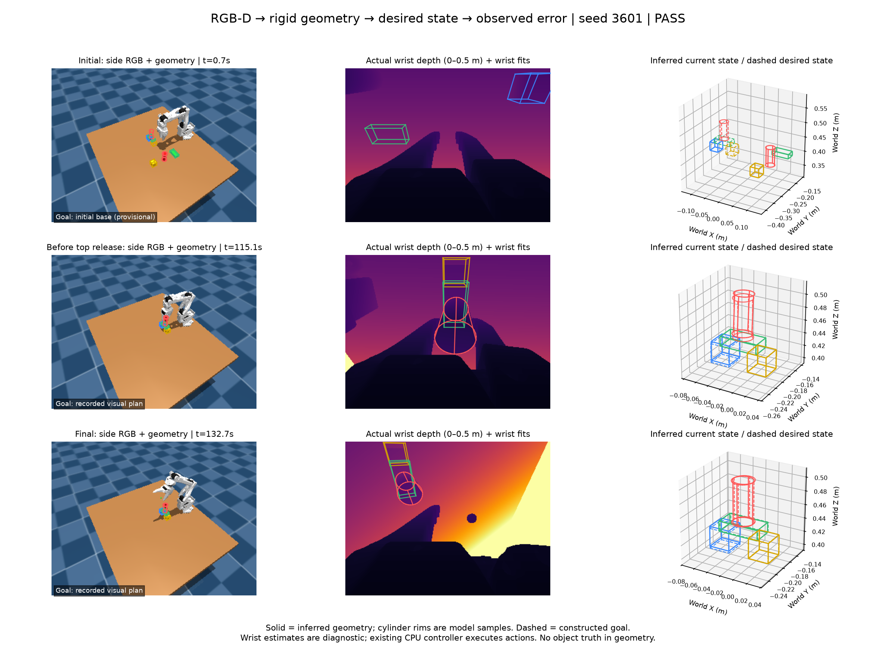
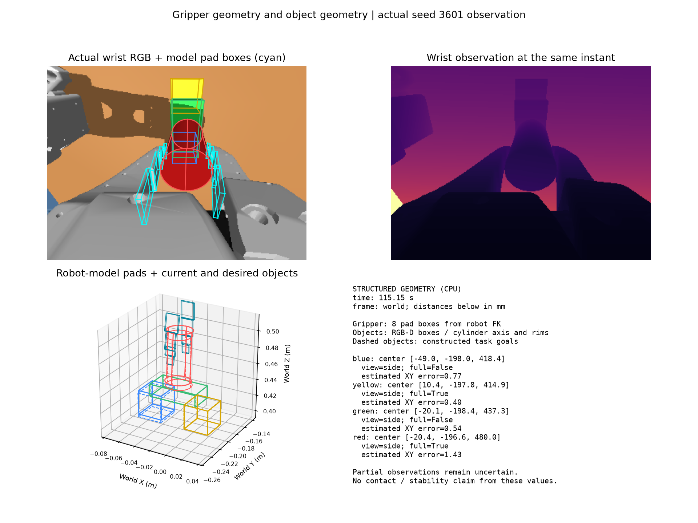

> Historical record. Commands and status statements describe that experiment;
> see the [current documentation](../README.md) before running anything.

# Mixed rigid geometry: a four-color beam bridge

The geometry-state experiment now covers a support graph with cubes, a flat
rectangular beam, and an upright cylinder. Each object has a unique color so
instance association does not require distinguishing same-color objects.

| Color | Declared task shape | Desired role |
| --- | --- | --- |
| Blue | Cube | Left foundation |
| Yellow | Cube | Right foundation |
| Green | Thin rectangular prism | Flat beam spanning both foundations |
| Red | Cylinder | Upright cap on the beam |

The public graph specifies foundation centers two measured cube widths apart,
leaving roughly one cube width between their inner faces. Metric sizes and
poses are estimated from RGB-D; catalog dimensions and object truth are not
provided to the policy. The existing task generator starts the beam flat.
This experiment does not test reorienting an initially upright beam.





## What changed

`mixed_rigid_state.py` supplies shape-specific sensor fits, rigid targets and
geometric errors. Cubes and rectangular prisms use eight inferred corners;
cylinders use center, axis, measured radius, height and end centers. Cylinder
rim samples are for visualization, not detected physical vertices. Cylinder
rotation error ignores rotation about its symmetry axis, while the beam's long
and thin axes cannot be exchanged as though it were a cube.

The observer measures dimensions at initialization and retains them. It removes
the table/background from each color's depth mask and records unavailable or
partial observations explicitly. It does not substitute a desired pose for a
missing observation. Initial beam dimensions can underestimate visible extent
because of image resolution; they remain measurements, not catalog values.

`mixed_state_demo.py` wraps the existing structure controller. In the generated
experimental bundle, color association supplies the **declared public shape**;
shape-classifier decisions do not determine which task object is selected.
The controller still requires visible geometry for grasping and placing. No
same-color object, distractor or VLM recognition is included.

Two explicit hooks in the generated bundle copy the controller's geometry-based
worksite origin and measured scale into the target record: after planning, and
after its first-foundation adjustment. No simulator object state is involved.
The observer constructs targets for the full support graph and computes both
beam-to-foundation overlaps and the cylinder-to-beam surface gap.

The original controller source and the previous three-cube bundled policy are
unchanged by this extension. The cube bundle's hash matches its earlier saved
manifest. New wrist fits remain diagnostic rather than controlling extra
corrections. Online geometry and control are CPU NumPy/SciPy; simulation and
rendering can use the GPU. Robot pad geometry uses the robot model and encoders.

## Fixed-layout results

All three scenes use four required objects, default NoSlip 0 physics, and the
same generated candidate hash. No policy tuning occurred between them.

| Seed | Final private evaluation | Recorded checkpoints | Outcome |
| --- | --- | ---: | --- |
| 3601 | Pass | 20 | Both cubes, beam and cylinder placed |
| 3602 | Fail | 16 | Beam placed; controller stopped with cylinder occluded |
| 3603 | Pass | 20 | Both cubes, beam and cylinder placed |

This is **2/3 demonstration scenes**, not a reliable estimate of generalization
success rate. The evaluator remains private and is read only after the rollout.

Seed 3601 was also run with wrist depth disabled. Both versions passed; their
137 action calls and complete saved physics trajectories were identical. This
checks that the new diagnostic sensor path did not change execution, not that
wrist depth improved control.

In seed 3601 the side view returned geometry in 76/80 attempts, with 47 full
reliable poses; wrist depth returned geometry in 40/80 attempts, with eight full
reliable poses. Five selected diagnostic observations came from the wrist.
The final yellow cube and red cylinder were fully reliable under the fit
criteria; blue and green remained partial. Blue's estimated height differed
from its target by about 3.25 mm under occlusion. That is an uncertain visual
estimate, not ground-truth displacement or proof of penetration.

The failed seed reported `Selected instance is occluded: red_0`. At the final
checkpoint, both the independent side and wrist fits also lacked sufficient
red depth. This supports an observation-availability failure, rather than a
same-color association failure. It does not prove that another view could not
recover the object.


## Evidence and reproduction

- [All outcomes, manifests and paired-control checks](../evaluations/rigid_bridge.json)
- [Successful structured final state](../evaluations/rigid_bridge_agent_packet.json)
- [All successful-example geometry records](../evaluations/rigid_bridge_states.json)
- [Failed-example geometry records](../evaluations/rigid_bridge_failure_states.json)
- Raw artifacts: `outputs/rigid_bridge_01`, `outputs/rigid_bridge_side_01`,
  `outputs/rigid_bridge_3602`, and `outputs/rigid_bridge_3603`.

```bash
OPENBLAS_NUM_THREADS=1 MUJOCO_GL=egl .venv/bin/python scripts/run_rigid_state_demo.py \
  --task thin_beam_bridge --seed 3601 --output outputs/rigid_bridge_new
```

Use `--side-only` for the depth-disabled sensor control. Output directories must
be new. Each run saves its candidate, manifest, camera NPZs, geometry JSON,
private result, physics replay, and actual-observation figures, including on
policy failure. Geometry fit replay timings exclude camera acquisition, RPC,
rendering, action execution and any future agent reasoning.

Five mixed-shape tests cover scale-dependent targets, duplicate-color rejection,
cylinder yaw symmetry, beam-axis alignment, and dual-support overlap. Seven
existing rigid-state tests also pass. The remaining control issue illustrated
here is acquiring an informative view when both current cameras lose the next
object, before using uncertain geometry for further actions.
