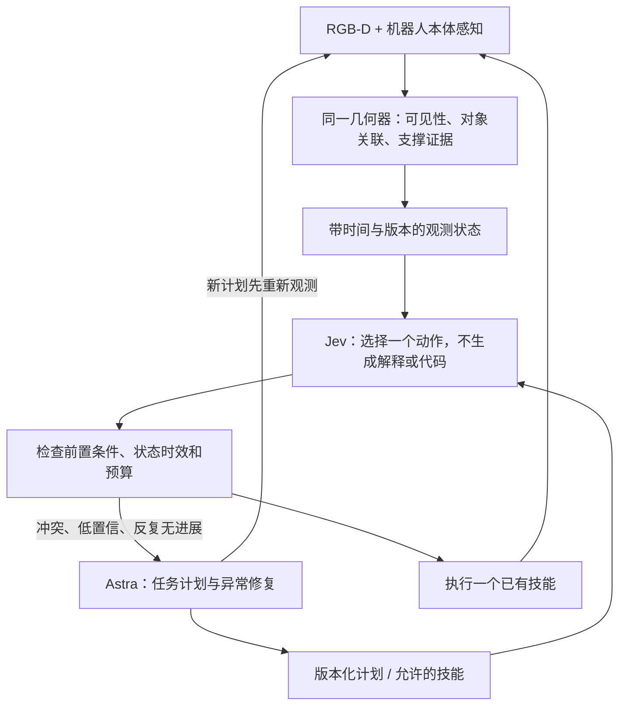

> 更新：本分支已接入官方 Jev 与真实初始观测闭环。当前状态、失败记录和运行方式以 [英文 harness 文档](../../docs/DUAL_SYSTEM.md) 为准；下文保留最初准备阶段的设计背景。

# Astra 计划 × Jev 决策：实验准备

2026-09-24。状态：接口和离线契约已运行；未请求 Jev 或 Astra 服务；未接入在线 MuJoCo 执行器。用户当前选择先准备接口与实验，不申请账号、不购买服务。

## 来源核验

用户提供的 Hugging Face 社区文章指向 thejevai.com；该站页脚声明与 TypeSafe 无关联。实验使用真正的 TypeSafe 官方服务，不把第三方同名服务的结果记为官方 Jev。

- [官方 API](https://docs.typesafe.ai/api)：POST https://api.typesafe.ai/v1/systemone，Bearer TYPESAFE_API_KEY。
- [模型与价格](https://docs.typesafe.ai/models)：固定 jev-1.13.0；文本/JSON 输入，不能直接接收 RGB-D 图像；公布价格 $0.042 / 百万输入 token，输出免费（查询于 2026-09-24）。
- [置信度定义](https://docs.typesafe.ai/confidence)：由候选概率分布计算，不等同于机器人动作成功概率。
- [官方已知局限](https://docs.typesafe.ai/model-jaggedness/jev-1.13)：正式选择任务前还应对照此页测试。

## 分工与闭环



自纠正必须留下完整证据：观测异常 → 升级原因 → Astra 的计划差异 → 新状态版本 → Jev 接续决策 → 实际物理结果。只是失败后重试，或只有两个模型被调用，不足以证明自纠正贡献。

当前 runtime 的 Plan 是恢复指令文本与版本号，是接口原型；完整目标 DAG、对象绑定、支撑依赖和执行器连接仍待实现。runtime.tick 只产生 gated_action，并不移动机器人。reobserve 后必须由执行器采集新数据并递增版本。

## 对照：分离选择能力与规划能力

### A. 决策层配对评测

各组收到相同传感器摘要、同一冻结计划和相同候选动作。比较 Astra 决策、Jev 决策、Jev→Astra 升级。计划准备成本单独列出；不能给其中一组更有利的计划。

当前 9 个样本来自真实相机记录，均属 development。reference_action 是可见性规则的参考答案，仅可测 rule agreement，不是独立正确标签。字段 whitelist 不传原始 run 名、故障种类/时序、私有评估器结果或物体真值。source 与参考答案只在本地评分文件，不进入模型 state。

### B. 系统层闭环评测

| 组 | 计划 | 日常决策 | 异常处理 |
|---|---|---|---|
| astra_only | Astra | Astra（固定 low 档） | Astra（固定 high 档） |
| hybrid | Astra | Jev Choice | 门控升级到 Astra，返回新计划 |
| jev_only | 人工冻结任务图 | Jev Choice | 在相同技能集合中选恢复动作，无 Astra |
| rule_only（附加） | 同一冻结任务图 | 确定性规则 | 固定恢复规则 |
| hybrid_no_repair（消融） | 与 hybrid 相同的初始 Astra 计划 | Jev Choice | 不允许 Astra 修改计划 |

Jev 不生成开放式计划，因此不能将 jev_only 描述为“Jev 独立生成策略代码”。系统层差异包含规划能力；决策层则控制计划不变。现有纯视觉技能在所有组复用，这轮研究不是从零学习运动控制。

## 任务与预算

第一阶段：初始短暂遮挡/持续遮挡、抓空、首次抬升丢失、正常回归。之后：遮挡解除后目标改变位置；双塔中只有一座受损；观察与历史计划矛盾。已有 4001/4002 都属于开发，不能做 heldout。

pilot 建议 5 类 × 4 个新且核验未用的场景 × 3 组，共 60 条物理 rollout；每组每场景重复 3 次则为 180 条。先做每组 2 条连接检查，确认预算后再运行整套。场景 manifest 必须先冻结；随机排列模型运行顺序。

初始候选预算：每条最多 20 次高层决策、2 次额外初始观测、1 次局部重抓、1 次初始计划及 2 次慢修复。置信门限 0.8 只是当前开发占位，必须在开发集标定各模型的 risk/coverage；不可宣称相同数值给出相同校准水平。

场景故障须按相同仿真时间或预注册运动事件触发，不能沿用“前两次相机调用”来做在线公平性实验。当前相机快照只用于离线接口开发。

仿真可以在等待模型时暂停，但必须分别记录 physics time、wall time、LLM wait。暂停模拟得到的高速不能表述成真实机器人反应时间。真实系统要在等待时保持姿态，并在回复后重新检查状态新鲜度。

## 指标

- 任务成功：最终私有结构评估器；恢复成功只统计故障确实触发的条目；持续遮挡的正确停止另列。
- 决策 accuracy：独立标注的“允许动作集合”上的正确率；不得把 Astra 回复当真值。当前数据仅报告规则一致率。
- 误动作率、无必要升级率、漏升级率、被门控拦截率；不能让门控掩盖模型错误。
- 端到端耗时 p50/p95、模型等待总量、恢复时长、额外动作/观测。
- 每条总费用、每次成功成本 = 所有成功及失败条目的总费用 / 成功数；零成功时记不可定义。
- token、实际模型版本、重试次数、超时、错误全部记账。Codex 订阅调用美元成本未知，不能填 0；Astra API 价格有可验证账单后再对比美元。
- Jev 价格预估只使用官方固定模型输入价；与供应商账单分列。跨网络/CLI 不同栈的延迟包括客户端启动，不能称模型纯推理延迟。

## 已准备文件与运行方法

从仓库根目录：

```bash
# 无网络：重建传感器案例与运行契约检查
uv run python research/dual_system_20260924/prepare_cases.py
uv run python -m unittest discover -s research/dual_system_20260924 -p 'test_*.py'

# 无网络：测试快慢控制流，回复明确标 TEST_DOUBLE_NOT_JEV
uv run python research/dual_system_20260924/replay.py \
  --mode hybrid --output outputs/dual_system_contract_NEW

# 有官方凭据后：一次 Jev 决策，无机器人动作
uv run python research/dual_system_20260924/probe_jev.py \
  --live --case dev-000 --output outputs/jev_live_probe_NEW.json

# 每个观测独立建计划/决策，不能当作物理闭环结果
uv run python research/dual_system_20260924/replay.py \
  --live --mode hybrid --limit 3 --output outputs/dual_system_live_NEW
```

先在运行这些命令的同一终端会话安全设置 TYPESAFE_API_KEY。不要把 key 发进聊天、写进仓库或公开网页。Astra 适配器使用现有 Codex 登录；以 fresh context、工具禁用及结构化输出调用 gpt-6-astra。该适配器尚未做真实调用验证，缺失权限/不支持参数会直接报错，不替换模型。

无账号时不要加 --live。所有输出路径必须是新路径，不覆盖旧结果。当前 smoke 运行输出在 outputs/dual_system_20260924/contract_smoke/report.json；没有模型精度、速度或省钱结论。

## 下一步验收

1. 官方账号就绪后验证固定 Jev 版本和实际 schema，保存真实调用与账单字段。
2. 用同一状态集做三组配对决策；独立标注、校准门限，冻结 prompt/plan。
3. 将高层动作接到隔离的 MuJoCo worker；重新观测、预算扣减和物理故障由 harness 管理。不能由模型自行声称执行成功。
4. 记录一次完整的快决策→异常→慢修复→快决策恢复录像；再运行冻结的配对评测，输出成功率–成本–延迟曲线。
