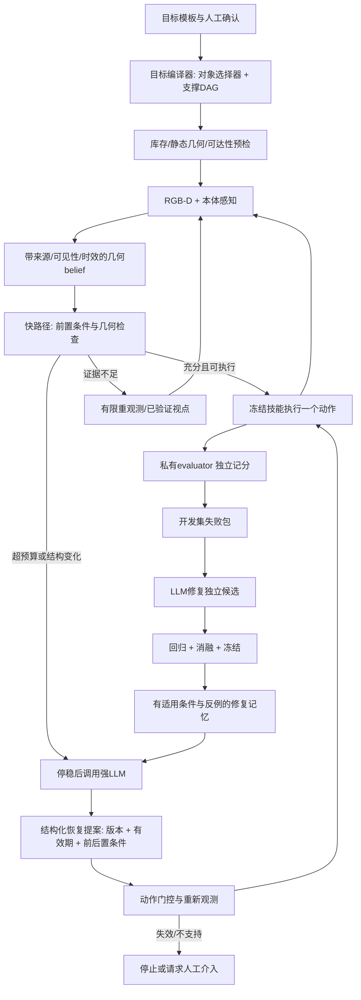

# 复杂任务与 agent workflow

## 任务课程：增加恢复难度，不先增加塔高

当前 SO-100 可达性、夹爪尺寸和 6 cm 横梁长度都是限制。复杂来自部分可观测、依赖关系和外部变化，比盲目加到 5 层更有研究价值。

| ID | 任务 | 当前积木与目标 | 故障/选择 | 状态 |
|---|---|---|---|---|
| R1 | 看不见就先看清 | 三个 3 cm cube，蓝红绿塔 | 短暂 vs 持续遮挡；继续/重观测/停止 | 本轮图像遮挡代理实验 |
| R2 | 抓空后换抓法 | 同一三层塔 | 第一次闭合失效；辨认抓空，重观测后再抓 | 本轮物理执行 |
| R3 | 抬升丢失后恢复 | 同一三层塔 | 抬升中夹爪短暂张开；辨认物体已掉回桌面 | 本轮执行器扰动实验；不是摩擦随机化 |
| R4 | 双塔保一修一 | 蓝/绿 cube 底座；红/黄 cube 顶块 | 一塔偏移，保持另一塔；规划必要动作最少的修复 | 设计，未物理执行 |
| R5 | 双支撑小桥恢复 | 两个 3 cm cube＋6 cm prism 横梁 | 一侧支撑被移位；先移走横梁，再纠正支柱 | 设计，需横向重定向抓取与双支撑判分 |
| R6 | 清障后回到目标 | 红细长条、蓝 cube＋同色干扰物 | 目标暂时遮挡/ID 歧义；清障停车不占未来目标位 | inventory 提供起点，恢复版本待做 |
| R7 | 人动一块后续建 | R4/R5 同一目标图 | 人移动一块后退出；agent 重新识别、局部修复、交还回合 | 先模拟外部干预；真人实验未做 |

### 小桥为何必须先做几何检查

用 60 mm 横梁，沿横梁方向两个 30 mm cube 中心距设为 40 mm，则内间隙 10 mm，横梁与每个 cube 的理论重叠约 25 mm。该尺寸只是理想平面布局，不证明物理可搭：还需要将初始直立长条旋到水平、确认可达姿态、指尖退让和两侧接触。不能用 teleport 把梁放好后称机器人学会架桥。

支撑目标是 AND：左右两个支撑都必须成立。不能仅将两个孤立支撑多边形做凸包，并把中间空区当成连续可接触面。需分别检查接触位置/法向、载荷分配可行性及整体 COM。视觉快路径只能估计，私有 evaluator 才能判真实接触。

R4 优先于 R5：保持所有初始姿态直立，复用现有抓放技能；先证明“只修损坏塔”的规划价值，再攻横梁重定向。R1–R3 是恢复 harness 的校准任务，R4/R6 是首批真正的计划级迁移，R5/R7 是后续扩展。

## 单个 agent + 明确角色接口

角色不必等于五个并行 LLM。先由一个强 LLM 在不同步骤承担任务编译/恢复诊断/代码修复；确定性模块负责感知、检查与执行。这样成本和归因更清楚。



关键点：图里 evaluator→开发失败包是 trial 完成后的离线边，不是在线 reward oracle。预留集结果不进入修复路径。

## 失败后的决策例子

1. 蓝底座不可见：不知道“移走了”还是“被遮挡”。保持手臂，重观测。重复仍不可见，再用已验证视点或升级；不能复制旧坐标并盲抓。
2. 抓后高度未增加：抓取没有确认。撤出、重新估位置；只允许一次有证据的抓取修改。不能把控制命令成功返回当成抓取成功。
3. 运输中物体从夹爪消失：将持有状态设为 unknown；需要新图像找回目标 ID。若掉落姿态不在技能适用域（如翻倒长条），请求新技能/停止，不继续原落位。
4. 红层偏移、绿层仍在上面：先建立依赖图。不能直接抽红层。先拆绿→停车→修红→放绿；每一步验证。此能力本轮仅设计，现有固定塔策略没有完整实现。
5. 模型回答到来时物体已移动：belief version 或有效期不匹配则拒绝；重新观测和规划，而不是执行过期建议。

## LLM 提案格式（设计）

```json
{
  "kind": "reobserve",
  "belief_version": 17,
  "expires_at_s": 22.5,
  "target_id": "red_2",
  "reason": "目标遮挡，当前几何无法确认抓取",
  "evidence_frames": ["camera_024.npz"]
}
```

初版动作契约只实现 reobserve/retry_grasp/continue/escalate/stop 的校验；局部重建、停车、清障需明确技能能力与轨迹验证后才加入。页面里的复杂任务配置是设计导出，不会调用机器人。

## Human debugging 的协议

UI 可以显示估计顶点、置信区间和目标线框。人工纠正应新建 belief revision，保留原值、修改者、理由和截图；不能无记录覆盖感知结果。人工改 belief 与人工搬动物体分别记录，分别报告成功率和操作次数；含人工真值纠正的 run 不能再称 autonomous sensor-only。
